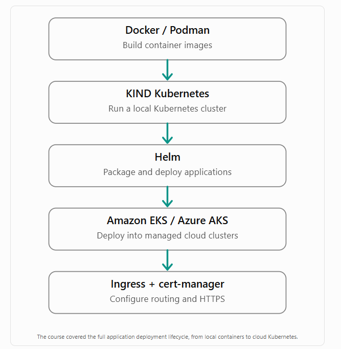

# 8.1 Next steps

**Next Steps — Advancing Your Kubernetes Skills**

**1. Overview**

This final lesson summarizes the skills learned throughout the **Explore California Kubernetes project** and recommends ways to continue developing Kubernetes expertise.

During the course, the Explore California application progressed from a simple Docker container to an HTTPS-enabled application running in cloud-managed Kubernetes environments.

The instructor recommends two major next steps:

1.  **Earn a Kubernetes certification** to deepen your technical knowledge and demonstrate your skills.

2.  **Experiment with advanced Kubernetes technologies**, particularly networking, storage, security, and observability.

**2. What you accomplished in this course**

Key skills covered include:

- Building container images with Docker and Podman.

- Creating Kubernetes clusters using KIND.

- Deploying applications using Deployments, Services, and Ingress resources.

- Packaging applications using Helm charts.

- Creating and managing Amazon EKS and Azure AKS clusters.

- Pushing container images into Amazon ECR and Azure ACR.

- Installing NGINX Ingress Controller and cert-manager.

- Configuring TLS certificates for HTTPS.

- Cleaning up cloud resources to avoid unnecessary costs.

**3. Next step \#1: Earn a Kubernetes certification**

The instructor recommends three certifications offered through the Linux Foundation and the Cloud Native Computing Foundation (CNCF).

**Certified Kubernetes Administrator (CKA)**

Focuses on Kubernetes administration, cluster operations, troubleshooting, networking, and workload management.

Best for Kubernetes administrators, DevOps engineers, and cloud engineers.

**Certified Kubernetes Application Developer (CKAD)**

Focuses on developing, deploying, configuring, and troubleshooting cloud-native applications.

Best for software developers and application engineers working with Kubernetes.

**Certified Kubernetes Security Specialist (CKS)**

Focuses on securing Kubernetes clusters, workloads, containers, and supply chains.

Best for security engineers, DevSecOps engineers, and experienced Kubernetes administrators. An active CKA certification is a prerequisite.

**Which certification should you pursue?**

| **Certification** | **Main focus** | **Recommended experience** |
|----|----|----|
| CKA | Cluster administration | Intermediate |
| CKAD | Application development | Beginner–Intermediate Kubernetes experience |
| CKS | Kubernetes security | Advanced |

**Recommended learning path:** CKAD → CKA → CKS.

Because the Explore California course focused heavily on application deployment, Helm, Services, and Ingress, CKAD is a natural next certification to consider.

Official certification information: [CNCF Kubernetes Certifications](https://www.cncf.io/training/certification/?utm_source=chatgpt.com).

**4. Next step \#2: Learn advanced Kubernetes technologies**

The instructor explains that deploying an application is only the beginning. Enterprise Kubernetes environments require additional knowledge.

| **Topic** | **What to learn** | **Why it matters** |
|----|----|----|
| Storage | PersistentVolumes, PVCs, StorageClasses | Persist application data |
| Networking | CNI, Services, DNS, NetworkPolicies | Control network communication |
| Security | RBAC, Secrets, Pod security | Protect clusters and workloads |
| Observability | Prometheus, Grafana, logging | Monitor application health |
| Autoscaling | HPA, node autoscaling | Handle changing workloads |
| CI/CD | GitHub Actions, Azure DevOps | Automate deployments |
| Infrastructure as Code | Terraform | Automate cloud infrastructure |

**5. Suggested hands-on Kubernetes projects**

Building on Explore California, these projects would help strengthen your practical skills.

1.  **Deploy an Angular application with MongoDB**

Use Kubernetes Deployments, Services, ConfigMaps, Secrets, and persistent storage.

2.  **Deploy Kubernetes infrastructure using Terraform**

Automate AKS or EKS cluster creation instead of manually running cloud CLI commands.

3.  **Build a CI/CD pipeline**

Automatically build container images, push them to ACR or ECR, and deploy using Helm.

4.  **Implement monitoring and security**

Configure Prometheus, Grafana, RBAC, NetworkPolicies, and workload resource limits.

**6. Key takeaway**

The Explore California course provided a foundation in containerization, Kubernetes administration, Helm, cloud deployment, and HTTPS configuration.

However, **running an application on a managed Kubernetes cluster does not automatically make it enterprise-ready**. Production environments also require strong security, reliable storage, monitoring, backups, scalability, and automated deployment processes.

The instructor's two recommendations are to pursue Kubernetes certification and continue experimenting with more advanced technologies.

**Suggested next goal:** Prepare for the CKAD certification while building a complete Kubernetes application with persistent storage, automated deployment, and monitoring.

# [README](./../../../README.md)
