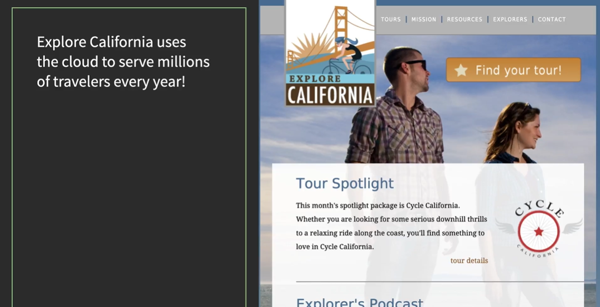

# 1.1 Our application before Kubernetes

**Explore California's engineering team faces severe deployment bottlenecks and environment inconsistencies, prompting the CTO to mandate a complete migration to Kubernetes.**

**🌐 Current Infrastructure**

- **Cloud platform:** All core infrastructure was migrated to AWS several years ago.

- **CI/CD tooling:** Engineers utilize Selenium and GitHub Actions to test and deploy website changes and services.

- **Architecture:** The majority of the application already runs inside containers.

**⚠️ Core Bottlenecks & Challenges**

- **Resource contention:** Containers run on a restricted pool of machines, causing developers to frequently fight over hardware resources.

- **Environment drift:** Pre-production environments do not match each other or production, causing thoroughly tested changes to break upon public release.

- **Fragile dependencies:** Downstream testing services (like databases and message queues) crash frequently, stalling the testing pipeline.

- **Slow time-to-market:** Due to these deployment headaches, new features take months to ship, whereas competitors like "Explore Texas" deploy updates overnight.

**🚀 The Mandate & Team Concerns**

- **The Challenge:** Prompted by the board, the CTO has ordered the team to move the entire infrastructure to Kubernetes, beginning with explorecalifornia.com.

- **Team anxiety:** Engineers worry about the complexity of Kubernetes, the massive size of configuration YAML files, and the sheer volume of process changes required to make the transition.

# [README](./../../../README.md)
