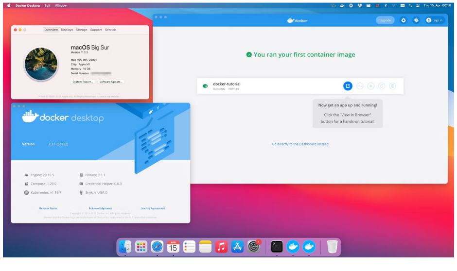
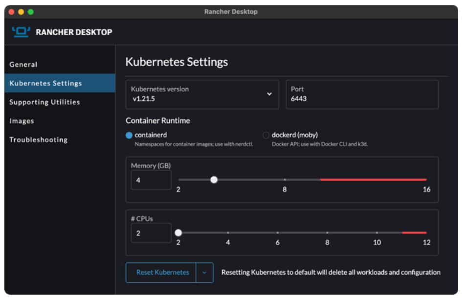
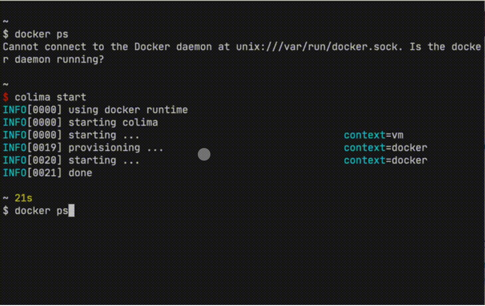

# 2.5 Other popular container managers

**Docker Desktop**

This is the one that started it all.

Maintained by Mirantis, Docker Desktop makes it easy to manage multiple containers on your machine. It also comes with helpful tools, like Docker Compose and Docker Swarm, that simplify running containers that are linked to each other at scale. Like Podman Desktop, it also comes with built-in support for creating and operating local Kubernetes clusters.

**Rancher Desktop**

Rancher Desktop is a container management tool maintained by SUSE. It's very similar to Docker Desktop. The only major difference is that it uses **k3d**, a Kubernetes in Docker tool similar to **kind**, to create Kubernetes clusters locally.

**colima**

**colima** is a command-line container management solution. It uses the Lima project to create the virtual machine for the container runtime. Visit [**github.com/lima-vm/lima**](http://github.com/lima-vm/lima) to learn more about Lima.

While it is a more advanced tool with a steeper learning curve, one big advantage of using colima is its flexibility. You can create any kind of VM you want to host the container runtime.

I use this to create VMs to run Podman and Docker on separate machines or test how Podman or Docker behave on different operating systems and network configurations.

- **colima**: An open-source and purely command-line container engine that uses the Lima project to create the virtual machines that host containers. This offers significantly more flexibility than other desktop variants at the cost of a slightly steeper learning curve.

# [README](./../../../README.md)
