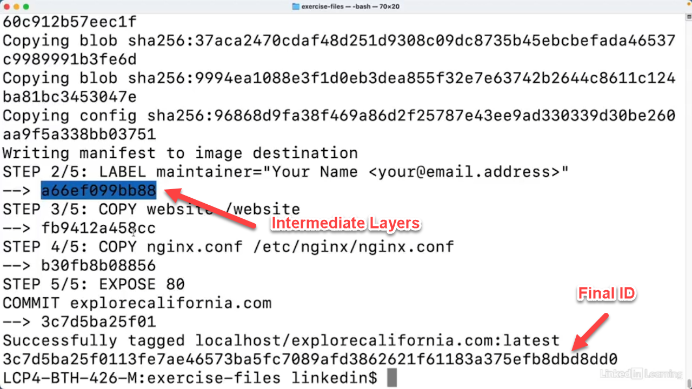

# 3.3 Building your image with Podman

**Building your image with Podman** module based on the transcript provided.

**🏗️** Breaking Down the Build Command

To compile the application image, execute the following command in the terminal:

```bash

podman build -t explorecalifornia.com .

```

- **build**: The specific podman subcommand responsible for compiling container images from a blueprint configuration file (Containerfile or Dockerfile).

- **-t explorecalifornia.com**: The "tag" flag. This assigns a human-readable name to your image. Skipping this option leaves the image nameless, forcing you to track it using its raw hexadecimal ID—a difficult task when managing numerous images.

- **. (The Dot)**: Specifies the **build context**. The context acts as the filesystem sandbox that the engine can access to pull files from during compilation. The single dot designates your current working directory (functionally equivalent to “\$PWD”).

**🍰** How the Image Bakes (Layered Architecture)



- **Intermediate Layers:** As the build runs, Podman processes each instruction inside the file line by line. Every separate command creates a distinct **image layer** that is stacked sequentially on top of the prior one.

- **Layer Identifiers:** Each individual step outputs a long, unique hexadecimal string called an intermediate layer ID.

- **Final Output:** The final ID displayed at the bottom of the execution trace represents the completed container image.

**💡** Finding Help

If you need to explore alternative parameters or configuration commands, run **podman help** to view a comprehensive list of available local subcommands.

# [README](./../../../README.md)
