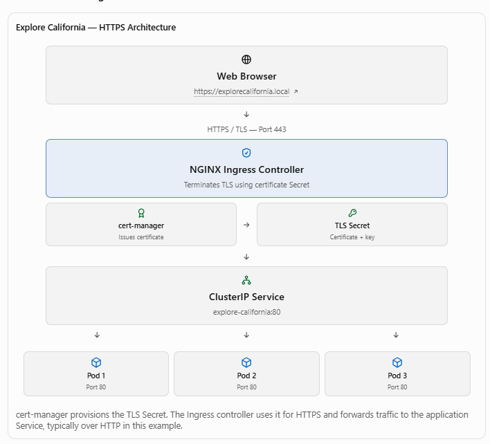
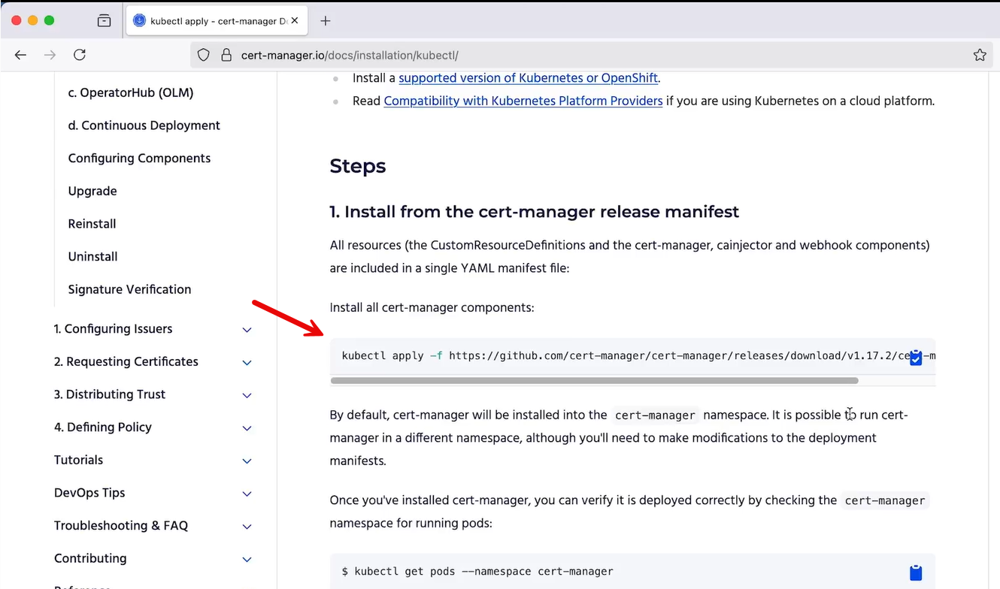

# 4.10 Adding HTTPS to your website with cert-manager

# Adding HTTPS to Your Website with cert-manager in Kubernetes

**1. What Is cert-manager?**

cert-manager is an open-source Kubernetes application that automates the creation, management, and renewal of TLS/SSL certificates.

It allows Kubernetes applications to use HTTPS without manually creating, installing, and renewing certificates.

**Benefits of cert-manager**

- Automates TLS certificate issuance.

- Manages certificates using Kubernetes resources.

- Supports certificate renewal.

- Stores certificates in Kubernetes Secrets.

- Integrates with Kubernetes Ingress controllers.

- Supports certificate authorities such as Let's Encrypt and other supported issuers.

Main goal of this lesson: Enable HTTPS for the Explore California website using cert-manager and a self-signed certificate.

**2. HTTP vs. HTTPS**

| **Feature**          | **HTTP**                       | **HTTPS**                       |
| -------------------- | ------------------------------ | ------------------------------- |
| Default port         | 80                             | 443                             |
| Encryption           | No                             | Yes, using TLS                  |
| Certificate required | No                             | Yes                             |
| Browser trust        | Not applicable                 | Depends on certificate trust    |
| Example              | http://explorecalifornia.local | https://explorecalifornia.local |

HTTPS encrypts communication between the browser and the Ingress controller. A self-signed certificate provides encryption but does not automatically establish trusted server identity.

**3. How cert-manager Works**



**4. Install cert-manager**

Visit the official website:

[cert-manager Installation Documentation](https://cert-manager.io/docs/installation/?utm_source=chatgpt.com)

The lesson uses the installation manifest provided in the official documentation.



After applying the installation manifest, verify the Pods:

```bash

kubectl get pods -n cert-manager

```

Expected components:

cert-manager

cert-manager-cainjector

cert-manager-webhook

All three components should become Running and ready.

What each component does:

| **Component** | **Purpose**                                                        |
| ------------- | ------------------------------------------------------------------ |
| cert-manager  | Manages certificates and renewal                                   |
| cainjector    | Injects CA certificate bundles into supported Kubernetes resources |
| webhook       | Validates and processes cert-manager resource requests             |

**5. Verify Your Git Branch**

Before configuring the certificate issuer, verify that you're using the correct exercise branch.

```bash

git branch --show-current

```

Expected:

04_10b

If necessary:

```bash

git checkout 04_10b

```

The exercise files contain a new configuration file:

issuer.yaml

**6. Create a Self-Signed Issuer**

An Issuer is a cert-manager resource that defines how certificates are issued.

For this lesson, we use a self-signed Issuer.

Example issuer.yaml:

```yaml
apiVersion: cert-manager.io/v1
kind: Issuer
metadata:
  name: explorecalifornia-ingress
spec:
  selfSigned: {}
```

**Explanation**

| **YAML property** | **Purpose**                                 |
| ----------------- | ------------------------------------------- |
| apiVersion        | Specifies the cert-manager API version      |
| kind: Issuer      | Defines an Issuer resource                  |
| metadata.name     | Names the Issuer                            |
| selfSigned: {}    | Configures self-signed certificate issuance |

Apply the configuration:

```bash

kubectl apply -f issuer.yaml

```

Verify the Issuer:

```bash

kubectl get issuers

```

Important: An Issuer is namespace-scoped. It must be in the same namespace as the Ingress and Certificate resources that reference it.

**7. Configure the Ingress for HTTPS**

Edit the existing Ingress:

```bash

kubectl edit ingress explore-california

```

Two changes are required:

1.  Add an annotation identifying the cert-manager Issuer.

2.  Configure TLS with a hostname and Kubernetes Secret name.

**Example Ingress Configuration**

```yaml
apiVersion: networking.k8s.io/v1
kind: Ingress
metadata:
  name: explore-california
  annotations:
    cert-manager.io/issuer: explorecalifornia-ingress
spec:
  rules:
    - host: explorecalifornia.local
      http:
        paths:
          - path: /
            pathType: Prefix
            backend:
              service:
                name: explore-california

```

This configuration tells cert-manager to issue a certificate for explorecalifornia.local and store it in the Secret named explorecalifornia-tls-data.

The Ingress controller then uses that Secret to terminate HTTPS connections.

**8. Understanding TLS Configuration**

| **Property**           | **Purpose**                                                     |
| ---------------------- | --------------------------------------------------------------- |
| cert-manager.io/issuer | Identifies the Issuer                                           |
| tls                    | Enables TLS configuration                                       |
| hosts                  | Specifies the hostname covered by the certificate               |
| secretName             | Names the Secret containing the TLS certificate and private key |

For example:

```yaml
tls:
  - hosts:
      - explorecalifornia.local
    secretName: explorecalifornia-tls-data

```

cert-manager's Ingress integration can automatically create a Certificate resource from this configuration.

**9. Verify the Certificate**

Check the Ingress:

```bash

kubectl get ingress

```

Example:

NAME HOSTS PORTS

explore-california explorecalifornia.local 80, 443

The presence of port 443 indicates that TLS is configured on the Ingress.

Next, verify the certificate:

```bash

kubectl get certificates

```

Example:

NAME READY SECRET

explorecalifornia-tls-data True explorecalifornia-tls-data

A READY value of True indicates that cert-manager considers the certificate ready.

Verify the Secret:

```bash

kubectl get secret explorecalifornia-tls-data

```

For more detailed troubleshooting:

```bash

kubectl describe certificate explorecalifornia-tls-data

```

**10. Test HTTPS in Your Browser**

Open:

https://explorecalifornia.local

The browser may display a certificate security warning.

**Why Does the Warning Appear?**

The certificate is self-signed, meaning it was not issued by a certificate authority that your browser already trusts.

| **Certificate type**                | **Browser behavior**                               |
| ----------------------------------- | -------------------------------------------------- |
| Self-signed                         | Usually displays a trust warning                   |
| Publicly trusted CA certificate     | Normally trusted if valid and correctly configured |
| Expired certificate                 | Displays a warning                                 |
| Certificate with incorrect hostname | Displays a warning                                 |

For a controlled local development environment, you can inspect the certificate and explicitly trust it if appropriate.

Do not bypass certificate warnings on unknown or production websites.

**11. Self-Signed vs. Let's Encrypt**

| **Feature**                          | **Self-Signed** | **Let's Encrypt**              |
| ------------------------------------ | --------------- | ------------------------------ |
| Cost                                 | Free            | Free                           |
| Browser trusted by default           | No              | Yes                            |
| Suitable for local testing           | Yes             | Sometimes, with a valid domain |
| Suitable for public production HTTPS | Generally no    | Yes                            |
| Automatic renewal with cert-manager  | Supported       | Supported                      |
| Public domain required               | No              | Generally yes                  |

For the local explorecalifornia.local hostname, a self-signed certificate is appropriate for learning.

Let's Encrypt generally requires control of a valid public domain and successful domain validation.

**12. Common cert-manager Commands**

| **Command**                                             | **When to use**                   |
| ------------------------------------------------------- | --------------------------------- |
| kubectl get pods -n cert-manager                        | Check cert-manager components     |
| kubectl get issuers                                     | List Issuers                      |
| kubectl describe issuer explorecalifornia-ingress       | Inspect Issuer status             |
| kubectl apply -f issuer.yaml                            | Create or update an Issuer        |
| kubectl edit ingress explore-california                 | Configure HTTPS                   |
| kubectl get ingress                                     | Check Ingress configuration       |
| kubectl get certificates                                | Check certificate readiness       |
| kubectl describe certificate explorecalifornia-tls-data | Troubleshoot certificate issuance |
| kubectl get secrets                                     | List Kubernetes Secrets           |

**Key Takeaways**

1.  cert-manager automates Kubernetes TLS certificate management.

2.  HTTPS encrypts traffic between clients and the Ingress controller.

3.  Issuer defines how certificates are issued.

4.  Self-signed certificates are useful for local development.

5.  cert-manager.io/issuer identifies which Issuer to use.

6.  tls.hosts specifies the hostname protected by the certificate.

7.  tls.secretName specifies where the certificate and private key are stored.

8.  kubectl get certificates verifies certificate readiness.

9.  Port 443 is the standard HTTPS port.

10. No application code changes are required when HTTPS terminates at the Ingress controller.

**Most Important Commands to Remember**

```bash

# Verify cert-manager
kubectl get pods -n cert-manager

# Create the self-signed Issuer

kubectl apply -f issuer.yaml

# Verify Issuer
kubectl get issuers

# Configure HTTPS on the Ingress
kubectl edit ingress explore-california

# Check Ingress
kubectl get ingress

# Verify certificate
kubectl get certificates

# Check TLS Secret
kubectl get secret explorecalifornia-tls-data

# Test HTTPS
curl -k -I <https://explorecalifornia.local>

```

The -k option tells curl to skip certificate verification. Use it only for controlled testing with certificates you expect not to be trusted.

Main concept: cert-manager simplifies HTTPS in Kubernetes by automatically issuing and managing TLS certificates. Combined with an NGINX Ingress Controller, it allows Explore California to serve encrypted HTTPS traffic without modifying the application itself.

# [README](./../../../README.md)
