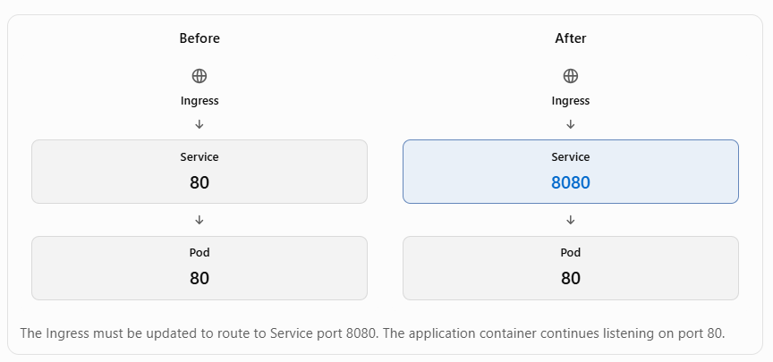

# 4.11 Challenge Change the port number

**Kubernetes Challenge — Change the Service Port Number**

**1. Challenge Overview**

The goal of this challenge is to change the Explore California Kubernetes Service port from 80 to 8080 while keeping the application accessible through its existing hostname.

Requirements:

- Change the Service port to 8080.

- Keep the application container listening on port 80.

- Ensure explorecalifornia.local continues working.

- Test the Service using kubectl port-forward.

- Do not create or modify any local YAML files.

**2. Understand the Existing Configuration**

Before making changes, the application uses this configuration:

| **Component**                | **Current port** |
| ---------------------------- | ---------------- |
| Ingress HTTPS                | 443              |
| ClusterIP Service            | 80               |
| Explore California container | 80               |

The goal is to change the Service port while leaving the container port unchanged.



**3. Step 1: Check the Existing Service**

Run:

```bash

kubectl get services

```

Inspect the Explore California Service:

```bash

kubectl describe service explore-california

```

Check its current port and target port.

**4. Step 2: Change the Service Port**

Edit the existing Service directly:

```bash

kubectl edit service explore-california

```

Find:

```yaml
ports:
  - port: 80
    targetPort: 80
    protocol: TCP

```


Change it to:

```yaml
ports:
  - port: 8080
    targetPort: 80
    protocol: TCP

```

Explanation:

- port: 8080 — The new Service port.

- targetPort: 80 — The application container still listens on port 80.

Save and exit the editor.

**5. Step 3: Update the Ingress**

Because the Service port changed, the Ingress must also point to the new port.

Run:

```bash

kubectl edit ingress explore-california

```

Find the backend Service configuration:

```yaml
backend:
  service:
    name: explore-california
    port:
      number: 80
```


Change it to:

```yaml
backend:
  service:
    name: explore-california
    port:
      number: 8080

```


Save the changes.

Important: Do not change the Ingress hostname or TLS configuration. HTTPS should continue using port 443.

**6. Step 4: Verify the Changes**

Check the Service:

```bash

kubectl get service explore-california

```

Expected port:

8080/TCP

Check the Ingress:

```bash

kubectl describe ingress explore-california

```

Confirm that its backend references:

explore-california:8080

**7. Step 5: Test with Port Forwarding**

Run:

```bash

kubectl port-forward service/explore-california 8080:8080

```

Open:

[http://localhost:8080](http://localhost:8080?utm_source=chatgpt.com)

The Explore California website should load.

Then verify the original hostname still works:

https://explorecalifornia.local

This confirms that the Ingress, Service, and Deployment remain connected.

**8. Important Kubernetes Commands**

| **Command**                                               | **Purpose**              |
| --------------------------------------------------------- | ------------------------ |
| kubectl get services                                      | List Services            |
| kubectl describe service explore-california               | Inspect Service ports    |
| kubectl edit service explore-california                   | Change the Service port  |
| kubectl edit ingress explore-california                   | Update Ingress routing   |
| kubectl get ingress                                       | Check Ingress status     |
| kubectl port-forward service/explore-california 8080:8080 | Test the Service locally |
| kubectl get pods                                          | Verify application Pods  |

**Key Takeaways**

1.  Kubernetes Services can expose a different port from the application container.

2.  port defines the port clients use to access the Service.

3.  targetPort defines the destination port on the Pod.

4.  Changing a Service port may require updating Ingress backend configuration.

5.  kubectl edit allows direct modification of Kubernetes resources without editing local YAML files.

6.  kubectl port-forward provides a quick way to test networking changes.

7.  The application container does not need to be rebuilt when only the Service port changes.

Main concept: Kubernetes separates application container ports from Service ports. You can change how applications are accessed without changing the application itself, provided that all dependent routing configurations are updated.

# [README](./../../../README.md)
