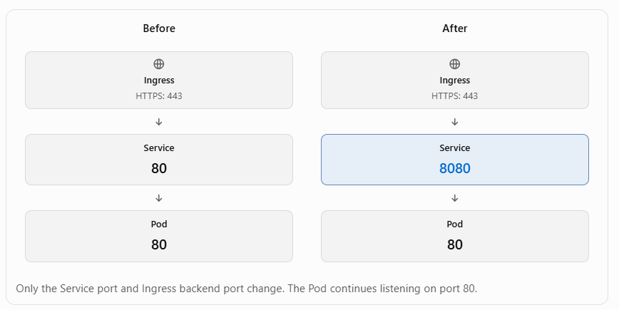
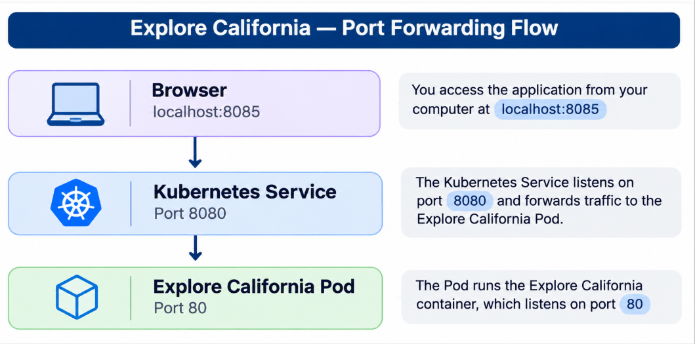

# 4.12 Solution Change the port number

**Solution — Change the Kubernetes Service Port Number**

**1. Overview**

This lesson demonstrates how to change the Explore California Kubernetes Service port from 80 to 8080 without changing the application container port.

The solution involves:

1.  Updating the Kubernetes Service.

2.  Testing the Service using port forwarding.

3.  Updating the Kubernetes Ingress.

4.  Verifying that HTTP and HTTPS still work.

Goal: Change the Service port to 8080 while keeping the Explore California application accessible through explorecalifornia.local.

**2. Understand the Port Changes**



**3. Step 1: Edit the Kubernetes Service**

Run:

```bash

kubectl edit service explore-california

```

Find the Service port configuration:

Before:

```yaml
ports:
  - port: 80
    targetPort: 80
    protocol: TCP

```


After:

```yaml
ports:
  - port: 8080
    targetPort: 80
    protocol: TCP

```


**Understanding the Difference**

| **Property** | **Value** | **Purpose**                            |
| ------------ | --------- | -------------------------------------- |
| port         | 8080      | Port exposed by the Kubernetes Service |
| targetPort   | 80        | Port used by the application container |
| protocol     | TCP       | Network protocol                       |

Important: Do not change targetPort because Explore California still listens on port 80.

Save and exit the editor. In Vim, use :wq.

**4. Step 2: Verify the Service**

Run:

```bash

kubectl get service explore-california

```

Expected output:

NAME TYPE CLUSTER-IP PORT(S)

explore-california ClusterIP 10.96.100.50 8080/TCP

This confirms the Service now exposes port 8080.

**5. Step 3: Test Using Port Forwarding**

The instructor uses local port 8085 to test Service port 8080.

Run:

```bash

kubectl port-forward service/explore-california 8085:8080

```

You can also use the shorter svc resource name:

```bash

kubectl port-forward svc/explore-california 8085:8080

```

**Port Mapping Explained**

| **Port** | **Purpose**                 |
| -------- | --------------------------- |
| 8085     | Port on your local computer |
| 8080     | Kubernetes Service port     |
| 80       | Application container port  |

Traffic flows through:



Open your browser:

[http://localhost:8085](http://localhost:8085?utm_source=chatgpt.com)

The Explore California website should load successfully.

**6. Step 4: Update the Kubernetes Ingress**

The Ingress must be updated because the Service port changed.

Run:

```bash

kubectl edit ingress explore-california

```

Find:

```yaml
backend:
  service:
    name: explore-california
    port:
      number: 80
```


Change it to:

```yaml
backend:
  service:
    name: explore-california
    port:
      number: 8080

```

Save and exit using :wq in Vim.

Why is this necessary? The Ingress must reference the correct Service port. Otherwise, requests may fail because the Ingress is still targeting port 80.

**7. Step 5: Verify HTTP and HTTPS**

Open:

http://explorecalifornia.local

The lesson demonstrates that the NGINX Ingress Controller redirects HTTP traffic to HTTPS.

The browser should redirect to:

https://explorecalifornia.local

This happens because the Ingress is configured with TLS, and the NGINX Ingress Controller is configured to redirect HTTP requests to HTTPS.

The self-signed certificate may still produce a browser trust warning.

**8. Common Commands Used**

| **Command**                                           | **Purpose**                  |
| ----------------------------------------------------- | ---------------------------- |
| kubectl edit service explore-california               | Change the Service port      |
| kubectl get service explore-california                | Verify Service configuration |
| kubectl port-forward svc/explore-california 8085:8080 | Test Service connectivity    |
| kubectl edit ingress explore-california               | Update Ingress backend port  |
| kubectl get ingress                                   | Verify Ingress status        |
| kubectl describe ingress explore-california           | Inspect Ingress routing      |
| kubectl get pods                                      | Verify application Pods      |

**9. Key Takeaways**

1.  port is the port exposed by a Kubernetes Service.

2.  targetPort is the destination port inside the application Pod.

3.  A Service can expose port 8080 while the container listens on port 80.

4.  kubectl edit service modifies an existing Service.

5.  kubectl port-forward tests connectivity without exposing the Service publicly.

6.  kubectl edit ingress updates the Ingress backend port.

7.  The application does not need to be rebuilt or redeployed.

8.  HTTPS continues working because the Ingress TLS configuration remains unchanged.

**10. Most Important Commands to Remember**

```bash

# Edit the Service
kubectl edit service explore-california

# Verify the Service
kubectl get service explore-california

# Test local port 8085 -> Service port 8080
kubectl port-forward svc/explore-california 8085:8080

# Update the Ingress backend
kubectl edit ingress explore-california

# Verify Ingress
kubectl get ingress

# Inspect Ingress routing
kubectl describe ingress explore-california

# Test HTTPS

curl -k -I <https://explorecalifornia.local>

```

curl -k skips certificate verification and is appropriate only for controlled local testing.

**Main concept:** Kubernetes separates the Service port from the container port. By updating the Service and Ingress together, you can change how an application is accessed without modifying the application or its Deployment.

# [README](./../../../README.md)
