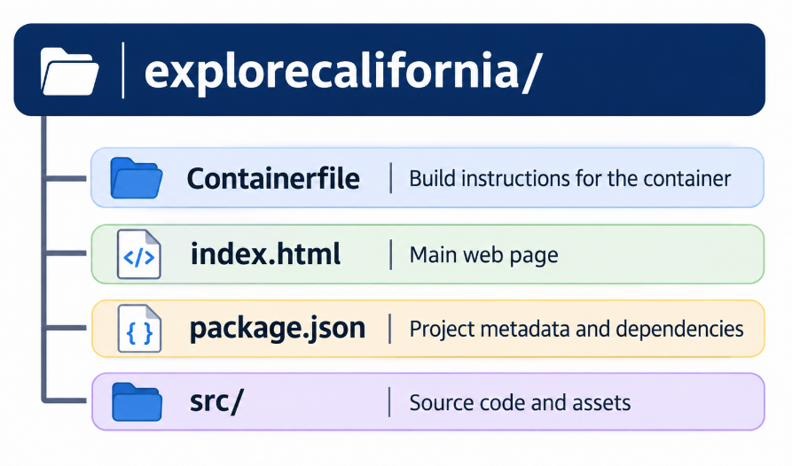
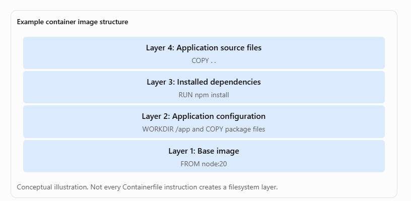

# 4.1 Running your app locally within Kubernetes

# Goal for this Chapter

- Create a Kubernetes cluster locally with Kind

- Create the Kubernetes resources you need to deploy Explore California into your cluster

- Serve Explore California over HTTPS without changing its container image

# Building Your Container Image with Podman

**1. What is Podman?**

Podman is a container management tool used to build, run, and manage container images and containers. It provides commands similar to Docker.

In this lesson, you learn how to build a container image using the Podman CLI and a Containerfile.

**2. Verify Your Git Branch**

Before building the image, make sure you're working in the correct Git branch.

Check the current branch:

```bash

git branch --show-current

```

Expected output:

O3_03b

Switch branches if necessary:

```bash

git checkout O3_03b

```

**3. Build a Container Image**

Run the following command:

```bash

podman build -t explorecalifornia.com .

```

**Command Breakdown**

| **Component**         | **Description**                                 |
|-----------------------|-------------------------------------------------|
| podman                | Podman command-line tool                        |
| build                 | Builds a container image from a Containerfile   |
| -t                    | Assigns a name or tag to the image              |
| explorecalifornia.com | Name of the container image                     |
| .                     | Uses the current directory as the build context |

Why use -t?

Naming an image makes it easier to find and manage, especially when your system contains hundreds or thousands of images.

**4. Understanding Build Context**

The build context contains the files and directories available to Podman during the image-building process.

Example project structure:



When you run:

```bash

podman build -t explorecalifornia.com .

```

Podman uses the current directory (.) as its build context.

You can check your current directory using:

```bash

pwd

```

**5. Understanding Container Image Layers**

When Podman builds an image, it processes the instructions in the Containerfile.

Each relevant build instruction can create a new image layer.

For example:

```yaml

FROM node:20
WORKDIR /app
COPY package\*.json .
RUN npm install
COPY . .
CMD ["npm", "start"]

```



Benefits of image layers:

- Reuse previously built layers.

- Speed up future builds through caching.

- Reduce duplicated storage.

- Make images easier to distribute.

**6. Understanding Image IDs**

After Podman completes the build, it displays an image ID.

Example:

Successfully tagged localhost/explorecalifornia.com:latest

Every image has a unique identifier.

You can list available images using:

```bash

podman images

```

Example output:

REPOSITORY TAG IMAGE ID

localhost/explorecalifornia.com latest a1b2c3d4e5f6

You can identify images by their names or unique image IDs.

**7. Useful Podman Commands**

| **Command**                    | **Purpose**                   |
|--------------------------------|-------------------------------|
| podman build -t myapp .        | Build an image                |
| podman images                  | List container images         |
| podman run -d -p 8080:80 myapp | Run a container               |
| podman ps                      | List running containers       |
| podman ps -a                   | List all containers           |
| podman logs \<container-id\>   | View container logs           |
| podman stop \<container-id\>   | Stop a container              |
| podman rmi myapp               | Remove an image               |
| podman help                    | Display available commands    |
| podman build --help            | Display build command options |

**8. Podman vs. Docker**

Podman and Docker support many similar commands.

| **Task**        | **Podman**    | **Docker**    |
|-----------------|---------------|---------------|
| Build image     | podman build  | docker build  |
| List images     | podman images | docker images |
| Run container   | podman run    | docker run    |
| List containers | podman ps     | docker ps     |
| Stop container  | podman stop   | docker stop   |

A major difference is that Podman has a daemonless architecture and supports rootless containers.

**Key Takeaways**

1.  podman build creates a container image using a Containerfile or Dockerfile.

2.  -t assigns a recognizable name to the image.

3.  . represents the current directory used as the build context.

4.  Image layers allow efficient storage and caching.

5.  Image IDs uniquely identify container images.

6.  podman images displays available images.

7.  podman help displays Podman's available commands.

Most important command to remember:

```bash

podman build -t explorecalifornia.com .

```

This builds a container image named explorecalifornia.com using the Containerfile or Dockerfile and build context in the current directory.

# [README](./../../../README.md)
