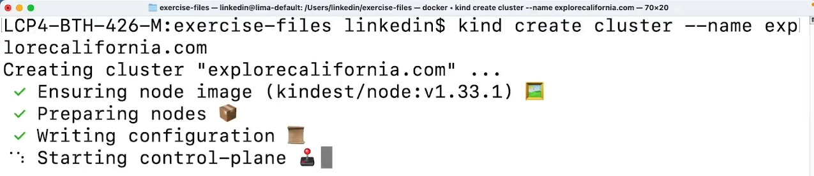
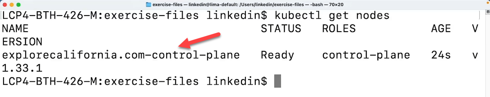
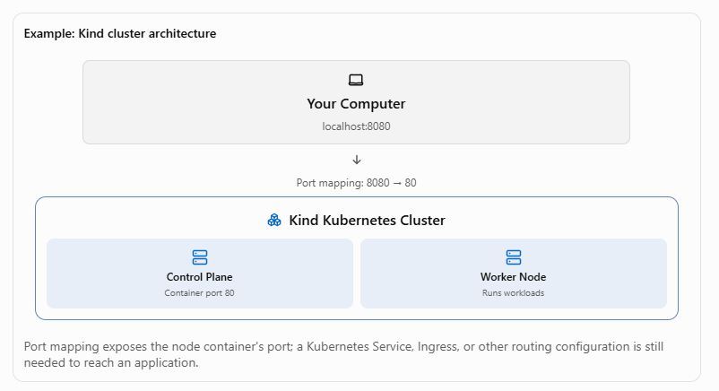

# 4.2 Creating your kind cluster

# Creating Your Kubernetes Cluster with Kind

## **1. What is Kind?**

Kind (Kubernetes IN Docker) is a tool used to create and run local Kubernetes clusters using containers.

Kind is commonly used for:

- Learning and practicing Kubernetes.

- Testing Kubernetes applications locally.

- Developing applications before deploying to production.

- Testing Kubernetes YAML configurations.

- Creating multi-node Kubernetes clusters.

Kind can use Docker or Podman as its container provider.

## **2. Verify Your Git Branch**

Before creating the cluster, make sure you're working in the correct Git branch.

Check the current branch:

```bash

git branch --show-current

```

Expected output:

04_02b

If you're on the wrong branch, switch using:

```bash

git checkout 04_02b

```

List the files in your current directory:

```bash

ls

```

You should see a configuration file named cluster.yaml.

## **3. Create a Kubernetes Cluster**

Create a cluster using:

```bash

kind create cluster

```

Get the cluster names

```bash

kubectl config get-cluster

```

To create a cluster with a custom name:

```bash

kind create cluster --name explorecalifornia.com

```



Command breakdown:

| **Component**         | **Description**                    |
|-----------------------|------------------------------------|
| kind                  | Kubernetes cluster management tool |
| create cluster        | Creates a local Kubernetes cluster |
| --name                | Specifies the cluster name         |
| explorecalifornia.com | Custom cluster name                |

Kind automatically creates a Kubernetes control-plane node. Additional worker nodes can be configured if needed.

## **4. Verify the Kubernetes Cluster**

After creating the cluster, run:

```bash

kubectl get nodes

```



Example output:

NAME STATUS ROLES

explorecalifornia.com-control-plane Ready control-plane

This confirms that the Kubernetes cluster is running and accessible through kubectl.

**5. Access a Kubernetes Node**

Kind runs Kubernetes nodes inside containers.

You can access a node using Podman:

```bash

podman exec -it explorecalifornia.com-control-plane sh

```

Command breakdown:

| **Component** | **Description** |
|----|----|
| podman exec | Executes a command inside a running container |
| -it | Opens an interactive terminal |
| explorecalifornia.com-control-plane | Kubernetes node container name |
| sh | Opens a shell inside the container |

This is useful for troubleshooting Kubernetes nodes.

To exit the container shell:

```bash

exit

```

You can also press Ctrl + D.

## **6. Delete a Kubernetes Cluster**

To delete a cluster:

```bash

kind delete cluster --name explorecalifornia.com

```

This removes the local Kubernetes cluster and its nodes.

Important: Deleting a Kind cluster also removes the Kubernetes workloads and cluster data stored within it, unless that data is stored externally.

## **7. Customize a Cluster Using cluster.yaml**

Kind supports configuration files for customizing Kubernetes clusters.

You can configure:

- Number of control-plane nodes and worker nodes.

- Port mappings.

- Kubernetes node images.

- Networking settings.

- Additional node configuration.

Example cluster.yaml:

```Yaml
kind: Cluster
apiVersion: kind.x-k8s.io/v1alpha4

nodes:
  - role: control-plane
    extraPortMappings:
      - containerPort: 80
        hostPort: 8080
        protocol: TCP

  - role: worker
```

This configuration creates a cluster with one control-plane node and one worker node.



## **8. Create a Cluster Using cluster.yaml**

Run:

```bash

kind create cluster --name explorecalifornia.com --config cluster.yaml

```

Explanation:

- kind create cluster creates the Kubernetes cluster.

- --name specifies the cluster name.

- --config cluster.yaml loads the custom cluster configuration.

After creation, verify the nodes:

```bash

kubectl get nodes

```

You should see two nodes if you used the example configuration above.

## **9. Common Kind Commands**

| **Command** | **When to use** |
|----|----|
| kind create cluster | Create a default cluster |
| kind create cluster --name mycluster | Create a named cluster |
| kind create cluster --config cluster.yaml | Create a customized cluster |
| kind get clusters | List Kind clusters |
| kubectl get nodes | Verify cluster nodes |
| kubectl get pods -A | View Pods across all namespaces |
| kubectl cluster-info | Display cluster information |
| podman exec -it NODE sh | Troubleshoot inside a Podman-backed node |
| kind delete cluster --name mycluster | Delete a named cluster |

**Key Takeaways**

1.  Kind creates local Kubernetes clusters using containers.

2.  kind create cluster creates a Kubernetes cluster.

3.  --name assigns a custom cluster name.

4.  kubectl get nodes verifies that the cluster is running.

5.  podman exec -it lets you access a node container for troubleshooting.

6.  kind delete cluster removes a Kubernetes cluster.

7.  cluster.yaml allows you to customize nodes, ports, and other settings.

8.  extraPortMappings maps host computer ports to Kubernetes node container ports.

**Most Important Commands to Remember**

```bash

# Create a cluster

kind create cluster --name explorecalifornia.com

# Check cluster nodes

kubectl get nodes

# List clusters

kind get clusters

# Delete a cluster

kind delete cluster --name explorecalifornia.com

# Create a cluster with custom configuration

kind create cluster --name explorecalifornia.com --config cluster.yaml

```

Main concept: Kind makes it easy to create, customize, troubleshoot, and delete local Kubernetes clusters without needing cloud infrastructure such as AWS EKS, Azure AKS, or Google GKE.

# [README](./../../../README.md)
