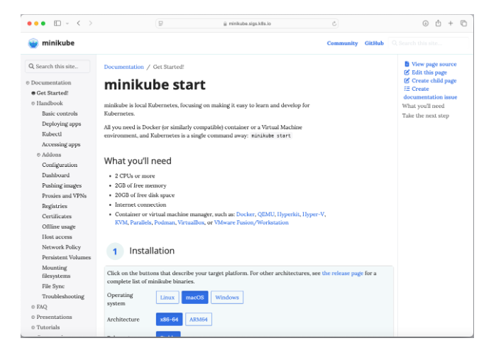
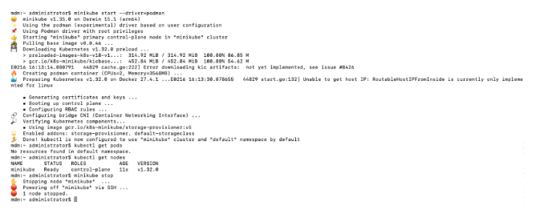
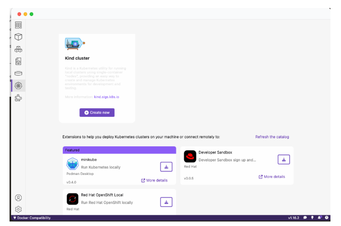

# 4.3 Creating Kubernetes clusters locally

While kind is a popular way of creating local Kubernetes clusters, it isn't the only way! You have several options for creating local Kubernetes clusters for testing.

Let's briefly learn more about them. Check out my [***Kubernetes: Provisioning for Infrastructure as Code***](https://www.linkedin.com/learning/kubernetes-provisioning-for-infrastructure-as-code/introduction?u=16585428) course if you're interested in learning more about how these tools work.

**minikube**

minikube, like kind, makes it easy to create local Kubernetes clusters. Unlike kind, however, minikube gives you the option of using VMs for the Kubernetes control plane and worker nodes. This is ideal for developers who want more isolated Kubernetes nodes or more control over where these VMs are created.

Installing minikube is similar to installing kind. Visit [**https://minikube.sigs.k8s.io**](https://minikube.sigs.k8s.io/), then click on "Get Started!" on the left. Confirm that the buttons in blue correspond to your operating system and processor architecture, then click the "Copy" button next to the code block that appears underneath.

Open a terminal, paste it in, and enter your password when prompted to continue the installation.

Once that's done, run minikube start --driver=podman to create a local cluster. Your new cluster will be ready in a few minutes!

**k3d**

k3d enables developers to create Kubernetes clusters that run entirely in Docker. While it was initially created by Rancher Labs as a sister project to k3s, it is now an open-source project that anyone can contribute to.

At this time of writing, k3d works best with Docker. While you can get it working with Podman, you'll find kind easier to get going with.

Like kind and minikube, installing k3d is straightforward. Visit [**https://k3s.io**](https://k3s.io/), then scroll down to the code block underneath Installation. Open a Terminal, paste that in, and hit ENTER to proceed with the installation.

Once the installation's done, run k3d start to confirm that everything's been installed.

**Container engines**

All of the popular container engines out in the wild—Docker, Podman and Rancher Desktop—offer a way of creating local Kubernetes clusters from the GUI. This is the easiest way to get started with a Kubernetes cluster, especially if you're new to terminals or just prefer doing things graphically!

Container engines will usually leverage one of the options mentioned above to create and manage your local cluster. For example, you can see that Podman Desktop creates kind clusters behind the scenes.

While I prefer to use CLI tools to create local Kubernetes clusters, how you choose to do so is, ultimately, a matter of preference.

**Other options**

- **colima**: An open-source, CLI-driven container engine. Works best with Docker. [**https://github.com/abiosoft/colima**](https://github.com/abiosoft/colima)

- **k3s**: A more fully-fledged Kubernetes distribution that can be run locally

# [README](./../../../README.md)
