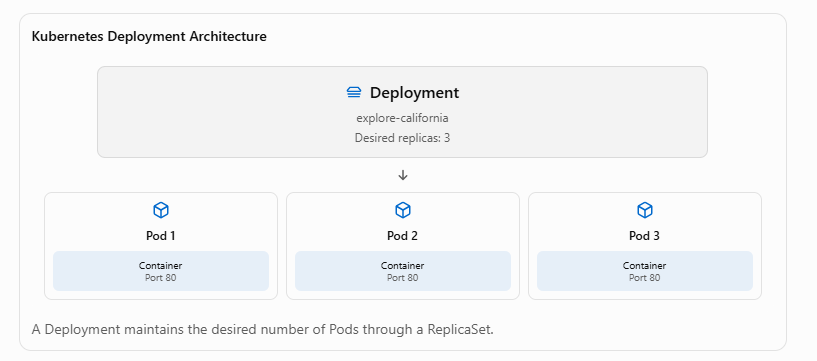
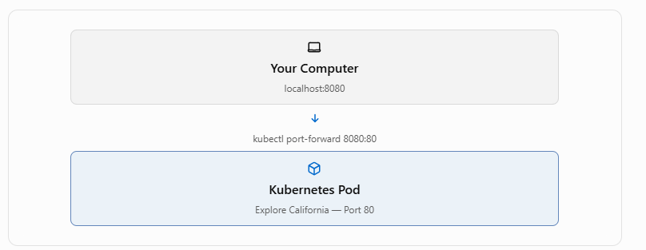

# 4.4 Scaling Explore California with a deployment

**Scaling Explore California with a Kubernetes Deployment**

**1. What Are Pods and Deployments?**

Kubernetes uses two important resources to run and manage containerized applications: Pods and Deployments.

**Pods**

A Pod is the smallest deployable unit in Kubernetes.

- **Contains one or more containers**.

- **Containers share** networking and can share storage volumes.

- Containers in the same **Pod run together** on the same node.

- Most application Pods contain a single container.

**Deployments**

A **Deployment manages Pods** and helps keep applications running.

- Creates and manages Pods.

- Supports scaling applications to multiple replicas.

- Replaces failed Pods.

- Supports rolling updates and rollbacks.

- Maintains the desired number of application replicas.



**2. Load the Container Image into Kind**

Before deploying Explore California, **load its container image into the local Kind cluster**.

```bash

kind load docker-image explorecalifornia.com --name explorecalifornia.com

```

Command breakdown:

| **Component**                | **Description**                         |
| ---------------------------- | --------------------------------------- |
| kind load docker-image       | Loads a local container image into Kind |
| explorecalifornia.com        | Container image name                    |
| --name explorecalifornia.com | Specifies the Kind cluster              |

This makes the locally built image available to the Kubernetes nodes.

**3. Create a Kubernetes Deployment**

Use **kubectl create** deployment to deploy Explore California.

```bash

kubectl create deployment explore-california \
  --image=localhost/explorecalifornia.com:latest \
  --port=80
```

Explanation:

- kubectl create deployment creates a Deployment.

- explore-california is the Deployment name.

- --image specifies the container image.

- --port=80 declares the container port.

The lesson uses the localhost/ image prefix because the locally built image is tagged that way. The image reference in the Deployment must match the image loaded into Kind.

**4. Verify the Deployment**

**Check whether the Deployment** is running:

```bash

kubectl get deployments

```

Check the Pods:

```bash

kubectl get pods

```

You might initially see:

NAME READY STATUS

explore-california-xxxxxxxxxx-xxxxx 0/1 **ImagePullBackOff**

**What Is ImagePullBackOff?**

ImagePullBackOff means Kubernetes attempted to pull the container image but could not retrieve it.

Common reasons include:

- Incorrect image name or tag.

- Image unavailable in the registry.

- Missing registry authentication.

- Incorrect image pull policy.

**5. Fix ImagePullBackOff**

Edit the Deployment:

```bash

kubectl edit deployment explore-california

```

Find the container's **imagePullPolicy** property.

Change:

```yaml

imagePullPolicy: Always

```

To:

```yaml

imagePullPolicy: IfNotPresent

```

**Image Pull Policies Explained**

| **Policy**   | **Behavior**                                                     |
| ------------ | ---------------------------------------------------------------- |
| Always       | Checks the registry whenever a container starts                  |
| IfNotPresent | Uses the local image if available; otherwise attempts to pull it |
| Never        | Only uses locally available images                               |

Recommended for this lesson: IfNotPresent, because the image has already been loaded into Kind.

Save the changes, then check the Pods:

```bash

kubectl get pods

```

Expected status:

READY STATUS

1/1 Running

Note: For images tagged latest, Kubernetes commonly defaults to Always unless a different policy is explicitly specified.

**6. Access the Application Using Port Forwarding**

Kubernetes supports port forwarding to access applications running inside Pods.

Run:

```bash

kubectl port-forward deployment/explore-california 8080:80

```

Command breakdown:

| **Component**                 | **Description**                                |
| ----------------------------- | ---------------------------------------------- |
| kubectl port-forward          | Forwards a local port to a Kubernetes resource |
| deployment/explore-california | Target Deployment                              |
| 8080                          | Port on your computer                          |
| 80                            | Port inside the application Pod                |



Open your browser:

http://localhost:8080

You should see the Explore California application.

Port forwarding is primarily useful for development, debugging, and testing. It is not a permanent solution for exposing production applications.

**7. Scale the Deployment**

Although the lesson initially creates one Pod, Kubernetes Deployments support multiple replicas.

To scale Explore California to three Pods:

```bash

kubectl scale deployment/explore-california --replicas=3

```

Verify the replicas:

```bash

kubectl get deployments

kubectl get pods

```

Expected Deployment status after all replicas become ready:

NAME READY UP-TO-DATE AVAILABLE

explore-california 3/3 3 3

Kubernetes will try to maintain three running replicas.

To scale back to one:

```bash

kubectl scale deployment/explore-california --replicas=1

```

**8. Services and Ingresses**

Port forwarding is temporary. Kubernetes provides Services and Ingresses for more persistent application access.

| **Resource** | **Purpose**                                    |
| ------------ | ---------------------------------------------- |
| Pod          | Runs application containers                    |
| Deployment   | Manages and scales Pods                        |
| Service      | Provides a stable network endpoint for Pods    |
| Ingress      | Routes external HTTP/HTTPS traffic to Services |

For example, a Service can distribute requests across multiple Explore California Pods, while an Ingress can expose the application through a hostname.

**9. Common Kubernetes Deployment Commands**

| **Command**                                                | **When to use**                 |
| ---------------------------------------------------------- | ------------------------------- |
| kubectl create deployment                                  | Create a Deployment             |
| kubectl get deployments                                    | List Deployments                |
| kubectl get pods                                           | Check Pod status                |
| kubectl describe deployment explore-california             | Troubleshoot a Deployment       |
| kubectl edit deployment explore-california                 | Modify Deployment configuration |
| kubectl logs deployment/explore-california                 | View application logs           |
| kubectl scale deployment/explore-california --replicas=3   | Scale to three Pods             |
| kubectl rollout status deployment/explore-california       | Check rollout progress          |
| kubectl port-forward deployment/explore-california 8080:80 | Access application locally      |
| kubectl delete deployment explore-california               | Delete the Deployment           |

**Key Takeaways**

1.  Pods run one or more containers in Kubernetes.

2.  Deployments manage Pods, scaling, and recovery from failures.

3.  kind load docker-image loads a local image into a Kind cluster.

4.  kubectl create deployment creates an application Deployment.

5.  ImagePullBackOff indicates Kubernetes cannot retrieve the required image.

6.  imagePullPolicy: IfNotPresent allows Kubernetes to use a locally available image.

7.  kubectl port-forward allows local access to an application.

8.  kubectl scale changes the number of application replicas.

9.  Services and Ingresses provide more persistent ways to access applications.

**Most Important Commands to Remember**

```bash

# Load image into Kind

kind load docker-image explorecalifornia.com --name explorecalifornia.com

# Create Deployment

kubectl create deployment explore-california \
  --image=localhost/explorecalifornia.com:latest \
  --port=80

# Check Deployment and Pods

kubectl get deployments

kubectl get pods

# Fix image pull policy if needed

kubectl edit deployment explore-california

# Access application locally

kubectl port-forward deployment/explore-california 8080:80

# Scale to three Pods

kubectl scale deployment/explore-california --replicas=3

# Verify rollout

kubectl rollout status deployment/explore-california

```

**Main concept:** A Kubernetes Deployment allows you to run, manage, scale, and recover containerized applications automatically, while Pods provide the environment in which those containers execute.

# [README](./../../../README.md)
