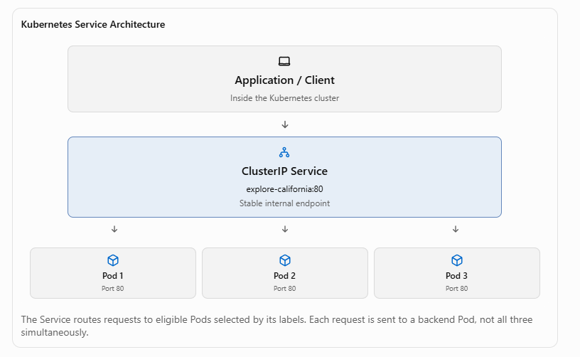
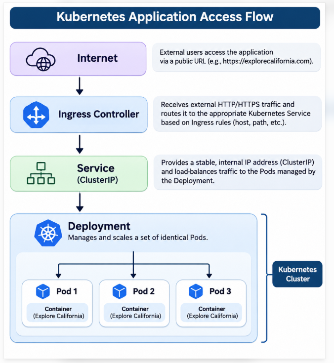

# 4.5 Exposing Explore California with a service

**Exposing Explore California with a Kubernetes Service**

**1. What Is a Kubernetes Service?**

A Kubernetes Service provides a stable network endpoint for accessing applications running inside Pods.

Pods can be created, deleted, restarted, or replaced. When this happens, their IP addresses may change.

A Service solves this problem by providing a consistent way to communicate with the application.

Benefits of Kubernetes Services:

- Provide stable IP addresses and DNS names.

- Allow applications to communicate inside the cluster.

- Route traffic to healthy, ready Pods.

- Distribute traffic across multiple Pods.

- Allow Ingress controllers to route external traffic to applications.

**2. Why Do We Need a Service?**

Without a Service, applications must communicate directly with Pod IP addresses.

For example:

Pod 1: 10.244.0.5

Pod 2: 10.244.0.6

Pod 3: 10.244.0.7

**If Kubernetes replaces a Pod, its IP address may change.**

**With a Service, applications can use a stable endpoint such as:**

**explore-california:80**

Kubernetes routes requests to the appropriate Pods.

**3. How a Kubernetes Service Works**



**4. Create a ClusterIP Service**

The lesson creates a Service for Explore California.

Run:

```bash

kubectl create service clusterip explore-california --tcp=80:80

```

**Command Breakdown**

| **Component**      | **Description**                        |
|--------------------|----------------------------------------|
| kubectl            | Kubernetes command-line tool           |
| create service     | Creates a Kubernetes Service           |
| clusterip          | Specifies the Service type             |
| explore-california | Service name                           |
| --tcp=80:80        | Maps Service port 80 to target port 80 |

Important: Creating a Service does not automatically guarantee that it connects to the Deployment. Its selector must match the Pod labels.

For this lesson, verify the labels and Service selector using:

```bash

kubectl get pods --show-labels

kubectl describe service explore-california

```

The selector created by the command above may need adjustment to match the Deployment's Pods.

**5. Understanding Service Ports**

The command uses:

```bash
--tcp=80:80
```

The two numbers represent:

| **Port**  | **Purpose**                |
|-----------|----------------------------|
| First 80  | Service port               |
| Second 80 | Target port inside the Pod |

For example:

```bash

kubectl create service clusterip explore-california --tcp=8080:80

```

This means the Service listens on port 8080 and forwards traffic to port 80 inside the selected Pod.

**6. Verify the Service**

Run:

```bash

kubectl get services

```

Example output:

NAME TYPE CLUSTER-IP PORT(S)

explore-california ClusterIP 10.96.100.50 80/TCP

The CLUSTER-IP is the internal IP address assigned to the Service.

You can inspect more information:

```bash

kubectl describe service explore-california
``````

To verify that the Service has Pods available as backends:

```bash

kubectl get endpointslices \
    -l kubernetes.io/service-name=explore-california

```

**7. Access the Service Using Port Forwarding**

A ClusterIP Service is only directly reachable inside the Kubernetes cluster.

To access it from your computer, use port forwarding:

```bash

kubectl port-forward service/explore-california 8080:80

```

Explanation:

- service/explore-california identifies the Service.

- 8080 is the port on your computer.

- 80 is the Service port.

Open your browser:

[http://localhost:8080](http://localhost:8080?utm_source=chatgpt.com)

You should see the Explore California website if the Service is correctly connected to its Pods.

**8. Types of Kubernetes Services**

Kubernetes provides several ways to expose applications.

| **Service type** | **Purpose** | **Typical use** |
|----|----|----|
| ClusterIP | Internal cluster access | Communication between applications |
| NodePort | Exposes a port on each node | Local testing or direct node access |
| LoadBalancer | Integrates with an external load balancer | Exposing applications externally |
| ExternalName | Maps a Service DNS name to another DNS name | Referencing external services |

The lesson focuses on ClusterIP, the default Service type.

**9. Deployment vs. Service vs. Ingress**

| **Kubernetes resource** | **Responsibility** |
|----|----|
| Pod | Runs application containers |
| Deployment | Creates, manages, and scales Pods |
| Service | Provides stable access to selected Pods |
| Ingress | Defines HTTP/HTTPS routing from outside the cluster |

A common architecture is:



Ingress requires an Ingress controller to implement its routing rules.

**10. Common Kubernetes Service Commands**

| **Command** | **When to use** |
|----|----|
| kubectl create service clusterip | Create a ClusterIP Service |
| kubectl get services | List Services |
| kubectl describe service explore-california | Inspect Service configuration |
| kubectl get endpointslices | Check Service backend endpoints |
| kubectl port-forward service/explore-california 8080:80 | Access Service locally |
| kubectl edit service explore-california | Modify Service configuration |
| kubectl delete service explore-california | Delete the Service |
| kubectl create service --help | View Service creation options |

**Key Takeaways**

1.  Services provide stable networking for Kubernetes Pods.

2.  Pod IP addresses can change when Pods are replaced.

3.  ClusterIP provides an internal IP address for a Service.

4.  A Service uses selectors to identify its backend Pods.

5.  --tcp=80:80 maps Service port 80 to Pod target port 80.

6.  kubectl get services displays existing Services.

7.  kubectl port-forward allows local access to a ClusterIP Service.

8.  Ingress can provide external HTTP/HTTPS access through a Service.

**Most Important Commands to Remember**

```bash

# Create a ClusterIP Service
kubectl create service clusterip explore-california --tcp=80:80

# List Services
kubectl get services

# Inspect the Service
kubectl describe service explore-california

# Check backend endpoints
kubectl get endpointslices \
    -l kubernetes.io/service-name=explore-california

# Forward local port 8080 to Service port 80
kubectl port-forward service/explore-california 8080:80

# Delete the Service
kubectl delete service explore-california

```

**Main concept:** A Kubernetes Service gives applications a stable network endpoint, allowing them to communicate with Pods without needing to know individual Pod IP addresses.

# [README](./../../../README.md)
