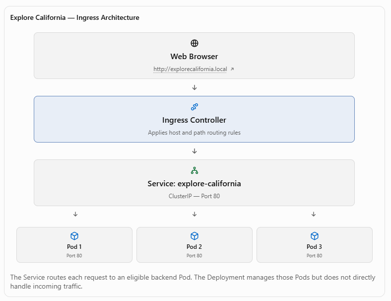

# 4.6 Routing Explore California with an ingress

# Routing Explore California with a Kubernetes Ingress

**1. What Is a Kubernetes Ingress?**

A Kubernetes Ingress is a resource that defines rules for routing external HTTP and HTTPS traffic to Services running inside a Kubernetes cluster.

An Ingress allows users to access applications through domain names and URL paths instead of using temporary port forwarding.

Benefits of Ingress:

- Exposes web applications outside the Kubernetes cluster.

- Routes traffic based on domain names.

- Routes requests based on URL paths.

- Supports multiple Services behind one entry point.

- Supports HTTPS/TLS termination when configured.

- Works with an Ingress controller to implement routing rules.

**2. Why Do We Need Ingress?**

Previously, Explore California used three Kubernetes resources:

| **Resource**        | **Purpose**                             |
|---------------------|-----------------------------------------|
| Pod                 | Runs the Explore California container   |
| Deployment          | Manages and scales the Pods             |
| Service (ClusterIP) | Provides stable internal access to Pods |

However, a ClusterIP Service is not directly accessible from outside the cluster.

An Ingress provides routing rules that an Ingress controller uses to make the application accessible externally.

**3. How Kubernetes Ingress Works**



**4. Create a Kubernetes Ingress**

First, view the available Ingress commands:

```bash

kubectl create ingress –help

```

Create an Ingress for Explore California:

```bash

kubectl create ingress explore-california \
  --rule="explorecalifornia.local/*=explore-california:80"

```

**Command Breakdown**

| **Component**           | **Description**                |
|-------------------------|--------------------------------|
| kubectl create ingress  | Creates an Ingress resource    |
| explore-california      | Name of the Ingress            |
| --rule                  | Defines the routing rule       |
| explorecalifornia.local | Hostname                       |
| /*                      | Matches paths under the root   |
| explore-california      | Destination Kubernetes Service |
| 80                      | Destination Service port       |

Result: Requests matching the hostname and path are routed to the explore-california Service on port 80 once a working Ingress controller is configured.

**5. Understanding Ingress Routing Rules**

Ingress can route requests to different Services based on their URLs.

For example:

| **URL**                         | **Destination Service** |
|---------------------------------|-------------------------|
| explorecalifornia.local/        | explore-california      |
| explorecalifornia.local/about   | explore-california      |
| explorecalifornia.local/tours   | explore-california      |
| explorecalifornia.local/contact | explore-california      |

All these requests can reach the same Service.

**Routing Multiple Services**

You can also route different URL paths to different applications.

| **URL path** | **Kubernetes Service** |
|--------------|------------------------|
| /            | frontend-service       |
| /api         | backend-service        |
| /admin       | admin-service          |

This allows multiple applications to share one hostname.

Important: Kubernetes Ingress supports Exact, Prefix, and controller-specific ImplementationSpecific path matching. Wildcard behavior is not universally supported as a general glob pattern. For standard prefix matching, use pathType: Prefix.

**6. Verify the Ingress**

After creating the Ingress, run:

```bash

kubectl get ingress

```

Example output:

NAME CLASS HOSTS ADDRESS PORTS

```
explore-california <none> explorecalifornia.local 80
```

The ADDRESS field may initially be empty.

**Why Is the Ingress Address Empty?**

Creating an Ingress resource does not automatically install an Ingress controller.

An Ingress controller is responsible for:

- Watching Kubernetes Ingress resources.

- Configuring the reverse proxy.

- Routing incoming HTTP/HTTPS traffic.

- Connecting requests to the correct Kubernetes Services.

Until a suitable controller is installed and configured, the Ingress rules will not route traffic. An empty ADDRESS alone does not conclusively prove that no controller exists, however.

**7. Ingress vs. Ingress Controller**

These two components have different responsibilities.

| **Component**      | **Responsibility**                                    |
|--------------------|-------------------------------------------------------|
| Ingress            | Defines traffic routing rules                         |
| Ingress Controller | Implements those rules and processes incoming traffic |

Think of an Ingress as a set of instructions and an Ingress controller as the software that executes them.

Popular controller implementations include NGINX-based controllers, Traefik, and cloud-provider controllers.

**8. Creating Ingress with YAML**

Although the lesson uses the kubectl create ingress command, you can also create Ingress resources using YAML.

Example ingress.yaml:

```yaml
apiVersion: networking.k8s.io/v1
kind: Ingress
metadata:
  name: explore-california
spec:
  rules:
    - host: explorecalifornia.local
      http:
        paths:
          - path: /
            pathType: Prefix
            backend:
              service:
                name: explore-california
                port:
                  number: 80
```

Apply the YAML configuration:

```bash

kubectl apply -f ingress.yaml

```


This configuration routes all paths under / for explorecalifornia.local to the Explore California Service.

The controller must also recognize this Ingress, potentially through an ingressClassName setting or a configured default IngressClass.

**9. Common Kubernetes Ingress Commands**

| **Command** | **When to use** |
|----|----|
| kubectl create ingress --help | View Ingress creation options |
| kubectl create ingress explore-california --rule="explorecalifornia.local/\*=explore-california:80" | Create an Ingress |
| kubectl get ingress | List Ingress resources |
| kubectl describe ingress explore-california | Inspect routing rules and events |
| kubectl get ingressclass | List available Ingress classes |
| kubectl apply -f ingress.yaml | Create or update Ingress from YAML |
| kubectl delete ingress explore-california | Delete an Ingress |

**10. Key Takeaways**

1.  Ingress defines external HTTP/HTTPS routing rules for Kubernetes Services.

2.  Ingress supports hostname-based and path-based routing.

3.  A single Ingress can route requests to multiple Services.

4.  kubectl create ingress creates an Ingress resource.

5.  --rule specifies the hostname, URL path, Service, and port.

6.  kubectl get ingress displays Ingress resources.

7.  An Ingress controller is required to implement the routing rules.

8.  A local hostname such as explorecalifornia.local also needs working name resolution and a reachable controller endpoint.

**Most Important Commands to Remember**

```bash
# Create an Ingress
kubectl create ingress explore-california \
  --rule="explorecalifornia.local/*=explore-california:80"

# List Ingress resources
kubectl get ingress

# Inspect the Ingress
kubectl describe ingress explore-california

# Check available Ingress classes
kubectl get ingressclass

# Apply an Ingress YAML file
kubectl apply -f ingress.yaml

# Delete the Ingress
kubectl delete ingress explore-california
```

Main concept: Kubernetes Ingress allows multiple web applications to be accessed through domain names and URL paths. The Ingress defines the routing rules, while an Ingress controller handles the actual traffic.

Next step in the lesson: Install and configure an Ingress controller so the Explore California application can be accessed through explorecalifornia.local instead of relying on kubectl port-forward.

# [README](./../../../README.md)
