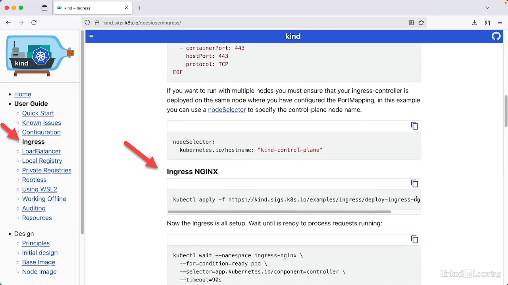

# 4.7 Installing NGINX ingress controller

**Installing NGINX Ingress Controller**

**1. What is an Ingress Controller?**

An **Ingress Controller** is a reverse proxy that manages external access to applications running inside a Kubernetes cluster.

- It receives incoming HTTP/HTTPS traffic.

- It routes requests to the appropriate Kubernetes services.

- It makes Kubernetes Ingress resources work.

- NGINX is one of the most popular Ingress Controller options.

**2. Installing NGINX Ingress Controller**

The instructor uses the Kind documentation to install NGINX Ingress Controller.

**Installation steps:**

1.  Open the Kind documentation: [https://kind.sigs.k8s.io](https://kind.sigs.k8s.io?utm_source=chatgpt.com)

2.  Navigate to the Ingress section.

3.  Find the NGINX Ingress section.

4.  Copy the installation command.

5.  Paste the command into your terminal and execute it.

> 

Kubernetes automatically creates the necessary resources, including:

- A namespace called ingress-nginx.

- An NGINX Ingress Controller deployment.

- A Service that provides access to the controller.

**3. Verify the Installation**

Check the deployment:

```bash

kubectl get deployment -n ingress-nginx

```

Check the services:

```bash

kubectl get services -n ingress-nginx

```

Check the pods:

```bash

kubectl get pods -n ingress-nginx

```

You should see the NGINX Ingress Controller running and ready.

**4. Understanding the Kubernetes Resources**

| **Resource** | **Purpose**                                         |
|--------------|-----------------------------------------------------|
| Namespace    | Organizes and isolates Kubernetes resources.        |
| Deployment   | Manages the NGINX Ingress Controller pods.          |
| Service      | Provides a single point of entry to the controller. |
| LoadBalancer | Exposes the service externally to the cluster.      |

**5. Understanding LoadBalancer**

The NGINX Ingress Controller uses a Kubernetes Service of type LoadBalancer.

- Exposes the controller outside the Kubernetes cluster.

- Provides an external IP address when supported by the environment.

- In cloud environments such as AWS and Azure, the IP can be externally accessible.

**6. Important Kubernetes Commands**

```bash

# Check Ingress Controller deployment
kubectl get deployment -n ingress-nginx

# Check Ingress Controller service
kubectl get service -n ingress-nginx

# Check Ingress Controller pods
kubectl get pods -n ingress-nginx

# Display all resources in the namespace
kubectl get all -n ingress-nginx

```

**7. Key Takeaways**

- **Ingress** defines how external HTTP/HTTPS traffic reaches Kubernetes services.

- **Ingress Controller** implements those routing rules.

- **NGINX** is a popular Ingress Controller.

- **Namespace** organizes the Ingress Controller resources.

- **Deployment** manages the controller pods.

- **Service** provides access to the controller.

- **LoadBalancer** exposes the controller externally when supported.

**Next lesson:** Test the Ingress resource installed earlier and verify that traffic is correctly routed to the application.

# [README](./../../../README.md)
