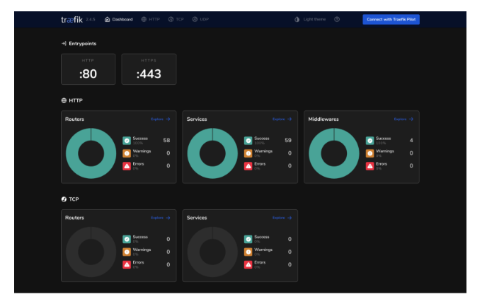

# 4.8 Popular Ingress controllers

**Popular Ingress Controllers**

There are several popular open-source and vendor-supplied Ingress controllers out there. This page outlines a few of them.

**HAProxy Ingress**

HAProxy is a popular open-source reverse proxy. Its Ingress controller is a great option for administrators who have prior experience with HAProxy, as you'll be able to reuse a lot of that knowledge here.

Click [**here**](https://haproxy-ingress.github.io/) to learn more about HAProxy Ingress.

**Traefik**

Traefik, originally a load balancer and service discovery tool for Docker networks, is a popular Ingress controller. It provides all of the same features as ingress-nginx as well as a nice GUI for observing Ingress controller behavior.

Click [**here**](https://doc.traefik.io/traefik/) to learn more about Traefik.

**Project Contour**

Contour is an Ingress controller based on the Envoy reverse proxy.

While nginx has robust reverse proxying capabilities, Envoy is an application that is dedicated to nothing but this. This can provide performance benefits at a lower resource footprint, which is useful for resource-constrained environments like edge computing.

Click [**here**](https://projectcontour.io/) to learn more about Project Contour.

**Cilium Ingress**

Cilium is a popular high-performance Container Network Interface. By leveraging Extended Berkeley Packet Filters (eBPF) for network operations and implementing advanced network functionality, such as multicluster meshing and BGP routing, it has become the CNI of choice for many enterprise Kubernetes installations.

However, Cilium also has Ingress capabilities! It supports many of the features available in ingress-nginx while also working closely with its CNI to offer some very cool features out of the box. It also supports Gateway, the next-generation of ingress networking within Kubernetes.

Click [**here**](https://docs.cilium.io/en/stable/network/servicemesh/ingress/#gs-ingress) to learn more about Cilium Ingress.

**Istio Ingress **

Istio is a service mesh platform. Service meshes provide Kubernetes administrators the ability to enhance network stability and resiliency without needing to change application behavior, such as application load balancing, transparent mutual TLS, and network path observability.

Istio also provides Ingress and Gateway capabilities. Since these also work together with Istio's service mesh capabilities, this is a good alternative for Kubernetes administrators looking to install service meshes.

**…and so many more!**

This is a small handful of the options out there for Kubernetes Ingress.

Click [**here**](https://docs.google.com/spreadsheets/d/191WWNpjJ2za6-nbG4ZoUMXMpUK8KlCIosvQB0f-oq3k/edit?usp=drivesdk) to check out a great spreadsheet comparing almost all of the open-source options out there!

# [README](./../../../README.md)
