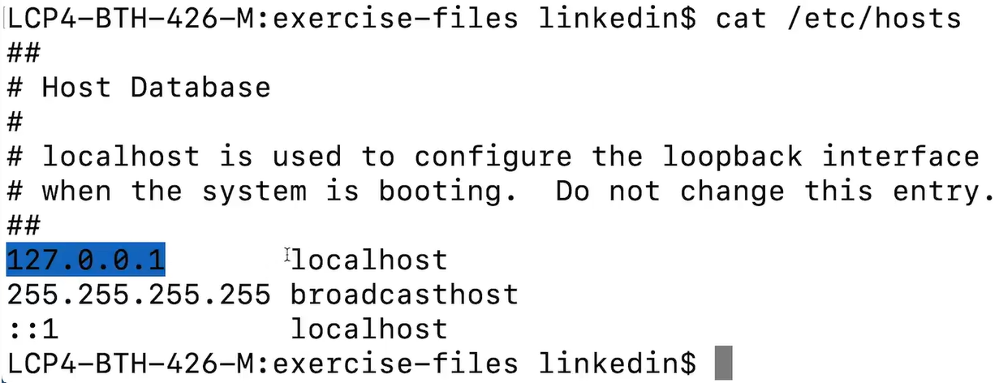
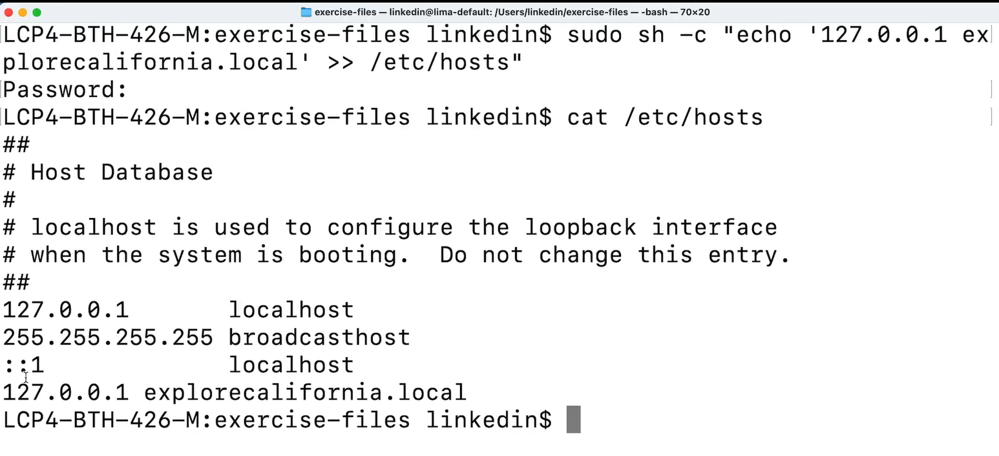
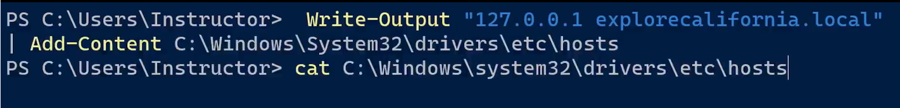
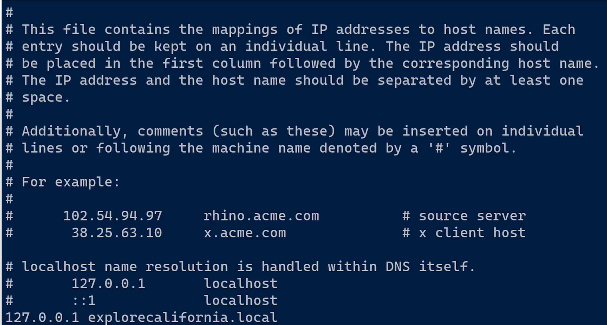
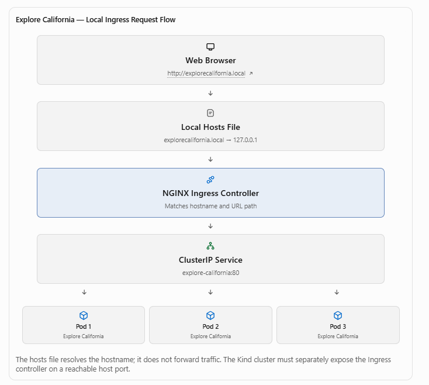

# 4.9 Testing your changes

**Testing Your Kubernetes Ingress Changes**

**1. Overview**

In this lesson, we learn how to test the NGINX Ingress Controller and verify that the Explore California application can be accessed through a custom hostname.

Previously, we created:

- A Deployment to run Explore California.

- A ClusterIP Service to provide internal access.

- An Ingress to define external routing rules.

- An NGINX Ingress Controller to process incoming HTTP requests.

Now we need to configure hostname resolution so our computer can access the application at:

http://explorecalifornia.local

**2. Verify the Kubernetes Ingress**

Run:

```bash

kubectl get ingress

```

Example output:

NAME CLASS HOSTS ADDRESS PORTS

explore-california nginx explorecalifornia.local localhost 80

Explanation:

| **Column** | **Description**                            |
|------------|--------------------------------------------|
| NAME       | Name of the Ingress resource               |
| CLASS      | Ingress controller class                   |
| HOSTS      | Hostname used to access the application    |
| ADDRESS    | Address reported by the Ingress controller |
| PORTS      | Ports exposed by the Ingress               |

The lesson shows that the Ingress now reports localhost as its address.

This indicates that the controller has updated the Ingress status, but we still need to test connectivity.

**3. Why Can't We Just Use localhost?**

The Ingress routing rule is configured for:

explorecalifornia.local

If we open:

http://localhost

The request uses the hostname localhost, which does not match the configured Ingress hostname.

The NGINX Ingress Controller uses the HTTP Host header to determine which Ingress rule applies.

We need our computer to resolve explorecalifornia.local to the address where the controller is reachable.

**4. Understanding the Hosts File**

A hosts file is a local operating system configuration file that maps hostnames to IP addresses.



For example:

127.0.0.1 localhost

127.0.0.1 explorecalifornia.local

This tells your computer that both names resolve to 127.0.0.1.

Unlike public DNS, hosts file mappings only affect the computer where they are configured.

**Hosts File Locations**

| **Operating system** | **File location**                     |
|----------------------|---------------------------------------|
| macOS                | /etc/hosts                            |
| Linux                | /etc/hosts                            |
| Windows              | C:\Windows\System32\drivers\etc\hosts |

**5. Configure the Hosts File on macOS or Linux**

Open a terminal and run:



```bash

echo "127.0.0.1 explorecalifornia.local" | sudo tee -a /etc/hosts

```

Command breakdown:

| **Component**           | **Description**                    |
|-------------------------|------------------------------------|
| echo                    | Prints the hostname mapping        |
| 127.0.0.1               | Local loopback IP address          |
| explorecalifornia.local | Custom hostname                    |
| sudo                    | Runs with administrator privileges |
| tee -a                  | Appends the mapping to the file    |
| /etc/hosts              | System hosts file                  |

Verify the change:

```bash

cat /etc/hosts

```

Expected entry:

127.0.0.1 explorecalifornia.local

**6. Configure the Hosts File on Windows**





Open PowerShell as Administrator.

Run:

```powershell

Add-Content -Path "C:\Windows\System32\drivers\etc\hosts" \`

    -Value "127.0.0.1 explorecalifornia.local"
```

This adds the hostname mapping to your Windows hosts file.

Verify:

```powershell

Get-Content "C:\Windows\System32\drivers\etc\hosts"

```

Expected entry:

127.0.0.1 explorecalifornia.local

Important: Administrator privileges are required to modify the Windows hosts file. Check whether the mapping already exists before adding it to avoid duplicates.

**7. Test the Explore California Application**

After updating your hosts file, open a browser and navigate to:

[http://explorecalifornia.local](http://explorecalifornia.local?utm_source=chatgpt.com)

If the Ingress controller is reachable on your computer's port 80, the Explore California website should appear.

You can also test the application using:

```bash

curl -I <http://explorecalifornia.local>

```

A successful response might look like:

HTTP/1.1 200 OK

Server: nginx

Content-Type: text/html

A 200 OK response indicates that the requested resource was served successfully.

**8. How the Complete Architecture Works**



**9. Troubleshooting Ingress Problems**

If the website does not load, use these commands.

| **Command** | **Purpose** |
|----|----|
| kubectl get ingress | Check Ingress status |
| kubectl describe ingress explore-california | Inspect routing rules and events |
| kubectl get pods -n ingress-nginx | Check Ingress controller Pods |
| kubectl get svc -n ingress-nginx | Inspect Ingress controller Services |
| kubectl get svc explore-california | Verify application Service |
| kubectl get endpointslices -l kubernetes.io/service-name=explore-california | Check application backend endpoints |
| kubectl get pods | Verify application Pods |

You can also test the hostname rule directly without editing the hosts file:

```bash

curl -H "Host: explorecalifornia.local" <http://127.0.0.1/>

```

This works only if the Ingress controller is reachable at 127.0.0.1:80.

If the connection is refused, check your Kind port mappings and controller exposure. If you receive 404 Not Found, check the Ingress hostname, path, class, and routing configuration.

**10. Local Hosts File vs. DNS**

| **Feature** | **Hosts file** | **DNS** |
|----|----|----|
| Scope | Individual computer | Network or internet |
| Configuration | Manual local entry | DNS records |
| Common use | Local development | Shared and production environments |
| Automatically available to other computers | No | Yes, when resolvable |
| Example | 127.0.0.1 explorecalifornia.local | Domain pointing to an external load balancer |

For a production deployment on AWS, Azure, or another cloud provider, you would typically configure a DNS record pointing to the external address of the Ingress controller or its load balancer.

**Key Takeaways**

1.  kubectl get ingress verifies the Ingress resource and its reported address.

2.  Ingress uses hostnames to match requests to routing rules.

3.  The hosts file maps a hostname to an IP address locally.

4.  127.0.0.1 refers to your own computer.

5.  Administrator privileges are required to edit system hosts files.

6.  curl can test HTTP connectivity and Ingress routing.

7.  Ingress controllers must be reachable from the client for routing to work.

8.  Production environments typically use DNS rather than manually editing hosts files.

**Most Important Commands to Remember**

```bash

# Check Ingress status
kubectl get ingress

# Check NGINX Ingress controller
kubectl get deployments -n ingress-nginx

# Check controller Service
kubectl get services -n ingress-nginx

# Verify application Service
kubectl get service explore-california

# Test hostname routing
curl -I <http://explorecalifornia.local>

```

**Main concept:** Testing a Kubernetes Ingress requires three things to work together: hostname resolution, a reachable Ingress controller, and correct routing to the application's Kubernetes Service.

# [README](./../../../README.md)
