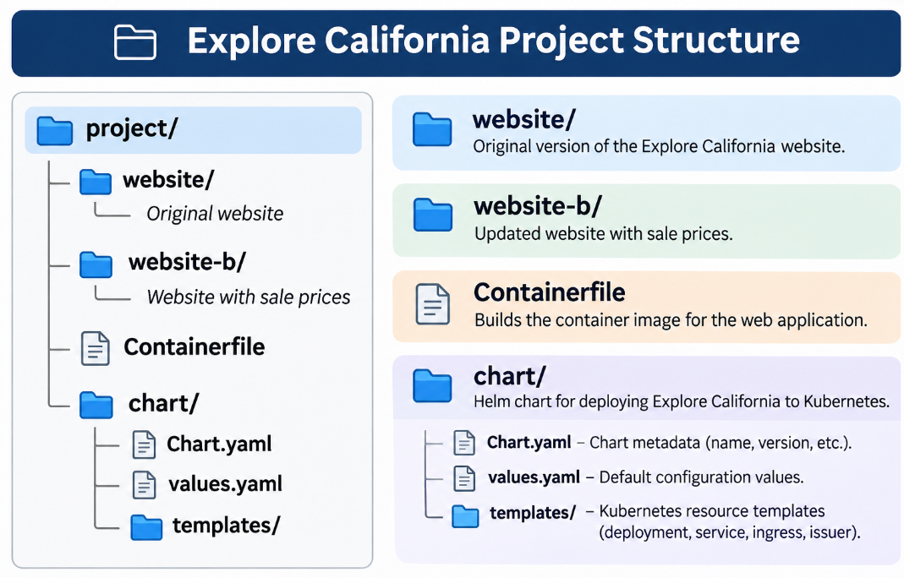
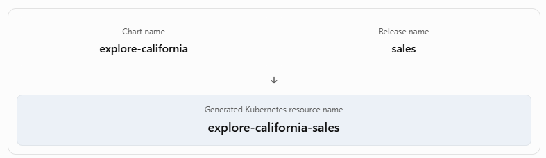
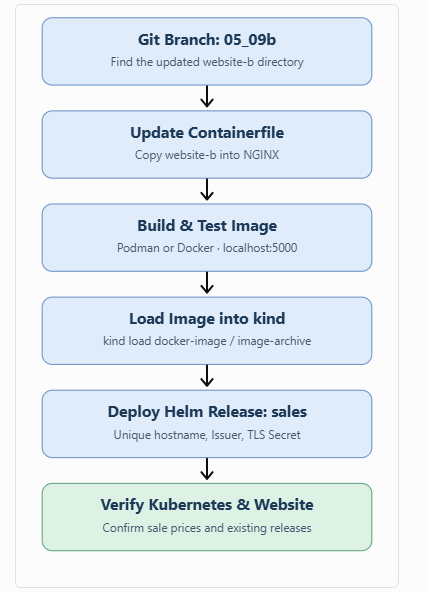

# 5.10 Solution Explore California sale

**Solution – Explore California Sale Challenge**

**1. Overview**

This lesson demonstrates how to deploy a new sale version of the Explore California website into Kubernetes using Podman or Docker, kind, and Helm.

The challenge requires updating the website with promotional prices while keeping all existing Explore California deployments running.

Main goal: Build a new container image, deploy it using a separate Helm release, and verify that the sale prices appear on the website.

**2. Step 1: Verify the Git Branch**

Check your current Git branch:

```bash

git branch --show-current

```

If necessary, switch to the challenge branch:

```bash

git checkout 05_09b

```

The branch contains the files needed for the sale deployment.

A new directory called website-b contains the updated website with promotional prices.



**3. Step 2: Update the Containerfile**

Modify the existing Containerfile so it copies the updated website.

Example:

```dockerfile

FROM nginx:alpine

COPY website-b/ /usr/share/nginx/html/

EXPOSE 80

```

The important change is:

```dockerfile

COPY website-b/ /usr/share/nginx/html/

```

This ensures that the new container image includes the sale prices instead of the original website.

**4. Step 3: Build the Sale Container Image**

Using Podman:

```bash

podman build -t explorecalifornia-sale .

```

Or Docker:

```bash

docker build -t explorecalifornia-sale .

```

This creates a new image named explorecalifornia-sale.

The original image remains available.

**5. Step 4: Test the Website Locally**

Run the new container:

```bash

podman run --rm -p 5000:80 explorecalifornia-sale

```

Open:

http://localhost:5000

Verify that the sale prices are displayed correctly.

| **Port** | **Purpose**           |
|----------|-----------------------|
| 5000     | Port on your computer |
| 80       | NGINX container port  |

This confirms that the updated website works before deploying it to Kubernetes.

**6. Step 5: Load the Image into kind**

Load the newly built image into the Kubernetes cluster.

For Docker:

```bash

kind load docker-image explorecalifornia-sale \
   --name explorecalifornia.com

```

If using Podman and the image is not available to Docker, save and load an archive:

bash

podman save -o explorecalifornia-sale.tar explorecalifornia-sale

```bash

kind load image-archive explorecalifornia-sale.tar \
   --name explorecalifornia.com

```

The --name option identifies the kind cluster.

Without it, kind may fail to find the intended cluster when multiple clusters exist.

**7. Step 6: Deploy a New Helm Release**

The challenge requires preserving all existing Explore California deployments.

To accomplish this, use a new Helm release named sales.

```bash
helm upgrade --install sales ./chart \
  --set image.name=localhost/explorecalifornia-sale:latest \
  --set image.pullPolicy=IfNotPresent \
  --set ingress.host=sales.explorecalifornia.local \
  --set ingress.issuerName=sales \
  --set ingress.tlsSecret=sales
```


The image name must match the image available inside the kind nodes. For this example, verify that the locally built image was loaded under localhost/explorecalifornia-sale:latest.

**Helm Configuration Explained**

| **Setting** | **Value** | **Purpose** |
|----|----|----|
| Release name | sales | Creates a separate Helm release |
| image.name | localhost/explorecalifornia-sale:latest | Uses the sale image |
| image.pullPolicy | IfNotPresent | Uses the locally loaded image |
| ingress.host | sales.explorecalifornia.local | Separate website hostname |
| ingress.issuerName | sales | Separate cert-manager Issuer |
| ingress.tlsSecret | sales | Separate TLS Secret |

**8. Step 7: Understand Helm Release Naming**

The chart uses Helm's built-in objects:

```yaml

name: {{ .Chart.Name }}-{{ .Release.Name }}

```

For example:



This naming convention allows multiple releases of the same Helm Chart to coexist.

**9. Step 8: Verify All Kubernetes Deployments**

Run:

```bash

kubectl get deployments

```

Expected deployments:

explore-california

explore-california-test

explore-california-sales

Check the other resources:

```bash

kubectl get services

kubectl get ingress

kubectl get issuer,certificates

```

Verify Helm releases:

```bash

helm list

```

The new sales release starts at revision 1, independently of the existing test release.

**10. Step 9: Configure the Hosts File**

For the local kind cluster, add a new hostname mapping.

**macOS / Linux**

```bash

sudo vim /etc/hosts

````

**Windows**

Open Notepad as Administrator:

```powershell

notepad C:\Windows\System32\drivers\etc\hosts

```

Add:

127.0.0.1 sales.explorecalifornia.local

This assumes the kind Ingress controller is exposed through localhost.

Open:

https://sales.explorecalifornia.local

Because the certificate is self-signed, the browser may display a security warning. Verify that it is your trusted local lab endpoint before proceeding.

**11. Step 10: Troubleshoot Incorrect Website Prices**

In the lesson, the new Helm release deployed successfully, but the website initially displayed the original prices.

Cause: The Helm Chart was still using the original container image.

The instructor corrected the problem by upgrading the sales release with the new image.

```bash

helm upgrade sales ./chart \
	--reuse-values \
	--set image.name=localhost/explorecalifornia-sale:latest
```

The --reuse-values option preserves the previous release configuration, including the custom hostname, Issuer, and TLS Secret.

Verify the image:

```bash

kubectl describe deployment explore-california-sales

```

Check that the Deployment references:

localhost/explorecalifornia-sale:latest

Check rollout status:

```bash

kubectl rollout status deployment/explore-california-sales

```

Refresh the browser to confirm that the promotional prices are now displayed.

**12. Complete Deployment Workflow**



**13. Common Commands**

| **Command** | **Purpose** |
|----|----|
| git branch --show-current | Check the current Git branch |
| git checkout 05_09b | Switch to the challenge branch |
| podman build -t explorecalifornia-sale . | Build the sale image |
| podman run --rm -p 5000:80 explorecalifornia-sale | Test locally |
| kind load docker-image ... --name explorecalifornia.com | Load Docker image into kind |
| helm upgrade --install sales ./chart | Install or upgrade the sale release |
| helm list | View Helm releases |
| kubectl get deployments | Verify application deployments |
| kubectl describe deployment explore-california-sales | Inspect the deployed image |
| kubectl rollout status deployment/explore-california-sales | Check rollout completion |

**Key Takeaways**

- Use a separate Helm release to deploy a new application version without replacing existing installations.

- The website-b directory contains the updated sale website.

- Docker or Podman packages the new website into a container image.

- kind must have access to the new image before Kubernetes can run it.

- Helm's .Chart.Name and .Release.Name simplify resource naming.

- --set allows you to override image names, hostnames, Issuers, and TLS Secrets.

- helm upgrade updates an existing release and creates a new revision.

- Always verify the deployed container image when the website does not show expected changes.

**Main lesson:** The Explore California sale challenge demonstrates how Helm releases, container images, and Kubernetes work together to deploy multiple versions of an application safely while preserving existing deployments.

**Next lesson**: Deploy Explore California to cloud-managed Kubernetes services on AWS and Azure.

# [README](./../../../README.md)
