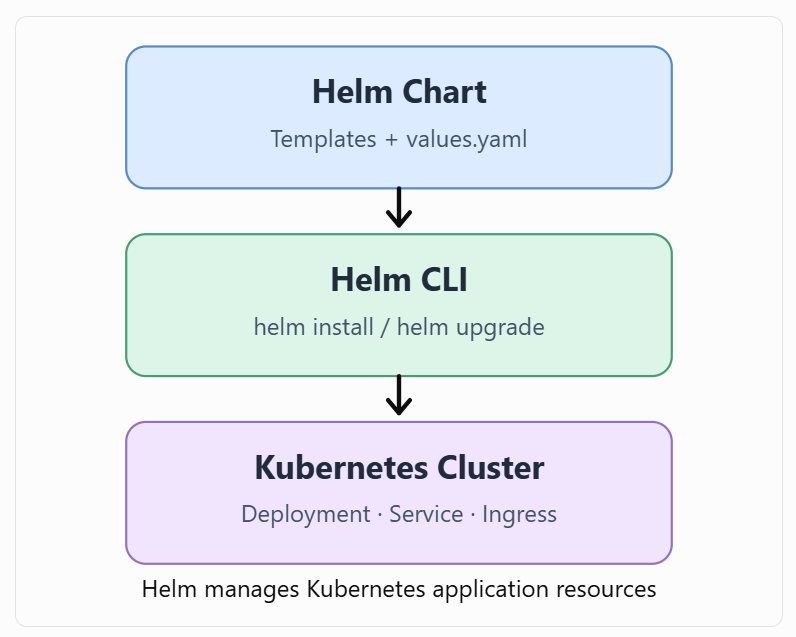

# 5.1 Why Helm

**Kubernetes Package Management with Helm**

**1. Introduction to Helm**

Course: Explore California – Kubernetes

Helm is a popular open-source Kubernetes package manager that simplifies deploying, configuring, upgrading, and managing applications in Kubernetes clusters.

In this lesson, we learn how to convert the existing Explore California Kubernetes resources into a Helm Chart.

**2. Why Use Helm?**

Previously, Explore California was deployed using Kubernetes commands such as:

```bash

kubectl create deployment explore-california

kubectl edit deployment explore-california

kubectl edit service explore-california

kubectl edit ingress explore-california

```

Managing Kubernetes resources manually creates several challenges:

- Repeatedly editing deployments, services, and ingress resources is time-consuming.

- Managing multiple YAML files becomes complicated.

- Some Kubernetes properties cannot be modified after resource creation.

- Reproducing the same configuration across environments is difficult.

Helm solves these problems by packaging Kubernetes YAML configurations into reusable, configurable templates.

**3. How Helm Works**



A Helm Chart contains Kubernetes resource templates and configuration values.

| **Component** | **Purpose**                                  |
|---------------|----------------------------------------------|
| Chart.yaml    | Defines chart metadata and version           |
| values.yaml   | Stores configurable application settings     |
| templates/    | Contains Kubernetes YAML templates           |
| Helm CLI      | Installs, upgrades, and manages applications |

**4. Three Steps to Create a Helm Chart**

1.  Create a Helm Chart

Use the Helm CLI to generate the initial chart structure.

```bash

helm create explore-california

```

2.  Extract Existing Kubernetes Resources

Export the current resource definitions.

```bash

kubectl get deployment explore-california -o yaml

kubectl get service explore-california -o yaml

kubectl get ingress explore-california -o yaml

```

Clean the exported YAML by removing cluster-generated metadata and runtime status fields, then convert the required definitions into Helm templates.

3.  Deploy the Application Using Helm

After configuring and validating the chart:

```bash

helm lint ./explore-california

helm install explore-california ./explore-california

```

If the existing Kubernetes resources are still present, first plan their migration or replacement to avoid Helm ownership conflicts.

**5. Common Helm Commands**

| **Command**                 | **When to use**             |
|-----------------------------|-----------------------------|
| helm create myapp           | Create a new chart          |
| helm lint ./myapp           | Validate chart structure    |
| helm template myapp ./myapp | Preview generated YAML      |
| helm install myapp ./myapp  | Install an application      |
| helm list                   | List installed releases     |
| helm upgrade myapp ./myapp  | Update an application       |
| helm rollback myapp 1       | Roll back to revision 1     |
| helm uninstall myapp        | Remove an installed release |

**6. Helm vs. kubectl**

| **kubectl** | **Helm** |
|----|----|
| Manages Kubernetes resources directly | Manages packaged applications |
| Usually uses individual YAML manifests | Uses charts with YAML templates |
| Updates resources with kubectl apply | Updates releases with helm upgrade |
| No built-in application release history | Maintains release revision history |
| Rollbacks depend on resource type and setup | Supports release rollback |

**Key Takeaways**

- Helm is a Kubernetes package manager.

- A Helm Chart packages application resources into reusable YAML templates.

- Helm simplifies installation, configuration, upgrades, and rollbacks.

- The Explore California application will be converted from manually managed Kubernetes resources into a Helm Chart.

- Helm helps maintain consistent application configurations across environments.

**Main lesson:** Instead of manually editing multiple Kubernetes resources every time an application changes, Helm allows you to manage the application as a single configurable package.

# [README](./../../../README.md)
