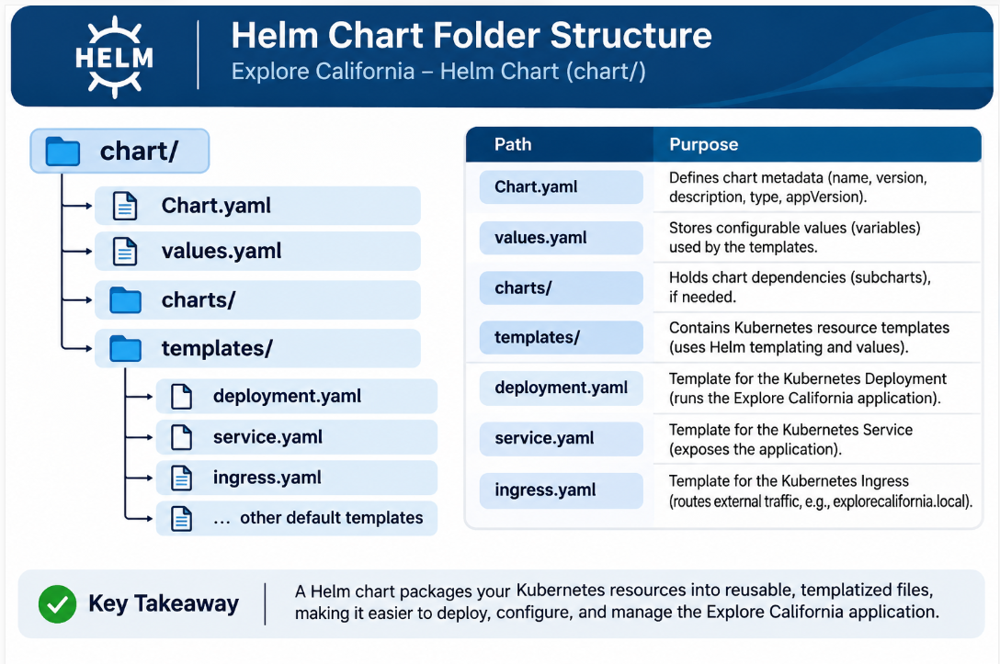

# 5.3 Initializing your chart

**Initializing Your Helm Chart**

**1. Overview**

This lesson explains how to initialize a Helm Chart for the Explore California website.

Helm automatically generates the basic files and directories needed to package and deploy applications to Kubernetes.

The goal is to create a clean Helm Chart that will later contain customized Kubernetes templates.

**2. Create the Helm Chart**

Run:

```bash

helm create chart

```

This creates a directory named chart containing the default Helm Chart files.

View the files:

```bash

ls chart

```

**Helm Chart Directory Structure**



| **File / Directory** | **Purpose**                               |
|----------------------|-------------------------------------------|
| Chart.yaml           | Defines chart metadata, name, and version |
| values.yaml          | Stores configurable variables             |
| charts/              | Contains chart dependencies               |
| templates/           | Contains Kubernetes YAML templates        |

**3. Configure Chart.yaml**

Open the file:

```bash

vim chart/Chart.yaml

```

Update its contents:

```bash

apiVersion: v2
name: explore-california
description: Chart to deploy the Explore California website
type: application
version: 1.0.0
appVersion: "1.0.0"

```

**Explanation**

| **Property**        | **Description**                               |
|---------------------|-----------------------------------------------|
| apiVersion: v2      | Helm chart API version                        |
| name                | Name of the Helm Chart                        |
| description         | Describes the chart's purpose                 |
| type: application   | Indicates an application chart                |
| version: 1.0.0      | Version of the Helm Chart                     |
| appVersion: "1.0.0" | Version of the Explore California application |

Important: version tracks changes to the Helm Chart, while appVersion tracks the application version. They do not need to match.

**4. Configure values.yaml**

Open:

```bash

vim chart/values.yaml

```

The values.yaml file stores configuration variables used by Helm templates.

For example:

```bash

replicaCount: 1

image:
  repository: explore-california
  tag: "1.0.0"

service:
  port: 8080


```

These values can later be referenced inside Helm templates using expressions such as:

```bash

replicas: {{ .Values.replicaCount }}

```

For this lesson: Delete the default contents of values.yaml and leave the file empty. Configuration values will be added in upcoming lessons.

**5. Remove Default Templates**

Helm automatically generates several templates.

Since the course will create custom Kubernetes templates, remove the generated files:

```bash

rm -r chart/templates/*

```

Verify the directory is empty:

```bash

ls chart/templates

```

No output indicates the directory is empty.

Note: This removes the default non-hidden files and directories inside templates/. Run it only when you intend to discard the generated templates.

**6. Final Helm Chart Structure**

After initialization and cleanup:


The chart is now ready for custom Kubernetes templates.

**7. Important Helm Commands**

| **Command**              | **Purpose**                                  |
|--------------------------|----------------------------------------------|
| helm create chart        | Generate a Helm Chart                        |
| ls chart                 | List chart files                             |
| vim chart/Chart.yaml     | Edit chart metadata                          |
| vim chart/values.yaml    | Edit chart variables                         |
| ls chart/templates       | List template files                          |
| rm -r chart/templates/\* | Remove generated templates                   |
| helm lint chart          | Validate the chart after templates are added |

**Key Takeaways**

- Helm Charts package Kubernetes resources into reusable configurations.

- Chart.yaml describes the chart.

- values.yaml defines configurable values.

- templates/ stores Kubernetes resource templates.

- Chart versions and application versions are separate.

- Removing the default templates prepares the chart for custom resources.

**Next lesson:** Convert the existing Explore California Kubernetes Deployment into a reusable Helm template.

# [README](./../../../README.md)
