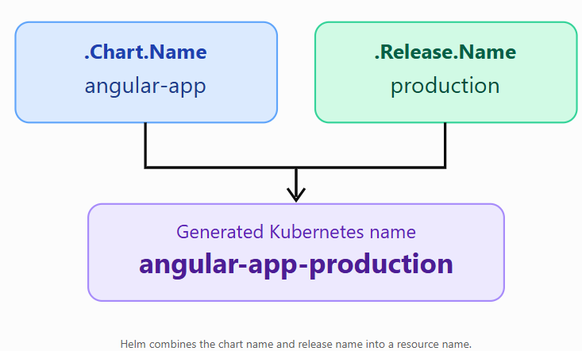
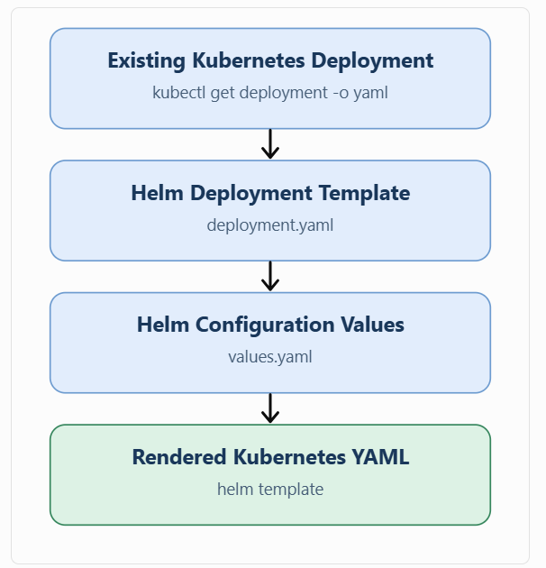

# 5.4 Templatizing the deployment

**Templatizing the Deployment with Helm**

**1. Overview**

This lesson explains how to convert the existing Explore California Kubernetes Deployment into a reusable Helm template.

Instead of hardcoding Kubernetes configuration values, Helm uses variables and built-in objects to make deployments flexible across different environments.

The process involves three main steps:

1.  Export the existing Kubernetes Deployment YAML.

2.  Replace hardcoded properties with Helm template expressions.

3.  Test the generated Kubernetes YAML using helm template.

**2. Export the Kubernetes Deployment**

Run:

```bash

kubectl get deployment explore-california -o yaml > ./chart/templates/deployment.yaml

```

This command retrieves the existing Deployment and saves its YAML configuration.

| **Command**                     | **Purpose**                         |
|---------------------------------|-------------------------------------|
| kubectl get deployment          | Retrieves a Kubernetes Deployment   |
| explore-california              | Deployment name                     |
| -o yaml                         | Outputs the resource in YAML format |
| >                              | Redirects output into a file        |
| chart/templates/deployment.yaml | Destination file                    |

**3. Clean Up the Deployment YAML**

Open the exported file:

```bash

vim chart/templates/deployment.yaml

```

Remove unnecessary cluster-generated fields, including:

- annotations (only those not needed)

- creationTimestamp

- generation

- resourceVersion

- uid

- status

These fields generally should not be included in reusable Helm templates.

Important: Keep essential Kubernetes fields such as apiVersion, kind, metadata.name, spec, selectors, and Pod templates.

**4. Configure Helm Values**

Open:

```bash

vim chart/values.yaml

```

Create configurable values:

```yaml
replicas: 1

image:
  name: explore-california:latest
  pullPolicy: IfNotPresent

ports:
  source: 80

```

The image name above is illustrative. Use the actual image name and tag loaded into your kind cluster.

**Explanation**

| **Helm Value**   | **Purpose**                |
|------------------|----------------------------|
| replicas         | Number of application Pods |
| image.name       | Container image name       |
| image.pullPolicy | Controls image downloading |
| ports.source     | Application container port |

**5. Understand Helm Template Expressions**

Helm uses double curly braces to insert dynamic values into YAML.

For example:

```yaml

replicas: {{ .Values.replicas }}

```

Helm reads the value from values.yaml and substitutes it when generating the Kubernetes manifest.

**Helm Built-in Objects**

| **Object**                     | **Description**               |
|--------------------------------|-------------------------------|
| {{ .Chart.Name }}              | Returns the chart name        |
| {{ .Release.Name }}            | Returns the Helm release name |
| {{ .Values.replicas }}         | Reads the replica count       |
| {{ .Values.image.name }}       | Reads the container image     |
| {{ .Values.image.pullPolicy }} | Reads the image pull policy   |

For example:

```yaml

name: {{ .Chart.Name }}-{{ .Release.Name }}

```

If the chart is named explore-california and the release is named production, the generated name becomes:

```yaml

name: explore-california-production

```

**6. Example Helm Deployment Template**

File: chart/templates/deployment.yaml

```yaml
apiVersion: apps/v1
kind: Deployment

metadata:
  name: {{ .Chart.Name }}-{{ .Release.Name }}
  labels:
    app: {{ .Chart.Name }}-{{ .Release.Name }}

spec:
  replicas: {{ .Values.replicas }}

  selector:
    matchLabels:
      app: {{ .Chart.Name }}-{{ .Release.Name }}

  template:
    metadata:
      labels:
        app: {{ .Chart.Name }}-{{ .Release.Name }}

    spec:
      containers:
        - name: {{ .Chart.Name }}-{{ .Release.Name }}

          image: {{ .Values.image.name | quote }}

          imagePullPolicy: {{ .Values.image.pullPolicy }}

          ports:
            - containerPort: {{ .Values.ports.source }}

```

This template allows the application configuration to change without manually modifying the Deployment YAML.

**Understanding Helm Templates in Kubernetes**

In Kubernetes Helm, the expression:

```

{{ .Chart.Name }}-{{ .Release.Name }}

```



**2. How Helm generates the name**

In Kubernetes Helm, .Release.Name **is not defined in a YAML file.**

Helm automatically assigns .Release.Name when you install or upgrade a Helm chart.

**1. Where does .Release.Name come from?**

When you run:

```bash

helm install production ./angular-app

```

- production = .Release.Name

- ./angular-app = Helm chart directory

Therefore:

```

{{ .Release.Name }}

```

Becomes:

production

**Example: Chart.yaml**

Your Helm chart contains a Chart.yaml file:

```yaml
apiVersion: v2
name: angular-app
description: Helm chart for Angular application
type: application
version: 1.0.0
appVersion: "1.0"

```

The important property is:

```yaml

name: angular-app

```

This determines the value of .Chart.Name.

**7. Test the Helm Template**

Use:

```bash

helm template production ./chart

```

This generates Kubernetes YAML from the Helm Chart without installing anything into the cluster.

For example, Helm converts:

```yaml
replicas: {{ .Values.replicas }}
```

Into:

```yaml
replicas: 1
```


You can also override values:

```bash

helm template production ./chart --set replicas=3

```

The resulting YAML contains:

```yaml

replicas: 3

```

This makes Helm especially useful for development, testing, and production environments.

**8. Helm Deployment Workflow**



**9. Common Commands**

| **Command** | **When to use** |
|----|----|
| kubectl get deployment explore-california -o yaml | Export an existing Deployment |
| vim chart/templates/deployment.yaml | Edit the Deployment template |
| vim chart/values.yaml | Configure Helm variables |
| helm lint ./chart | Check chart validity |
| helm template production ./chart | Preview generated manifests |
| helm install production ./chart | Install the chart |
| helm upgrade production ./chart | Update an existing Helm release |

**Key Takeaways**

- Helm templates replace hardcoded Kubernetes settings with dynamic variables.

- values.yaml stores configurable application settings.

- .Values accesses configuration values.

- .Chart.Name and .Release.Name provide built-in naming information.

- helm template tests generated Kubernetes YAML without deploying it.

- The same Helm Chart can be reused across multiple environments with different configurations.

Main lesson: Templatizing the Explore California Deployment makes it easier to manage container images, replica counts, ports, and application names without repeatedly editing Kubernetes resources.

Next lesson: Use helm template to validate the Explore California Deployment before installing it into Kubernetes.

# [README](./../../../README.md)
