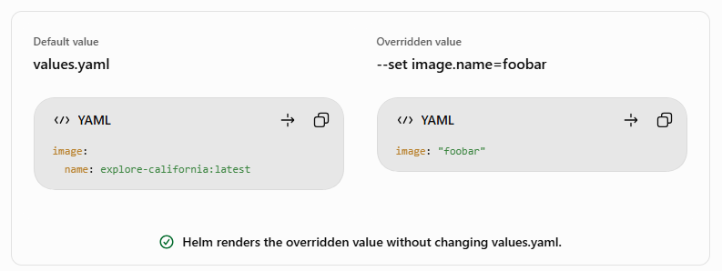

# 5.5 Testing your templates

**Testing Your Helm Templates**

**1. Overview**

This lesson explains how to test and validate Helm templates before deploying an application to Kubernetes.

After creating the Explore California Deployment template, we use the helm template command to generate Kubernetes YAML and verify that Helm correctly replaces template variables with their configured values.

Main goal: Confirm that Helm templates generate the expected Kubernetes configurations without installing anything into the cluster.

**2. Render the Helm Template**

Run:

```bash

helm template test ./chart

```

**Command Explanation**

| **Component** | **Purpose**                                   |
|---------------|-----------------------------------------------|
| helm          | Helm command-line tool                        |
| template      | Generates Kubernetes YAML from Helm templates |
| test          | Helm release name used for rendering          |
| ./chart       | Location of the Helm Chart                    |

Helm reads the chart templates and values.yaml, then generates the final Kubernetes manifests.

**3. View the Generated YAML**

Helm may generate a large amount of YAML.

To review the output page by page, run:

```bash

helm template test ./chart | less

```

The | symbol sends the output from Helm to the less pager.

Useful navigation commands:

| **Key** | **Action**       |
|---------|------------------|
| Space   | Next page        |
| b       | Previous page    |
| /image  | Search for image |
| n       | Find next match  |
| q       | Exit             |

**4. Verify Helm Template Values**

Suppose Chart.yaml contains:

```yaml

name: explore-california
version: 1.0.0
appVersion: "1.0.0"

```

And values.yaml contains:

```yaml

replicas: 1

image:
  name: explore-california:latest
  pullPolicy: IfNotPresent

ports:
  source: 80
  
```


The Deployment template references:

```yaml

metadata:
	name: {{ .Chart.Name }}-{{ .Release.Name }}

spec:
	replicas: {{ .Values.replicas }}

```

When running:

```bash

helm template test ./chart

```

```yaml

Helm generates:
metadata:
  name: explore-california-test

spec:
  replicas: 1


```

The release name test comes from the command, while explore-california comes from Chart.yaml.

**5. Override Values Using --set**

Helm allows you to override configuration values directly from the command line.

For example:

```bash

helm template test ./chart --set image.name=foobar

```

This temporarily overrides the image.name value defined in values.yaml.



This feature is useful when deploying the same application to development, testing, and production environments.

**6. Additional Helm Validation Commands**

| **Command** | **Purpose** |
|----|----|
| helm template test ./chart | Render Kubernetes YAML |
| helm template test ./chart \\ less | Review output page by page |
| helm template test ./chart --set replicas=3 | Test three replicas |
| helm template test ./chart --set image.name=foobar | Test a different container image |
| helm lint ./chart | Check for common chart problems |
| helm install test ./chart --dry-run=client --debug | Simulate installation and inspect rendered output |

Important: Successfully rendering a Helm template does not guarantee that the application will deploy successfully. Kubernetes resource validation, image availability, and cluster configuration must also be checked.

**7. Why Testing Helm Templates Matters**

Testing Helm templates helps developers:

- Verify that variables are replaced correctly.

- Confirm application names and labels.

- Check replica counts, container images, and ports.

- Test configuration changes without modifying the Kubernetes cluster.

- Reuse charts across different environments, including local kind clusters, AWS, and Azure.

**Key Takeaways**

- helm template renders Helm Charts into Kubernetes YAML without deploying them.

- less makes large YAML output easier to inspect.

- --set overrides values from values.yaml for the current command.

- .Chart.Name provides the chart name.

- .Release.Name provides the release name.

- Testing templates helps identify configuration mistakes before deployment.

Main lesson: Helm makes Kubernetes deployments more flexible by allowing configuration values to be changed dynamically without manually editing Kubernetes YAML files.

Next lesson: Convert the Explore California Kubernetes Service and Ingress resources into Helm templates.

# [README](./../../../README.md)
