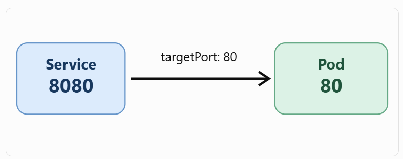
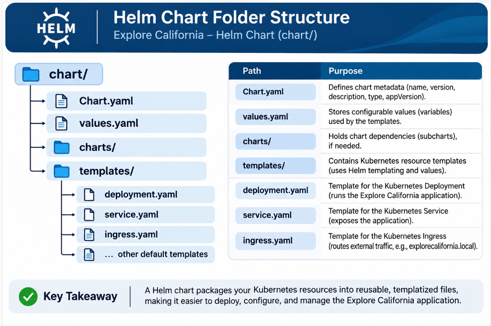

# 5.6 Templatizing the service and ingress

**Templatizing the Service and Ingress with Helm**

**1. Overview**

This lesson explains how to convert the existing Explore California Kubernetes Service and Ingress resources into reusable Helm templates.

Previously, we created a Helm template for the Deployment. Now we will configure the Service and Ingress to use dynamic Helm values.

Main goal: Make Kubernetes networking, ports, hostnames, and HTTPS certificate settings configurable through values.yaml.

**2. Export the Kubernetes Service**

Run:

```bash

kubectl get service explore-california -o yaml > chart/templates/service.yaml

```

This exports the existing Kubernetes Service configuration into the Helm Chart.

Open the file:

```bash

vim chart/templates/service.yaml

```

Remove cluster-generated properties that should not be included in reusable templates, such as:

- creationTimestamp

- resourceVersion

- uid

- clusterIP and clusterIPs

- ipFamilies and ipFamilyPolicy

- status

Keep the necessary Service configuration, including metadata, selector, ports, and type.

**3. Configure Service Port Values**

Update chart/values.yaml:

```yaml
ports:
  source: 80
  service: 8080

```

| **Value**     | **Description**                        |
|---------------|----------------------------------------|
| ports.source  | Container port used by the application |
| ports.service | Port exposed by the Kubernetes Service |

**Example Service Template**

File: chart/templates/service.yaml

```yaml
apiVersion: v1
kind: Service

metadata:
  name: {{ .Chart.Name }}-{{ .Release.Name }}

spec:
  type: ClusterIP

  selector:
    app: {{ .Chart.Name }}-{{ .Release.Name }}

  ports:
    - name: http
      port: {{ .Values.ports.service }}
      targetPort: {{ .Values.ports.source }}
      protocol: TCP

```


This configuration routes traffic from Service port 8080 to application container port 80.



**4. Export the Kubernetes Ingress**

Run:

```bash

kubectl get ingress explore-california -o yaml > chart/templates/ingress.yaml

```

Open the file:

```bash

vim chart/templates/ingress.yaml

```

Remove unnecessary cluster-generated metadata and the status section.

Important: Keep the annotations required for HTTPS and cert-manager.

**5. Configure Ingress Values**

Add the following settings to values.yaml:

```yaml
ingress:
  host: explorecalifornia.local
  issuerName: explore-california-issuer
  tlsSecret: explore-california-tls

```

| **Value**          | **Purpose**                                      |
|--------------------|--------------------------------------------------|
| ingress.host       | Domain name used to access the website           |
| ingress.issuerName | cert-manager Issuer responsible for certificates |
| ingress.tlsSecret  | Kubernetes Secret containing the TLS certificate |

The issuer and secret names are examples; they must match the resources used by your cluster.

**6. Example Ingress Template**

File: chart/templates/ingress.yaml

```yaml
apiVersion: networking.k8s.io/v1
kind: Ingress

metadata:
  name: {{ .Chart.Name }}-{{ .Release.Name }}

  annotations:
    cert-manager.io/issuer: {{ .Values.ingress.issuerName | quote }}

spec:
  ingressClassName: nginx

  tls:
    - hosts:
        - {{ .Values.ingress.host | quote }}
      secretName: {{ .Values.ingress.tlsSecret | quote }}

  rules:
    - host: {{ .Values.ingress.host | quote }}
      http:
        paths:
          - path: /
            pathType: Prefix
            backend:
              service:
                name: {{ .Chart.Name }}-{{ .Release.Name }}
                port:
                  number: {{ .Values.ports.service }}

```


Important correction: The Ingress backend must reference the Service port (8080), not the container port (80), when those ports are different.

The cert-manager annotation tells cert-manager which namespace-scoped Issuer to use. If using a ClusterIssuer instead, the annotation should be cert-manager.io/cluster-issuer.

**7. Final values.yaml Configuration**

After combining the Deployment, Service, and Ingress settings:

```yaml
replicas: 1

image:
  name: explore-california:latest
  pullPolicy: IfNotPresent

ports:
  source: 80
  service: 8080

ingress:
  host: explorecalifornia.local
  issuerName: explore-california-issuer
  tlsSecret: explore-california-tls

```

This centralizes the application configuration into one file.

**8. Test All Helm Templates**

Run:

```bash

helm template test ./chart | less

```

Helm generates Kubernetes manifests for the Deployment, Service, and Ingress.

Verify that:

- The Deployment has the correct container image and replica count.

- The Service uses port 8080 and targetPort 80.

- The Ingress points to the correct Service name and port.

- The hostname is explorecalifornia.local.

- The TLS Secret and certificate issuer are configured correctly.

You can also validate the chart:

```bash

helm lint ./chart

```

**9. Helm Chart Directory Structure**



The chart now contains three Kubernetes resource templates.

**10. Common Commands**

| **Command** | **Purpose** |
|----|----|
| kubectl get service explore-california -o yaml | Export the Service |
| kubectl get ingress explore-california -o yaml | Export the Ingress |
| vim chart/values.yaml | Configure Helm values |
| helm template test ./chart | Generate Kubernetes manifests |
| helm template test ./chart \| less | Review generated YAML |
| helm lint ./chart | Validate chart configuration |

**Key Takeaways**

- Helm makes Service and Ingress configurations reusable and configurable.

- values.yaml centralizes application settings.

- The Service exposes port 8080 and forwards traffic to container port 80.

- Ingress routes external HTTPS traffic to the Kubernetes Service.

- cert-manager annotations and TLS Secrets support HTTPS.

- helm template verifies the generated YAML without deploying the application.

Main lesson: By converting the Deployment, Service, and Ingress into Helm templates, Explore California can be deployed into different Kubernetes environments without manually rewriting its resource configurations.

Next lesson: Add the cert-manager Issuer resource to the Helm Chart so the application can manage its HTTPS certificate configuration alongside the other Kubernetes resources.

# [README](./../../../README.md)
