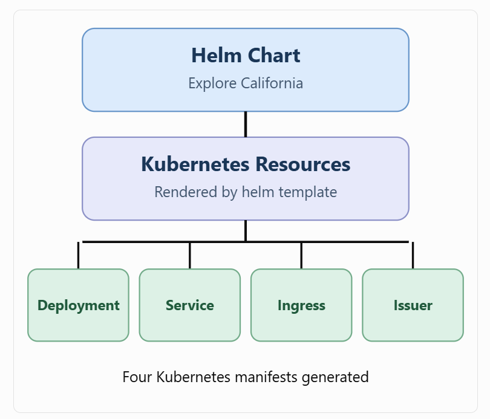
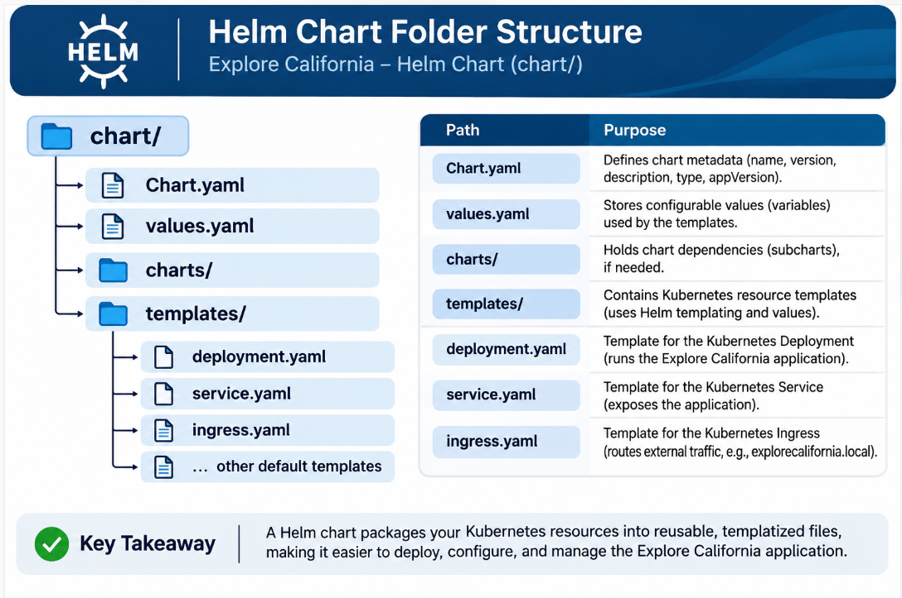

# 5.7 Templatizing the cert-manager issuer

**Templatizing the cert-manager Issuer with Helm**

**1. Overview**

This lesson explains how to convert the existing cert-manager Issuer into a reusable Helm template for the Explore California application.

The Issuer is responsible for defining how TLS certificates are issued for HTTPS connections.

Previously, we created Helm templates for:

- Kubernetes Deployment

- Kubernetes Service

- Kubernetes Ingress

Now we will add the cert-manager Issuer to complete the Helm Chart.

**2. Export the Existing Issuer**

Run:

```bash

kubectl get issuer explorecalifornia-ingress -o yaml > chart/templates/issuer.yaml

```

| **Command**                 | **Purpose**                              |
|-----------------------------|------------------------------------------|
| kubectl get issuer          | Retrieves a cert-manager Issuer          |
| explorecalifornia-ingress   | Name of the existing Issuer              |
| -o yaml                     | Outputs the Issuer configuration in YAML |
| >                          | Saves the output into a file             |
| chart/templates/issuer.yaml | Helm template destination                |

**3. Open the Issuer and Values Files**

Use Vim to open both files side by side:

```bash

vim -O chart/values.yaml chart/templates/issuer.yaml

```

This allows you to edit Helm values and the Issuer template simultaneously.

Useful Vim commands:

| **Command**      | **Purpose**            |
|------------------|------------------------|
| Ctrl + W, then W | Switch between windows |
| :w               | Save changes           |
| :wq              | Save and exit          |
| :q!              | Exit without saving    |

**4. Clean Up the Issuer YAML**

Remove unnecessary Kubernetes-generated properties:

- creationTimestamp

- generation

- resourceVersion

- uid

- status

Keep the essential configuration:

```yaml
apiVersion: cert-manager.io/v1
kind: Issuer
metadata:
  name: explorecalifornia-ingress
spec:
  selfSigned: {}

```

This example represents a self-signed Issuer, as used in the Explore California HTTPS exercise.

**5. Replace Hardcoded Values with Helm Templates**

Instead of hardcoding the Issuer name, reference values.yaml.

**values.yaml**

```yaml
ingress:
  host: explorecalifornia.local
  issuerName: explorecalifornia-ingress
  tlsSecret: explore-california-tls
```

**templates/issuer.yaml**

```yaml
apiVersion: cert-manager.io/v1
kind: Issuer

metadata:
  name: {{ .Values.ingress.issuerName }}

spec:
  selfSigned: {}

```

Helm replaces:

```yaml

name: {{ .Values.ingress.issuerName }}

```

With:

```yaml

name: explorecalifornia-ingress

```

Important: The Issuer name must match the name referenced by the Ingress annotation cert-manager.io/issuer.

**6. Test the Helm Chart**

Run:

```bash

helm template test ./chart | less

```

This generates the Kubernetes YAML without deploying resources into the cluster.

The rendered output should contain four resources:



**7. Troubleshooting Helm Template Errors**

During the lesson, the instructor encountered a nil pointer error caused by a misspelled Helm expression.

Incorrect:

```yaml

name: {{ .Value.ingress.issuerName }}

````

Correct:

```ymal

name: {{ .Values.ingress.issuerName }}

```

Helm uses .Values with a capital V and an s at the end.

Other common problems include missing configuration keys, incorrect capitalization, and invalid YAML formatting.

To troubleshoot:

```bash

helm template test ./chart –debug

```

You can also check the chart:

```bash

helm lint ./chart

```

Note that successful rendering does not verify that cert-manager is installed or that certificates can actually be issued.

**8. Final Helm Chart Directory Structure**



The Helm Chart now includes the resources needed for the Explore California application and its HTTPS configuration.

Before deployment, cert-manager and the required Ingress controller must already be installed in the Kubernetes cluster.

**9. Common Commands**

| **Command** | **Purpose** |
|----|----|
| kubectl get issuer | List existing Issuers |
| kubectl get issuer explorecalifornia-ingress -o yaml | Export Issuer configuration |
| vim chart/templates/issuer.yaml | Edit Issuer template |
| helm template test ./chart | Render all Helm templates |
| helm template test ./chart \\ less | Review generated YAML |
| helm template test ./chart --debug | Troubleshoot rendering errors |
| helm lint ./chart | Check Helm Chart configuration |

**Key Takeaways**

- cert-manager Issuers define how TLS certificates are issued.

- The Issuer can be managed as part of a Helm Chart.

- .Values.ingress.issuerName makes the Issuer name configurable.

- helm template helps identify incorrect Helm expressions.

- A nil pointer error may indicate a misspelled or missing configuration value.

- The Explore California Helm Chart now includes Deployment, Service, Ingress, and Issuer templates.

**Main lesson:** By adding the cert-manager Issuer to the Helm Chart, Explore California can manage its application resources and HTTPS certificate configuration together through Helm.

**Next lesson:** Deploy the completed Explore California Helm Chart into the Kubernetes cluster.

# [README](./../../../README.md)
