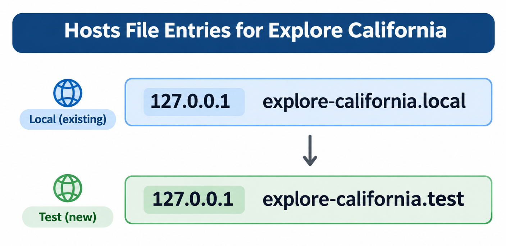
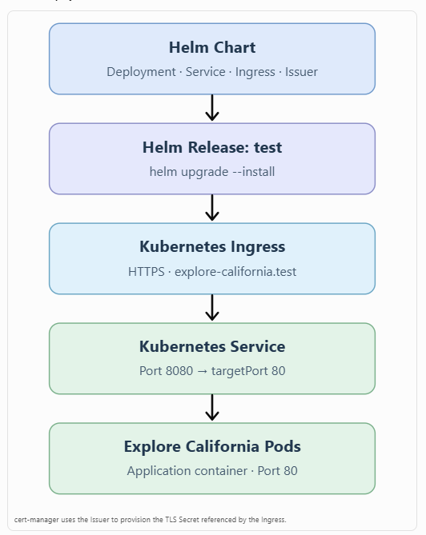

# 5.8 Deploying your Helm chart

**Deploying Your Helm Chart in Kubernetes**

**1. Overview**

This lesson demonstrates how to deploy the completed Explore California Helm Chart into a Kubernetes cluster.

After creating and testing the Deployment, Service, Ingress, and cert-manager Issuer templates, the next step is to install the chart and verify that the application works over HTTPS.

Main goal: Deploy Explore California using Helm, manage application revisions, avoid resource conflicts, and verify HTTPS connectivity.

**2. Three Ways to Deploy a Helm Chart**

Helm supports several deployment approaches.

| **Method** | **Command** | **Purpose** |
|----|----|----|
| Render and apply | helm template test ./chart \\ kubectl apply -f - | Deploy YAML without Helm release tracking |
| Install | helm install test ./chart | Create a new Helm release |
| Upgrade or install | helm upgrade --install test ./chart | Install if missing; otherwise upgrade |

Recommended for this lesson:

```bash

helm upgrade --install test ./chart

```

This command automatically determines whether to install or upgrade the Helm release.

Unlike applying rendered YAML directly with kubectl, Helm tracks release revisions and supports rollback.

**3. Resolve Existing Resource Conflicts**

The first installation may fail because Kubernetes resources already exist.

For example, the original cert-manager Issuer:

explorecalifornia-ingress

Helm generally cannot adopt existing resources unless they have the required Helm ownership metadata.

To avoid conflicts, override the Issuer name and Ingress hostname:

```bash

helm upgrade --install test ./chart \
    --set ingress.issuerName=test \
	--set ingress.host=explore-california.test
	
```

This creates a separate Issuer and Ingress configuration for the new Helm release.

Changing the hostname is important because two Ingress resources should not claim the same host and path on the same Ingress controller.

**4. Understand Helm Release Revisions**

Each successful Helm installation or upgrade creates a release revision.

| **Revision** | **Action**                     |
|--------------|--------------------------------|
| 1            | Initial installation           |
| 2            | Change Issuer name to test2    |
| 3            | Change TLS Secret name to test |

Example upgrade:

```bash

helm upgrade --install test ./chart \
  --set ingress.issuerName=test2 \
  --set ingress.host=explore-california.test \
  --set ingress.tlsSecret=test
  
```


Helm upgrades the existing release instead of creating a completely new release.

Check release history:

```bash

helm history test

```

Note: Helm revisions record changes to the release; they do not necessarily indicate that all Pods or resources were recreated.

**5. Verify Kubernetes Resources**

After installation, verify that the Kubernetes resources were created.

```bash

kubectl get deployments

kubectl get services

kubectl get ingress

kubectl get issuer,certificates

```

Expected application resources include:

| **Resource**           | **Example name**        |
|------------------------|-------------------------|
| Deployment             | explore-california-test |
| Service                | explore-california-test |
| Ingress                | explore-california-test |
| Issuer                 | test2                   |
| TLS Certificate/Secret | test                    |

The resource naming convention is:

```bash

name: {{ .Chart.Name }}-{{ .Release.Name }}

```

For this release:



This convention makes Helm-managed Kubernetes resources easier to identify.

**6. Verify the TLS Certificate**

The instructor discovered that the new Ingress initially reused the original TLS Secret.

To prevent that, the Helm command was updated with:

```bash

--set ingress.tlsSecret=test

```

This configures the new Ingress to use a different TLS Secret.

Verify the certificate and Issuer:

```bash

kubectl get issuer,certificates

```

Inspect the Ingress:

```bash

kubectl describe ingress explore-california-test

```

Check that the TLS configuration references the expected Secret:

```yaml
tls:
  - hosts:
      - explore-california.test
    secretName: test
```


Important: Changing the Secret name alone does not guarantee that a certificate will be issued. cert-manager must be installed and configured correctly, and the Ingress must contain the appropriate issuer annotation.

**7. Configure Local DNS Resolution**

To access the application using its hostname, update the computer's hosts file.

For a local kind cluster configured to expose the Ingress controller on localhost, add:

127.0.0.1 explore-california.test

**macOS / Linux**

```bash

sudo vim /etc/hosts

```

**Windows**

Open PowerShell as Administrator:

```powershell

notepad C:\Windows\System32\drivers\etc\hosts

```

Add the same entry and save the file.

This maps the hostname to your local machine. It does not configure DNS for other computers.

**8. Test the Application in a Browser**

Open:

https://explore-california.test

Expected behavior:

1.  The browser connects to the local Kubernetes Ingress.

2.  The Ingress routes HTTPS traffic to the Explore California Service.

3.  The Service forwards requests to the application Pods.

4.  The website loads successfully.

Because the lesson uses a self-signed certificate, the browser may display a certificate warning.

For this controlled local lab, you can inspect the certificate and proceed if you trust the local endpoint. Production environments should use certificates trusted by clients.

**9. Helm Deployment Architecture**



**10. Common Helm Commands**

| **Command** | **When to use** |
|----|----|
| helm install test ./chart | Install a new release |
| helm upgrade --install test ./chart | Install or upgrade |
| helm list | Show installed Helm releases |
| helm status test | Check release status |
| helm history test | View revision history |
| helm rollback test 1 | Restore revision 1 |
| helm uninstall test | Uninstall the release |
| kubectl get deployments | Verify Deployments |
| kubectl get services | Verify Services |
| kubectl get ingress | Verify Ingress resources |
| kubectl get issuer,certificates | Check cert-manager resources |
| kubectl describe ingress explore-california-test | Inspect Ingress routing and TLS |

**Key Takeaways**

- helm upgrade --install is useful for maintaining applications because it handles both installation and upgrades.

- Helm tracks release revisions, enabling rollback.

- --set overrides values without editing values.yaml.

- Existing Kubernetes resources can cause Helm installation conflicts.

- Separate release names, Issuers, hostnames, and TLS Secrets help isolate deployments.

- kubectl get verifies resources, while kubectl describe provides detailed information.

- Local hosts-file entries allow testing custom hostnames.

- Self-signed certificates can enable HTTPS for development, but are not automatically trusted by browsers.

**Main lesson**: Helm simplifies deploying, upgrading, and managing Kubernetes applications as reusable packages. Explore California has now been successfully converted into a Helm Chart and deployed with HTTPS.

**Next lesson:** Deploy the Explore California application to a cloud Kubernetes environment, such as AWS or Azure.

# [README](./../../../README.md)
