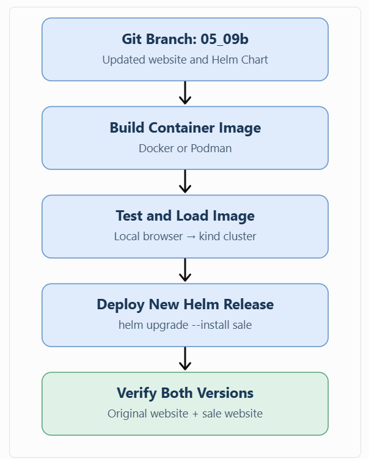

# 5.9 Challenge Explore California sale

**Challenge – Explore California Sale**

**1. Challenge Overview**

Explore California is launching a seasonal sale to compete with its biggest competitor, Explore Texas.

The business has provided updated prices for several popular travel packages.

Your responsibility is to deploy a new version of the Explore California website with the sale prices into Kubernetes without affecting existing deployments.

**2. Challenge Objectives**

The challenge requires you to:

1.  Retrieve the updated project files from Git 05_09b.

2.  Identify the updated website and sale prices.

3.  Build a new container image using Docker or Podman.

4.  Test the updated website locally.

5.  Deploy the new application version using Helm.

6.  Verify the sale prices are displayed correctly.

7.  Keep all existing Explore California deployments running.

**3. Step 1: Switch to the Git Branch**

```bash

git switch 05_09b

```

Review the project files:

```bash

git status

git log -1 –oneline

```

Compare changes with the previous branch to identify the updated application files.

Important: The instructor confirms that the necessary website and Helm Chart changes are already provided in branch 05_09b.

You do not need to manually modify the website or Helm Chart.

**4. Step 2: Build and Test the Container Image**

Build the updated website image using Podman:

```bash

podman build -t explore-california:sale .

```

Or Docker:

```bash

docker build -t explore-california:sale .

```

Test the container locally, assuming the application listens on port 80:

```bash

podman run --rm -p 8080:80 explore-california:sale

```

Open:

http://localhost:8080

Verify that the updated sale prices appear correctly.

**5. Step 3: Load the Image into kind**

If you are using a local kind Kubernetes cluster, load the image into the cluster.

For Docker:

```bash

kind load docker-image explore-california:sale --name explorecalifornia.com

```

For Podman, you can save the image as a tar archive:

bash

podman save -o explore-california-sale.tar explore-california:sale

Then load it:

```bash

kind load image-archive explore-california-sale.tar --name explorecalifornia.com

```

Replace the cluster name if your kind cluster uses a different name.

**6. Step 4: Deploy a Separate Helm Release**

Use a new release name to avoid replacing the existing application.

Example:

```bash
helm upgrade --install sale ./chart \
  --set image.name=explore-california:sale \
  --set image.pullPolicy=IfNotPresent \
  --set ingress.host=explore-california.sale \
  --set ingress.issuerName=explore-california-sale-issuer \
  --set ingress.tlsSecret=explore-california-sale-tls


```

This command assumes the chart uses the same value names introduced in the previous lessons.

**Why use a new Helm release?**

| **Existing deployment**   | **Sale deployment**      |
|---------------------------|--------------------------|
| Release: test             | Release: sale            |
| Original website          | Website with sale prices |
| Existing container image  | Updated container image  |
| Existing Ingress hostname | explore-california.sale  |
| Existing TLS Secret       | Separate TLS Secret      |

Using a new Helm release allows both application versions to run simultaneously.

**7. Step 5: Verify Kubernetes Resources**

Check the installed Helm releases:

```bash

helm list

```

Check Kubernetes resources:

```bash

kubectl get deployments

kubectl get pods

kubectl get services

kubectl get ingress

kubectl get issuer,certificates

```

Expected resource names include:

explore-california-test

explore-california-sale

Both versions should remain deployed.

**8. Step 6: Test the Sale Website**

For a local kind cluster with an Ingress controller accessible through localhost, add this entry to your computer's hosts file:

127.0.0.1 explore-california.sale

Open:

https://explore-california.sale

Verify that the updated sale prices appear and the original Explore California website remains accessible.

A browser warning is expected if the lab uses a self-signed TLS certificate.

**9. Challenge Workflow**



**10. Challenge Success Checklist**

Deployment verification


- Updated project files are checked out from branch 05_09b.

- The sale container image builds successfully.

- Updated prices are verified locally.

- The image is available to the kind cluster.

- A new Helm release is deployed.

- The original Explore California deployment remains running.

- The sale website loads with the updated prices.

- The new Ingress and TLS configuration are verified.

**Key Takeaways**

- Helm releases allow multiple versions of the same application to run simultaneously.

- Use a different release name for the sale deployment.

- Container images should be tested before Kubernetes deployment.

- kind load makes locally built images available to the kind cluster.

- helm upgrade --install simplifies application installation and updates.

- Unique Ingress hostnames, Issuer names, and TLS Secrets help prevent conflicts.

- Existing applications should remain available during the sale deployment.

Main lesson: Use Docker or Podman to package the updated Explore California website, then use a separate Helm release to deploy the sale version into Kubernetes without disrupting existing applications.

# [README](./../../../README.md)
