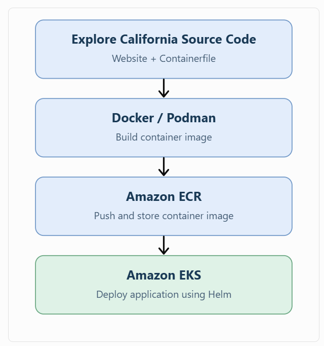

# 6.1 From kind to EKS Whats changing

**From kind to Amazon EKS (Amazon Elastic Kubernetes Service) – What's Changing?**

**1. Overview**

This lesson introduces the transition from running Explore California locally using kind (Kubernetes in Docker) to deploying the application into cloud-managed Kubernetes environments.

Previously, we successfully deployed Explore California using:

- Docker or Podman to build container images.

- kind to create a local Kubernetes cluster.

- kubectl to manage Kubernetes resources.

- Helm to package and deploy the application.

- Ingress and cert-manager to configure HTTPS.

Main goal: Move Explore California from a local development environment to cloud-managed Kubernetes clusters on AWS and Microsoft Azure.

**2. Why Move from kind to the Cloud?**

kind is excellent for learning, development, and testing Kubernetes applications.

However, production applications typically require infrastructure that supports reliability, scalability, security, and external accessibility.

| **Feature** | **kind (Local)** | **Cloud Kubernetes (EKS / AKS)** |
|----|----|----|
| Environment | Local computer | Cloud infrastructure |
| Primary purpose | Development and testing | Production and development |
| Cluster management | Developer-managed | Cloud-managed control plane |
| Container images | Locally built and loaded | Stored in cloud registries |
| Scaling | Limited by local resources | Uses cloud compute resources |
| Availability | Depends on local machine | Supports highly available architectures |
| Networking | Local ports and Ingress | Cloud networking and load balancers |
| Helm support | Yes | Yes |

**3. AWS: Amazon EKS and Amazon ECR**

Amazon Elastic Kubernetes Service (EKS)

Amazon EKS is a managed Kubernetes service that allows organizations to deploy and operate Kubernetes applications on AWS without managing the Kubernetes control plane themselves.

Amazon Elastic Container Registry (ECR)

Amazon ECR is a managed container image registry used to store, manage, and retrieve container images.

**AWS Deployment Workflow**



The application image is uploaded to ECR, and Kubernetes running on EKS pulls the image when deploying Pods.

**4. Azure: AKS and ACR**

Azure Kubernetes Service (AKS)

AKS is Microsoft's managed Kubernetes service for deploying, scaling, and managing containerized applications.

Azure Container Registry (ACR)

ACR is Azure's managed container registry for storing and distributing container images.

**Azure Deployment Workflow**

The process is similar to AWS:

1.  Build the Explore California container image.

2.  Push the image to Azure Container Registry.

3.  Create an Azure Kubernetes Service cluster.

4.  Configure kubectl access to AKS.

5.  Deploy the application using the existing Helm Chart.

6.  Verify the website is accessible.

**5. AWS vs. Azure Kubernetes Services**

| **Component**          | **AWS**      | **Microsoft Azure** |
|------------------------|--------------|---------------------|
| Managed Kubernetes     | Amazon EKS   | Azure AKS           |
| Container registry     | Amazon ECR   | Azure ACR           |
| Cloud CLI              | AWS CLI      | Azure CLI           |
| Kubernetes CLI         | kubectl      | kubectl             |
| Package manager        | Helm         | Helm                |
| Container images       | Docker / OCI | Docker / OCI        |
| Application deployment | Helm Charts  | Helm Charts         |

Both platforms use standard Kubernetes resources, making applications portable between environments.

**6. Why Helm Makes Cloud Migration Easier**

One of the most important lessons is that the Helm Chart created locally can also be used to deploy Explore California to AWS and Azure.

For example, the same Deployment template can use different container images depending on the environment.

**Local kind**

```bash

helm upgrade --install explore ./chart \
	--set image.name=explorecalifornia:latest

```

**Amazon EKS**

```bash

helm upgrade --install explore ./chart \
	--set image.name=\<aws-account-id\>.dkr.ecr.\<region\>.amazonaws.com/explorecalifornia:latest

```

**Azure AKS**

```bash

helm upgrade --install explore ./chart \
	--set image.name=\<registry-name\>.azurecr.io/explorecalifornia:latest

```

These are illustrative commands. The image must exist in the relevant registry, the Kubernetes context must point to the intended cluster, and any cloud-specific Ingress or certificate configuration must be prepared.

**7. Key Differences When Moving to the Cloud**

| **Local Kubernetes** | **Cloud Kubernetes** |
|----|----|
| kind create cluster | Create EKS or AKS cluster |
| kind load docker-image | Push image to ECR or ACR |
| Local image storage | Cloud container registry |
| Local Ingress configuration | Cloud networking and Ingress configuration |
| Local hostname mapping | Typically public or private DNS |
| Self-signed certificates for testing | Trusted TLS certificates for production |
| Local machine resources | Cloud compute and storage |

Important: A managed Kubernetes service does not automatically make an application production-ready. Security, monitoring, backups, resource limits, networking, and availability still require configuration.

**8. Common Tools and Commands**

| **Tool / Command**          | **Purpose**                            |
|-----------------------------|----------------------------------------|
| docker build / podman build | Build container images                 |
| aws eks                     | Manage AWS EKS clusters                |
| aws ecr                     | Manage AWS container registries        |
| az aks                      | Manage Azure AKS clusters              |
| az acr                      | Manage Azure container registries      |
| kubectl get nodes           | Verify Kubernetes cluster connectivity |
| helm upgrade --install      | Install or upgrade the application     |
| kubectl get deployments     | Verify application deployments         |
| kubectl get ingress         | Verify application routing             |

**Key Takeaways**

- kind is useful for local Kubernetes development and testing.

- Amazon EKS provides managed Kubernetes on AWS.

- Amazon ECR stores container images for AWS deployments.

- Azure AKS provides managed Kubernetes on Microsoft Azure.

- Azure ACR stores container images for Azure deployments.

- Helm Charts make it easier to deploy the same application across multiple Kubernetes environments.

- Moving to the cloud requires additional considerations for networking, security, scaling, and availability.

**Main lesson:** The Kubernetes and Helm skills learned locally transfer directly to cloud environments. Explore California can use the same Helm Chart to deploy to Amazon EKS or Azure AKS, with environment-specific configuration changes.

**Next lesson:** Create an Amazon ECR repository, push the Explore California container image, and prepare an Amazon EKS cluster for deployment.

# [README](./../../../README.md)
