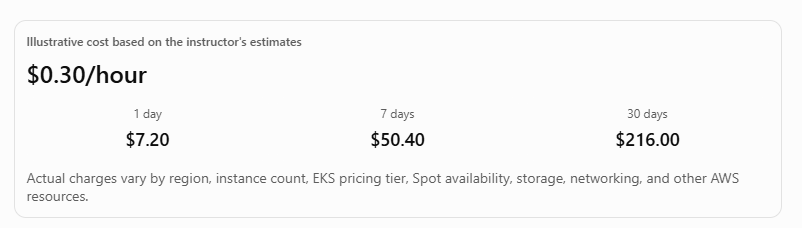
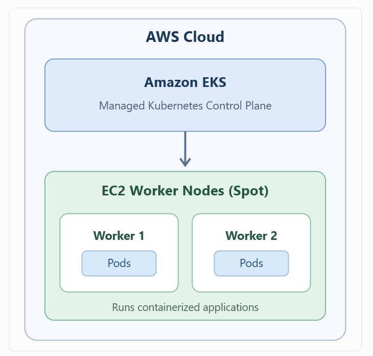

# 6.2 Deploying your EKS cluster with eksctl

**Deploying an Amazon EKS Cluster with eksctl**

**1. Overview**

This lesson explains how to create an Amazon Elastic Kubernetes Service (EKS) cluster using the eksctl command-line tool.

Previously, Explore California was deployed locally using kind. Now, we will create a Kubernetes cluster in AWS to prepare for deploying the application into the cloud.

Main goal: Use eksctl to provision an EKS cluster with EC2 Spot Instances while understanding AWS costs and authentication requirements.

**2. What Is eksctl?**

eksctl is a command-line tool that simplifies creating and managing Amazon EKS clusters.

Instead of manually configuring AWS networking, Kubernetes control plane resources, and worker nodes, eksctl automates much of the process.

| **Tool** | **Purpose**                          |
|----------|--------------------------------------|
| AWS CLI  | Interacts with AWS services          |
| eksctl   | Creates and manages EKS clusters     |
| kubectl  | Manages Kubernetes resources         |
| Helm     | Deploys applications into Kubernetes |

**3. Understand AWS EKS Costs**

Amazon EKS is not completely free.

The instructor provides the following approximate costs for the course environment:

| **Resource**      | **Approximate hourly cost** |
|-------------------|-----------------------------|
| EKS control plane | $0.10                      |
| EC2 worker nodes  | $0.20                      |
| Combined          | $0.30                      |



Important: Delete unused EKS clusters and their associated resources to avoid unnecessary AWS charges.

**4. Choose an EC2 Worker Node Instance**

The instructor discusses two EC2 instance types.

| **Instance** | **Architecture**     | **Example use**                 |
|--------------|----------------------|---------------------------------|
| t3.2xlarge   | x86_64 (Intel/AMD)   | x86-compatible container images |
| t4g.2xlarge  | ARM64 (AWS Graviton) | ARM-compatible container images |

Both instance types provide 8 vCPUs and 32 GiB of memory.

The correct choice depends on your container image's architecture, not necessarily the processor in your laptop. For example, a Windows computer can deploy ARM64 worker nodes if the application image supports ARM64.

**5. Create the EKS Cluster**

For x86_64 worker nodes:

```bash

eksctl create cluster \
  --name explorecalifornia-cluster \
  --node-type t3.2xlarge \
  --spot

```

For ARM64 worker nodes:

```bash

eksctl create cluster \
  --name explorecalifornia-cluster \
  --node-type t4g.2xlarge \
  --spot

```

**Command Explanation**

| **Parameter**         | **Purpose**                      |
|-----------------------|----------------------------------|
| eksctl create cluster | Creates a new EKS cluster        |
| --name                | Specifies the cluster name       |
| --node-type           | Selects the EC2 worker node type |
| --spot                | Requests EC2 Spot Instances      |

Spot Instances can cost less than On-Demand Instances, but AWS can interrupt them when capacity is needed.

For a learning environment, Spot Instances can help reduce costs. Production applications should account for possible interruptions.

**6. Verify AWS Authentication**

If the command fails because of invalid or expired AWS credentials, verify your AWS CLI authentication.

```bash

aws sts get-caller-identity

```

This displays the AWS account and IAM identity associated with your current credentials.

For an AWS CLI profile:

```bash

aws configure list

```

If your organization uses AWS IAM Identity Center (SSO), refresh the appropriate profile:

```bash

aws sso login --profile my-profile

```

The AWS identity must have sufficient permissions to create EKS clusters and their supporting infrastructure.

**7. Wait for Cluster Creation**

The instructor estimates that provisioning the cluster takes approximately 10–15 minutes.

During cluster creation, AWS provisions resources such as:

- EKS Kubernetes control plane

- VPC networking and subnets

- Security groups

- EC2 worker nodes

- IAM roles and related infrastructure

Provisioning time varies based on AWS region, configuration, and available capacity.

**8. Verify the EKS Cluster**

After cluster creation, check the available EKS clusters:

```bash

eksctl get clusters

```

Configure kubectl access if necessary:

```bash

aws eks update-kubeconfig \
  --name explorecalifornia-cluster \
  --region us-east-1

```

Replace us-east-1 with your actual AWS region.

Verify Kubernetes connectivity:

```bash

kubectl get nodes

```

Check the cluster:

```bash

kubectl cluster-info

```

If the nodes show Ready, they have successfully joined the cluster and are available for scheduling workloads.

**9. EKS Deployment Architecture**



**10. Delete the EKS Cluster When Finished**

To avoid ongoing charges, delete the cluster after completing the exercises:

```bash

eksctl delete cluster \
  --name explorecalifornia-cluster \
  --region us-east-1 \
  --wait

```

Confirm deletion:

```bash

eksctl get clusters --region us-east-1

```

Also verify in AWS that associated resources, such as load balancers, EBS volumes, and other independently managed infrastructure, have been removed.

**11. Common Commands**

| **Command**                 | **Purpose**                         |
|-----------------------------|-------------------------------------|
| eksctl create cluster       | Create an EKS cluster               |
| eksctl get clusters         | List EKS clusters                   |
| aws sts get-caller-identity | Verify AWS credentials              |
| aws eks update-kubeconfig   | Configure kubectl access            |
| kubectl get nodes           | Check worker nodes                  |
| kubectl cluster-info        | View Kubernetes cluster information |
| eksctl delete cluster       | Delete an EKS cluster               |

**Key Takeaways**

- Amazon EKS provides managed Kubernetes infrastructure on AWS.

- eksctl simplifies EKS cluster creation.

- EC2 instances provide worker node compute resources.

- t3.2xlarge uses x86_64 architecture, while t4g.2xlarge uses ARM64.

- Spot Instances can reduce compute costs but may be interrupted.

- AWS credentials must be valid before creating the cluster.

- Cluster creation generally takes several minutes.

- Deleting unused cloud infrastructure helps prevent unexpected charges.

**Main lesson:** eksctl makes it easier to create an Amazon EKS cluster without manually configuring every AWS resource. Once the cluster is ready, Explore California can be deployed using the Helm Chart developed in earlier lessons.

**Next lesson:** Create an Amazon ECR repository, upload the Explore California container image, and deploy the application to the EKS cluster using Helm.

# [README](./../../../README.md)
