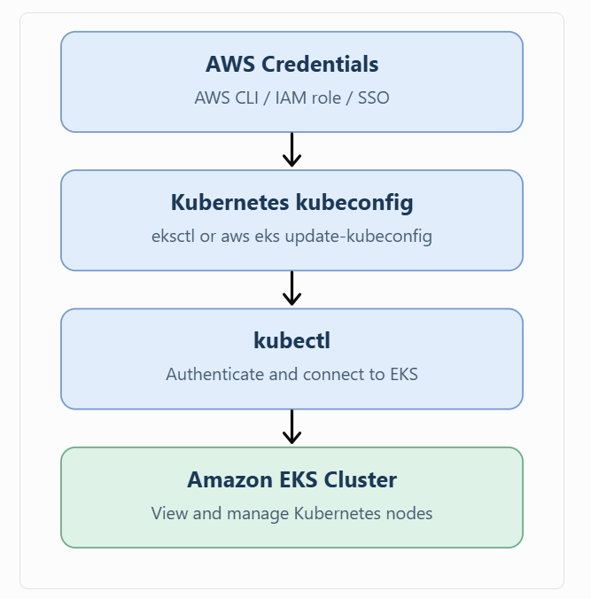

# 6.3 Logging into your EKS cluster

**Logging into Your Amazon EKS Cluster**

**1. Overview**

This lesson explains how to connect or reconnect to an Amazon EKS Kubernetes cluster after creating it with eksctl.

The instructor demonstrates how to verify Kubernetes connectivity, troubleshoot authentication problems, and regenerate the kubeconfig file when necessary.

Main goal: Successfully authenticate to AWS EKS and manage the cluster using kubectl.

**2. Verify Your EKS Connection**

After creating the cluster, run:

```bash

kubectl get nodes

```


This command displays the worker nodes registered with the Kubernetes cluster.

Example output:

NAME STATUS ROLES AGE VERSION

ip-10-0-1-100.ec2.internal Ready <none> 10m v1.xx.x

ip-10-0-2-101.ec2.internal Ready <none> 10m v1.xx.x

| **Column** | **Description**                        |
|------------|----------------------------------------|
| NAME       | Kubernetes worker node hostname        |
| STATUS     | Indicates whether the node is ready    |
| ROLES      | Kubernetes node role                   |
| AGE        | Time since the node registered         |
| VERSION    | Kubernetes version running on the node |

A Ready status indicates that the node is available to run workloads.

To confirm which cluster kubectl is targeting, run:

```bash

kubectl config current-context

```


**3. Troubleshoot Connection Errors**

If you return to the project after some time, you may encounter errors such as:

The connection to the server was refused

Or:

You must be logged in to the server

These errors can have different causes.

| **Problem**           | **Possible cause**                             |
|-----------------------|------------------------------------------------|
| Connection refused    | Incorrect kubeconfig or unreachable API server |
| Authentication failed | Expired AWS credentials                        |
| Access denied         | Missing IAM or EKS authorization               |
| Cluster not found     | Incorrect AWS region or cluster name           |

The instructor demonstrates two approaches to restoring access.

**4. Method 1: Refresh AWS Credentials**

First, verify your AWS identity:

```bash

aws sts get-caller-identity

```

This command displays the AWS account and IAM identity associated with your current credentials.

If your workflow uses an IAM role, you can assume it using AWS STS:

```bash

aws sts assume-role \
  --role-arn arn:aws:iam::<account-id>:role/<role-name> \
  --role-session-name eks-session

```


AWS returns temporary credentials, including:

AccessKeyId

SecretAccessKey

SessionToken

Expiration

These correspond to the environment variables:

```bash

AWS_ACCESS_KEY_ID

AWS_SECRET_ACCESS_KEY

AWS_SESSION_TOKEN

```


Important: All three temporary credential values are required. Do not expose them in logs, screenshots, or shared documents.

If your organization uses AWS IAM Identity Center, you may instead refresh your login using:

```bash

aws sso login --profile my-profile

```


**5. Method 2: Regenerate the kubeconfig File**

The instructor uses eksctl to restore the Kubernetes configuration.

```bash

eksctl utils write-kubeconfig \
  --cluster explorecalifornia-cluster

```


This command writes the configuration required for kubectl to connect to the EKS cluster.

You can also use the AWS CLI:

```bash

aws eks update-kubeconfig \
  --name explorecalifornia-cluster \
  --region us-east-1

```


Replace us-east-1 with the region where your EKS cluster was created.

The kubeconfig file typically contains:

- Kubernetes API server endpoint

- Cluster certificate authority information

- Cluster context

- AWS authentication configuration

The default location is:

~/.kube/config

**6. Verify the Connection Again**

After refreshing AWS credentials and kubeconfig, run:

```bash

kubectl config current-context

kubectl get nodes

kubectl cluster-info

```


If kubectl get nodes returns the expected EKS worker nodes, your connection is working.

You can also verify the cluster directly through AWS:

```bash

aws eks describe-cluster \
  --name explorecalifornia-cluster \
  --region us-east-1 \
  --query "cluster.status"

```


Expected output for an available cluster:

"ACTIVE"

**7. EKS Authentication Workflow**



**8. Common Commands**

| **Command**                    | **Purpose**                            |
|--------------------------------|----------------------------------------|
| aws sts get-caller-identity    | Verify AWS identity                    |
| aws sts assume-role            | Obtain temporary IAM role credentials  |
| eksctl utils write-kubeconfig  | Generate EKS kubeconfig                |
| aws eks update-kubeconfig      | Update Kubernetes access configuration |
| kubectl config current-context | Display active Kubernetes context      |
| kubectl get nodes              | Verify cluster access and worker nodes |
| kubectl cluster-info           | Display cluster connection information |
| aws eks describe-cluster       | Check EKS cluster details and status   |

**Key Takeaways**

- kubectl get nodes verifies access to Kubernetes worker nodes.

- AWS credentials may expire and require refreshing.

- AWS STS can provide temporary credentials through IAM roles.

- eksctl utils write-kubeconfig regenerates the EKS connection configuration.

- aws eks update-kubeconfig is another way to configure access.

- kubectl config current-context helps verify the selected cluster.

- Authentication and Kubernetes authorization are separate requirements.

Main lesson: Connecting to Amazon EKS requires valid AWS credentials, the correct kubeconfig, and sufficient Kubernetes permissions. Once access is restored, you can continue managing Explore California using kubectl and Helm.

Next lesson: Prepare the Explore California container image for Amazon ECR and deploy it to the EKS cluster.

# [README](./../../../README.md)
