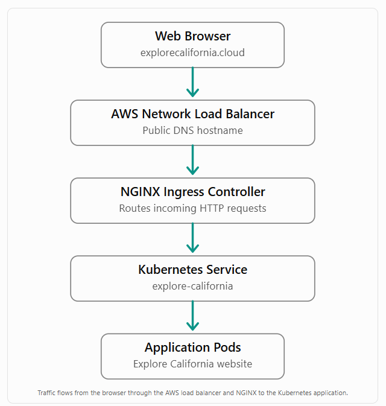
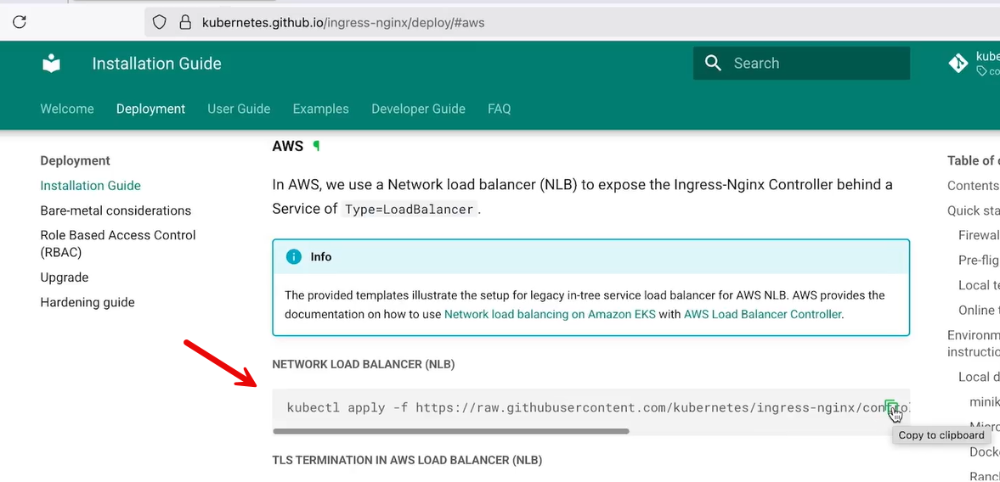
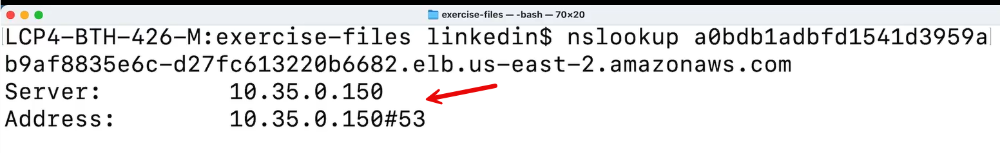
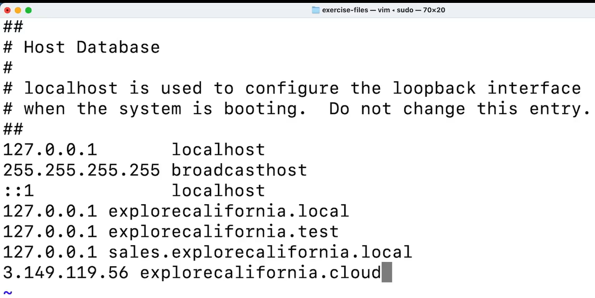

# 6.4 Installing NGINX ingress controller into EKS

**Installing NGINX Ingress Controller into Amazon EKS**

**1. Overview**

This lesson demonstrates how to install the **NGINX Ingress Controller** into an Amazon Elastic Kubernetes Service (EKS) cluster and expose applications to external traffic using an AWS Network Load Balancer (NLB).

Unlike a local KIND cluster, Amazon EKS can automatically provision an AWS load balancer when a Kubernetes Service is configured with type: LoadBalancer, provided the necessary AWS integration and permissions are configured.

**2. How NGINX Ingress works in EKS**



**3. Installation steps**

**Step 1: Open NGINX Ingress documentation**

Visit [NGINX Ingress Controller — AWS Deployment](https://kubernetes.github.io/ingress-nginx/deploy/?utm_source=chatgpt.com#aws) and locate the AWS Network Load Balancer installation instructions.

**Step 2: Install the controller**

Use the installation manifest specified in the AWS documentation for your chosen controller version.

```bash

kubectl apply -f <manifest-url>

```



This creates the controller's Kubernetes resources, including its Deployment and Service.

**Step 3: Verify the controller Service**

```bash

kubectl get svc -n ingress-nginx

```

Example output:

NAME TYPE EXTERNAL-IP

ingress-nginx-controller LoadBalancer abc.elb.amazonaws.com

The external hostname identifies the AWS load balancer.

**Step 4: Resolve the load balancer hostname**

```bash

nslookup <load-balancer-dns>

```

This returns one or more IP addresses associated with the load balancer.



**Step 5: Update the local hosts file**

On Linux or macOS:

basn

sudo vim /etc/hosts

Add an entry using an IP address returned by nslookup:

203.0.113.10 explorecalifornia.cloud



The IP shown is only an example, not a real load balancer address.

On Windows, edit C:\Windows\System32\drivers\etc\hosts as administrator.

**Step 6: Test browser access**

Open:

http://explorecalifornia.cloud

An NGINX **404 Not Found** response can indicate that the controller is reachable but no matching Ingress routing rule exists yet.

**4. Important Kubernetes commands**

| **Command** | **Purpose** |
|----|----|
| kubectl get nodes | Verify EKS nodes |
| kubectl get pods -n ingress-nginx | Check controller Pods |
| kubectl get svc -n ingress-nginx | Find load balancer hostname |
| kubectl get ingress -A | View Ingress resources |
| kubectl describe ingress \<name\> | Troubleshoot Ingress configuration |
| kubectl logs -n ingress-nginx deployment/ingress-nginx-controller | View controller logs |

**5. Important production considerations**

- **Load balancer IP addresses can change.** For production, create a DNS record pointing to the load balancer hostname instead of relying on a hosts-file IP entry.

- **A 404 is not necessarily an installation failure.** It may simply mean that no Ingress rule matches the requested hostname or path.

- **AWS charges for load balancers.** Delete unused EKS resources to avoid ongoing costs.

- **Controller lifecycle matters.** The community ingress-nginx project has announced retirement in March 2026. For new production deployments, consider supported alternatives such as AWS Load Balancer Controller or a maintained Gateway API implementation.

**6. Key takeaway**

The main difference between KIND and EKS is how external traffic reaches the Ingress Controller.

| **KIND** | **Amazon EKS** |
|----|----|
| Local Kubernetes cluster | AWS-managed Kubernetes cluster |
| Often uses localhost or local port mappings | Can use an AWS Network Load Balancer |
| Local testing | Cloud deployment |
| Hosts file can point to 127.0.0.1 | Hosts file can temporarily point to an NLB IP |
| No AWS load balancer charges | AWS load balancer charges may apply |

**Next lesson:** Deploy the Explore California Helm chart with an Ingress resource that routes explorecalifornia.cloud to the application's Kubernetes Service.

# [README](./../../../README.md)
