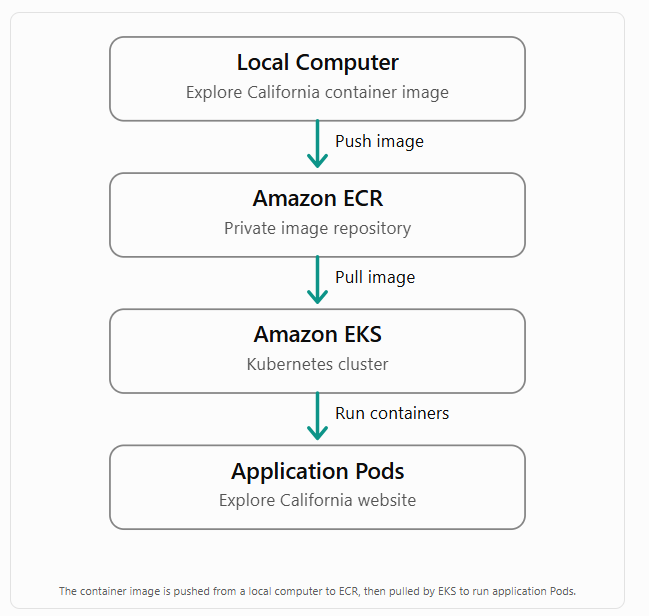
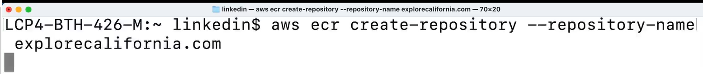
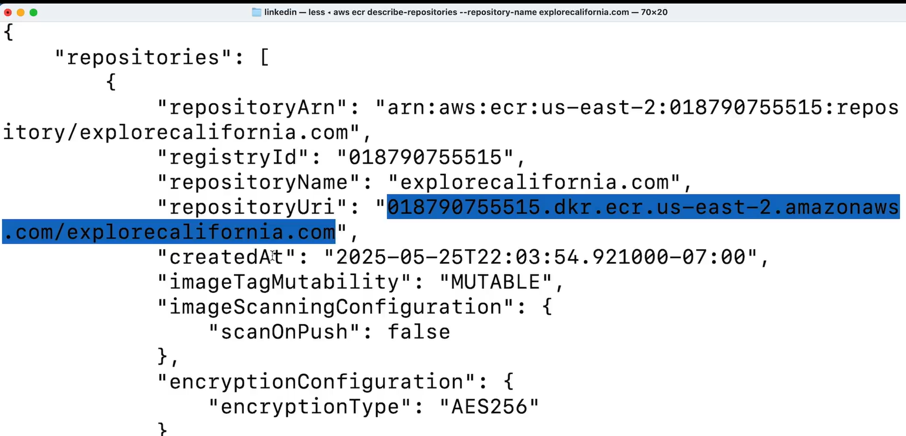

# 6.5 Creating an ECR repository

**Creating an Amazon ECR Repository for Kubernetes EKS**

**1. Overview**

This lesson demonstrates how to create an **Amazon Elastic Container Registry (ECR)** repository to store Docker or Podman container images for deployment into an Amazon EKS Kubernetes cluster.

The goal is to prepare a private container registry for the **Explore California** application.

Amazon ECR is AWS's managed container image registry service.

**2. How Amazon ECR works with EKS**



**3. Step-by-step: Create an ECR repository**

**Step 1: Create the repository**

Run the AWS CLI command:

```bash

aws ecr create-repository \
--repository-name explorecalifornia.com

```



**What this does:**

- Creates a private ECR repository.

- Assigns a repository URI.

- Allows container images to be stored in AWS.

Example repository URI:

```bash

123456789012.dkr.ecr.us-east-1.amazonaws.com/explorecalifornia.com

```

The AWS account number and region will be different in your environment.

**Step 2: Retrieve repository information**

```bash

aws ecr describe-repositories \
  --repository-names explorecalifornia.com

```



This command retrieves repository information, including its URI, registry ID, and creation date.

To retrieve only the repository URI:

```bash

aws ecr describe-repositories \
  --repository-names explorecalifornia.com \
  --query 'repositories[0].repositoryUri' \
  --output text

```

**Step 3: Authenticate to Amazon ECR**

Amazon ECR requires authentication before you can push container images.

For Docker:

```bash

aws ecr get-login-password --region us-east-1 \
  | docker login \
  --username AWS \
  --password-stdin \
  123456789012.dkr.ecr.us-east-1.amazonaws.com

```


For Podman:

```bash

aws ecr get-login-password --region us-east-1 \
  | podman login \
  --username AWS \
  --password-stdin \
  123456789012.dkr.ecr.us-east-1.amazonaws.com

```


Replace the account ID and region with your actual AWS information.

**Expected output:**

Login Succeeded!

The authentication token is valid for 12 hours.

**4. Important AWS ECR commands**

| **Command**                   | **Purpose**                     |
|-------------------------------|---------------------------------|
| aws ecr create-repository     | Create a repository             |
| aws ecr describe-repositories | Retrieve repository information |
| aws ecr get-login-password    | Authenticate Docker or Podman   |
| aws ecr list-images           | List images in a repository     |
| aws ecr describe-images       | Display image metadata          |
| aws ecr delete-repository     | Delete a repository             |

**5. Next step: Push the Explore California image**

Once authentication succeeds, you can tag and push your locally built container image.

Example using Podman:

```bash

# Tag the existing local image

podman tag explorecalifornia.com:latest \
  123456789012.dkr.ecr.us-east-1.amazonaws.com/explorecalifornia.com:v1

# Push image to Amazon ECR

podman push \
  123456789012.dkr.ecr.us-east-1.amazonaws.com/explorecalifornia.com:v1

```


Verify the uploaded image:

```bash

aws ecr list-images \
  --repository-name explorecalifornia.com

```

After the image is uploaded, your EKS cluster can pull it, provided its node or Pod IAM role has the necessary ECR permissions.

**6. Amazon ECR vs. Docker Hub**

| **Feature** | **Amazon ECR** | **Docker Hub** |
|----|----|----|
| Provider | AWS | Docker |
| Private repositories | Yes | Yes |
| AWS IAM integration | Native | No native IAM integration |
| EKS integration | Native AWS support | Supported |
| Authentication | AWS credentials / ECR token | Docker Hub credentials / tokens |
| Typical usage | AWS applications | General container distribution |

**7. Key takeaway**

**Amazon ECR stores container images; Amazon EKS runs those images as Kubernetes Pods.**

The overall deployment process is:

1.  Build the Explore California container image using Docker or Podman.

2.  Create an ECR repository.

3.  Authenticate to ECR.

4.  Tag and push the image.

5.  Configure the Kubernetes Deployment or Helm chart to use the ECR image URI.

6.  Deploy the application into EKS.

The lesson completes the repository creation and authentication stages. The next lesson will demonstrate pushing the image.

**Official AWS documentation:** [Creating an Amazon ECR private repository](https://docs.aws.amazon.com/AmazonECR/latest/userguide/repository-create.html?utm_source=chatgpt.com).

# [README](./../../../README.md)
