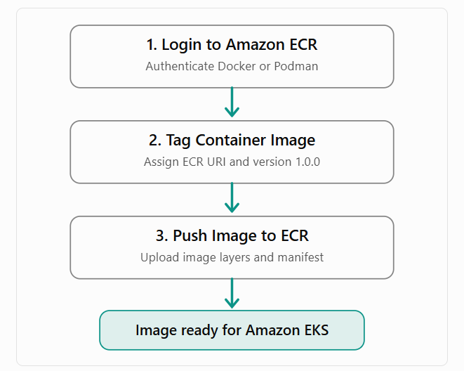

# 6.6 Deploying the Explore California image into ECR

**Deploying the Explore California Container Image into Amazon ECR**

**1. Overview**

This lesson explains how to upload the **Explore California container image** into Amazon Elastic Container Registry (ECR) so that it can later be deployed to an Amazon EKS Kubernetes cluster.

The process consists of three main steps:

1.  **Login** — Authenticate Docker or Podman with Amazon ECR.

2.  **Tag** — Assign the ECR repository URI and version number to the container image.

3.  **Push** — Upload the image to Amazon ECR.

**2. How the process works**



**3. Step-by-step commands**

**Step 1: Login to Amazon ECR**

This step was completed in the previous lesson.

```bash

aws ecr get-login-password --region us-east-1 \
  | podman login \
  --username AWS \
  --password-stdin \
  123456789012.dkr.ecr.us-east-1.amazonaws.com

```

Expected output:

Login Succeeded!

**Step 2: Retrieve the ECR repository URI**

```bash

aws ecr describe-repositories \
  --repository-names explorecalifornia.com

```

Example repository URI:

```

123456789012.dkr.ecr.us-east-1.amazonaws.com/explorecalifornia.com

```

Replace the example account ID and region with your own.

**Step 3: Tag the container image**

```bash

podman tag \
  localhost/explorecalifornia.com:latest \
  123456789012.dkr.ecr.us-east-1.amazonaws.com/explorecalifornia.com:1.0.0

```

**Explanation:**

| **Component** | **Purpose** |
|----|----|
| podman tag | Assign a new image name and tag |
| localhost/explorecalifornia.com:latest | Existing local container image |
| 123456789012.dkr.ecr.us-east-1.amazonaws.com | ECR registry address |
| explorecalifornia.com | Repository name |
| 1.0.0 | Container image version |

Verify the image tag:

```bash

podman images

```

The new image name should appear in the list.

**Step 4: Push the image to Amazon ECR**

```bash

podman push \
  123456789012.dkr.ecr.us-east-1.amazonaws.com/explorecalifornia.com:1.0.0

```

Podman uploads the image layers and writes the image manifest to the registry.

Successful output typically includes messages similar to:

Copying blob...

Copying config...

Writing manifest to image destination

**Step 5: Verify the image in ECR**

```bash

aws ecr list-images \
  --repository-name explorecalifornia.com

```

Expected image tag:

1.0.0

**4. Why use version 1.0.0 instead of latest?**

The instructor recommends using explicit version numbers to make deployments easier to track.

| **Image tag** | **Description** |
|----|----|
| latest | Conventional default tag; does not guarantee the newest image |
| 1.0.0 | Initial application version |
| 1.0.1 | Small update or bug fix |
| 1.1.0 | New functionality |
| 2.0.0 | Major application update |

Version tags help identify deployed releases and simplify troubleshooting and rollbacks. For production deployments, immutable tags or image digests provide stronger guarantees.

**5. Important commands**

| **Command**                   | **Purpose**                         |
|-------------------------------|-------------------------------------|
| podman images                 | List local container images         |
| podman tag                    | Assign a repository URI and version |
| podman push                   | Upload an image to a registry       |
| aws ecr describe-repositories | Retrieve ECR repository information |
| aws ecr list-images           | Verify uploaded images              |

Docker users can replace podman with docker in the equivalent commands.

**6. Key takeaway**

**Amazon ECR stores the Explore California container image, while Amazon EKS runs the application in Kubernetes.**

The deployment workflow is:

Build Image → Login to ECR → Tag Image → Push to ECR → Deploy to EKS

After successfully uploading version 1.0.0, the Explore California image is ready to be referenced in the application's Kubernetes Deployment or Helm chart.

**Next lesson:** Deploy Explore California into Amazon EKS using Helm and the container image stored in ECR.

# [README](./../../../README.md)
