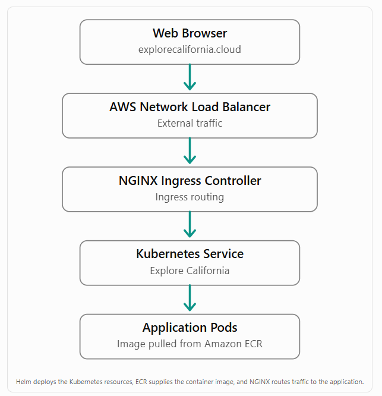
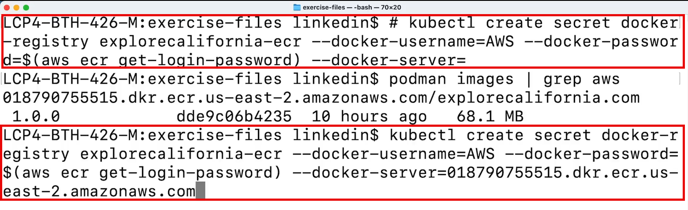

# 6.7 Deploying Explore California into EKS

**Deploying Explore California into Amazon EKS Using Helm**

**1. Overview**

This lesson demonstrates how to deploy the **Explore California application into Amazon Elastic Kubernetes Service (EKS)** using Helm, Amazon ECR, Kubernetes Secrets, and the NGINX Ingress Controller.

The application image has already been uploaded to Amazon ECR. The next step is to configure Kubernetes to retrieve the image and make the application accessible through a web browser.

The deployment involves three main steps:

1.  **Create an image pull secret** to authenticate with Amazon ECR.

2.  **Deploy the application using Helm**, configuring the container image and hostname.

3.  **Configure the NGINX Ingress Controller** to route external traffic to the application.

**2. EKS deployment architecture**



**3. Step-by-step deployment**

**Step 1: Create an Amazon ECR image pull secret**

The instructor creates a Kubernetes Secret containing credentials that allow the cluster to authenticate with Amazon ECR.

```bash

kubectl create secret docker-registry explorecalifornia-ecr \
  --docker-server=123456789012.dkr.ecr.us-east-1.amazonaws.com \
  --docker-username=AWS \
  --docker-password="\$(aws ecr get-login-password --region us-east-1)"

```



Replace the example AWS account number and region with your own values.

Verify the Secret:

```bash

kubectl get secrets

```

**Important:** The image pull secret must be referenced by the Pod specification, typically using imagePullSecrets. Creating the Secret alone does not make Kubernetes use it.

Also, ECR authorization tokens expire after 12 hours. For EKS, using the appropriate IAM permissions on the node role or Pod image-pulling mechanism is generally preferable to manually managed ECR pull secrets.

**Step 2: Deploy Explore California using Helm**

The instructor uses Helm to install the application and override configuration values.

Example:

```bash

helm upgrade --install eks ./chart \
  --set image.name=123456789012.dkr.ecr.us-east-1.amazonaws.com/explorecalifornia.com \
  --set image.tag=1.0.0 \
  --set ingress.host=explorecalifornia.cloud

```

This example assumes the Helm chart uses image.name, image.tag, and ingress.host. The exact keys must match the chart's values.yaml and templates.

**Explanation:**

| **Parameter**          | **Purpose**                      |
|------------------------|----------------------------------|
| helm upgrade --install | Install or update a Helm release |
| eks                    | Helm release name                |
| ./chart                | Local Helm chart directory       |
| image.name             | ECR container image repository   |
| image.tag              | Container image version          |
| ingress.host           | Application hostname             |

**Step 3: Verify the Kubernetes Pods**

```bash

kubectl get pods

```

Expected example:

NAME READY STATUS

explore-california-xxxxx 1/1 Running

A running Pod indicates that the container has started successfully.

**Step 4: Check the Kubernetes Ingress**

```bash

kubectl get ingress

```

The instructor discovers that the Ingress exists but has not been associated with the NGINX Ingress Controller.

Without the correct Ingress class, the controller may not process the routing configuration.

**Step 5: Configure the NGINX Ingress class**

Edit the Ingress:

```bash

kubectl edit ingress explore-california-eks

```

Add the following field under spec:

```yaml
spec:
  ingressClassName: nginx
  rules:
    - host: explorecalifornia.cloud

```

The ingressClassName field tells Kubernetes which Ingress Controller should handle the resource.

The example shows only part of the Ingress configuration. Preserve the existing HTTP paths and backend Service definitions when editing.

For a permanent configuration, add ingressClassName: nginx to the Helm chart template or configure the chart's corresponding value. Otherwise, a future Helm upgrade may overwrite the manual change.

**Step 6: Verify the Ingress address**

```bash

kubectl get ingress

```

Expected example:

NAME CLASS HOSTS

explore-california-eks nginx explorecalifornia.cloud

The Ingress may take a few minutes to receive its external address.

Check the controller Service:

```bash

kubectl get svc -n ingress-nginx

```

The external hostname should correspond to the AWS load balancer serving the NGINX controller.

**Step 7: Test the application**

Open:

http://explorecalifornia.cloud

If the hostname resolves to the load balancer and the Ingress is configured correctly, the Explore California website should appear.

**4. Important Kubernetes and Helm commands**

| **Command** | **Purpose** |
|----|----|
| kubectl get secrets | Verify Kubernetes Secrets |
| helm upgrade --install eks ./chart | Deploy or update the Helm release |
| kubectl get pods | Verify application Pods |
| kubectl get ingress | Check Ingress configuration |
| kubectl edit ingress explore-california-eks | Modify the Ingress |
| kubectl get svc -n ingress-nginx | Check the NGINX load balancer |
| kubectl get certificates | Check cert-manager Certificate resources |

**5. Remaining issue: HTTPS certificates**

Although the application is successfully running in AWS, the instructor identifies one remaining problem.

Running:

```bash

kubectl get certificates

```

returns an error because **cert-manager has not yet been installed**, so Kubernetes does not recognize the Certificate custom resource type.

Cert-manager is used to automate TLS certificate issuance and renewal for Kubernetes applications.

The next lesson will install cert-manager and configure HTTPS for Explore California.

**6. Key takeaway**

The Explore California application is now deployed into Amazon EKS using Helm.

- Container image stored in Amazon ECR

  - Completed in the previous lesson

- Kubernetes image pull credentials created

  - Using a docker-registry Secret

- Application deployed using Helm

  - Version 1.0.0

- NGINX Ingress configured

  - Using ingressClassName: nginx

- Website accessible through AWS

  - Using the configured hostname

- HTTPS certificate configuration

  - Pending cert-manager installation

**Next lesson:** Install cert-manager into EKS and configure a TLS certificate so Explore California can be accessed securely using HTTPS.

# [README](./../../../README.md)
