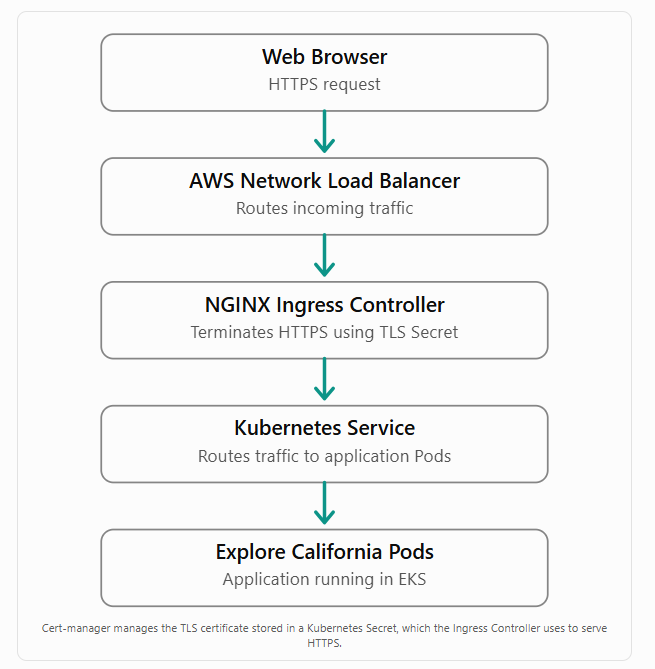
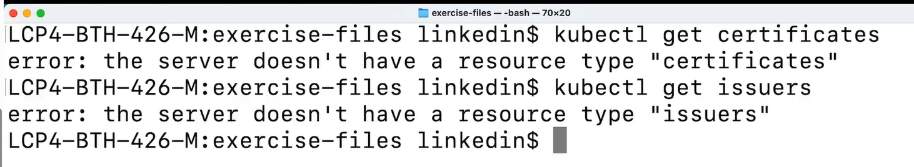
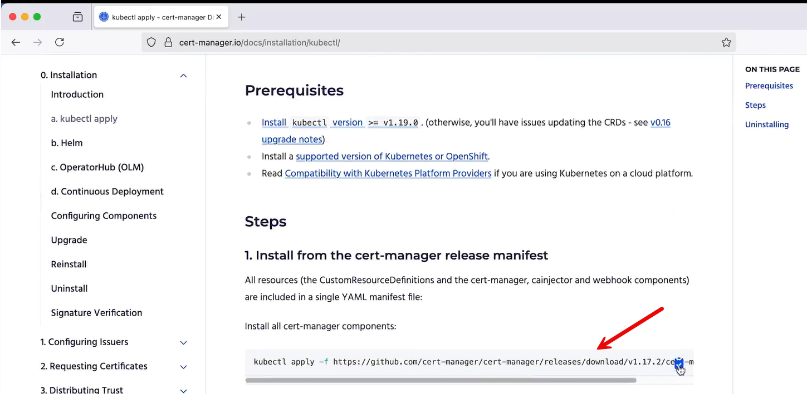
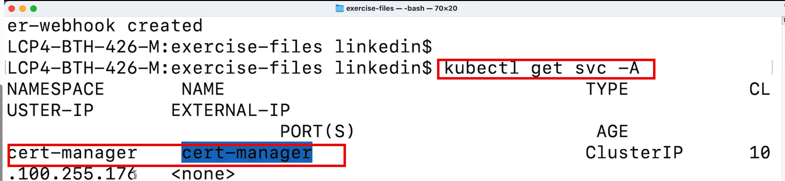
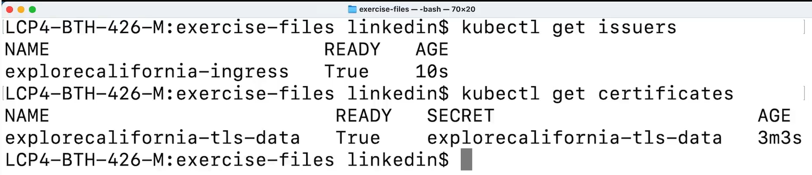

# 6.8 Installing cert-manager into EKS

**Installing cert-manager into Amazon EKS**

**1. Overview**

This lesson explains how to install **cert-manager** into an Amazon Elastic Kubernetes Service (EKS) cluster and configure TLS certificates for the Explore California application.

In the previous lesson, Explore California was successfully deployed using Helm and the NGINX Ingress Controller. However, the cluster did not recognize Kubernetes Certificate or Issuer resources because cert-manager had not been installed.

**Goal:** Install cert-manager, redeploy the Helm chart, and verify that a TLS certificate is created and associated with the application's Ingress.

**2. How cert-manager works in EKS**



Cert-manager works alongside Kubernetes by managing certificate-related resources:

| **Component**     | **Purpose**                                            |
|-------------------|--------------------------------------------------------|
| cert-manager      | Automates certificate issuance and renewal             |
| Issuer            | Defines how certificates are issued within a namespace |
| ClusterIssuer     | Defines a certificate issuer available cluster-wide    |
| Certificate       | Requests and manages a TLS certificate                 |
| Kubernetes Secret | Stores the issued certificate and private key          |
| Ingress           | Configures HTTPS access to the application             |



**3. Step-by-step installation**

**Step 1: Install cert-manager**

Visit the official installation documentation:

[cert-manager — Installation with kubectl](https://cert-manager.io/docs/installation/kubectl/?utm_source=chatgpt.com)

The instructor installs cert-manager using the Kubernetes manifest from the official website.

Example command structure:

```bash

kubectl apply -f \
https://github.com/cert-manager/cert-manager/releases/download/<VERSION>/cert-manager.yaml
 
```



Replace \<VERSION\> with a supported cert-manager release from the official documentation.

The installation creates several Kubernetes resources, including CustomResourceDefinitions (CRDs), Deployments, Services, and webhook components.

**Step 2: Verify cert-manager services**

The transcript checks the services running in the cluster.

A standard command for viewing Services across namespaces is:

```bash

kubectl get svc -A

```



Look for Services in the cert-manager namespace.

**Step 3: Verify cert-manager Pods**

```bash

kubectl get pods -n cert-manager

```

Expected example:

NAME READY STATUS

cert-manager-xxxxx 1/1 Running

cert-manager-cainjector-xxxxx 1/1 Running

cert-manager-webhook-xxxxx 1/1 Running

All three components should become healthy.

You can also verify the installation using:

```bash

kubectl rollout status deployment/cert-manager -n cert-manager

kubectl rollout status deployment/cert-manager-webhook -n cert-manager

kubectl rollout status deployment/cert-manager-cainjector -n cert-manager

```

**4. Redeploy Explore California using Helm**

Once cert-manager is installed, the instructor redeploys the existing Helm chart.

Example:

```bash

helm upgrade --install eks ./chart \
  --set image.name=123456789012.dkr.ecr.us-east-1.amazonaws.com/explorecalifornia.com \
  --set image.tag=1.0.0 \
  --set ingress.host=explorecalifornia.cloud

```

Replace the example image URI with your actual ECR repository.

The Helm chart must contain templates for the Issuer and Certificate, or an Ingress configuration that triggers certificate creation.

**Important:** Re-running Helm does not automatically create certificates unless the chart includes the appropriate certificate configuration.

**5. Verify the Issuer and Certificate**

**Check the Issuer**

```bash

kubectl get issuers

```

Expected example:

NAME READY

explore-california True

READY=True indicates that the Issuer is ready to issue certificates.

**Check the Certificate**

```bash

kubectl get certificates

```

Expected example:

NAME READY SECRET

explore-california True explore-california-tls

A READY=True status indicates that cert-manager considers the certificate ready.



**Check the Ingress**

```bash

kubectl describe ingress explore-california-eks

```

Look for the TLS configuration referencing the certificate Secret.

Example:

```yaml

spec:
  ingressClassName: nginx
  tls:
    - hosts:
        - explorecalifornia.cloud
      secretName: explore-california-tls

```

This tells the NGINX Ingress Controller which TLS Secret to use for the hostname.

**6. Important Kubernetes commands**

| **Command** | **Purpose** |
|----|----|
| kubectl get svc -A | List Services across namespaces |
| kubectl get pods -n cert-manager | Check cert-manager Pods |
| helm upgrade --install eks ./chart | Deploy or update Explore California |
| kubectl get issuers | Verify certificate Issuers |
| kubectl get certificates | Verify TLS certificates |
| kubectl describe certificate \<name\> | Troubleshoot certificate issuance |
| kubectl describe ingress explore-california-eks | Inspect HTTPS configuration |

**7. Important security considerations**

Installing cert-manager does not automatically guarantee trusted HTTPS.

- A **self-signed certificate** can encrypt traffic but generally produces a browser trust warning unless its issuing certificate is trusted.

- A **publicly trusted certificate**, such as one issued through Let's Encrypt, requires a valid domain and successful domain validation.

- An Ingress must reference the correct TLS Secret.

- Cert-manager must be able to complete the issuance process successfully.

For production applications, use an appropriate trusted certificate authority and configure automated renewal.

**8. Key takeaway**

**1. Install cert-manager**

Add certificate management capabilities to EKS

**2. Verify cert-manager Pods**

Ensure the controller, webhook and cainjector are healthy

**3. Redeploy the Helm chart**

Create the application's configured certificate resources

**4. Verify Issuer and Certificate**

Check their READY status

**5. Inspect the Ingress**

Confirm that the TLS Secret is referenced

**Final result:** The Explore California application has cert-manager installed in its EKS cluster, and its Helm-managed certificate configuration can now be processed. Once the certificate is ready and the Ingress references its TLS Secret, the application can serve HTTPS traffic.

# [README](./../../../README.md)
