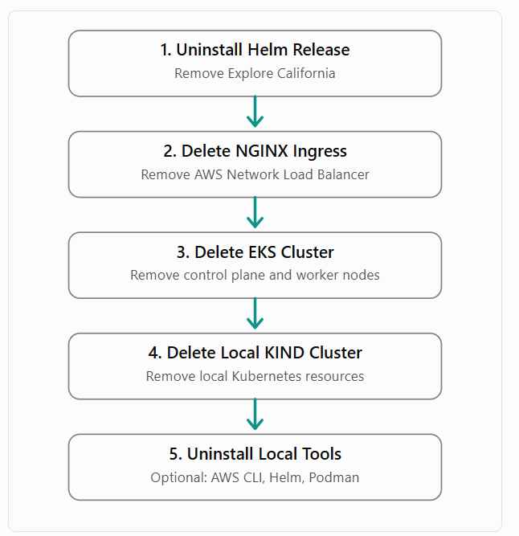
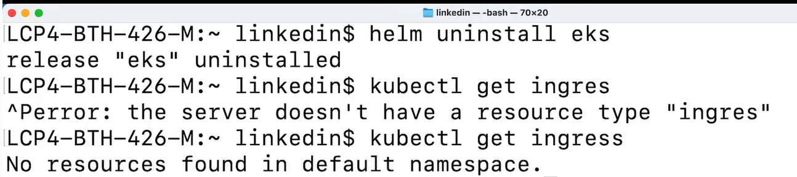
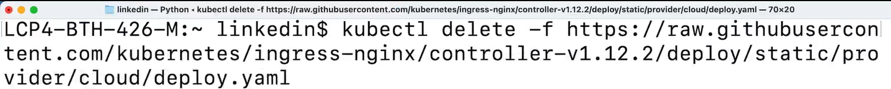

# 6.9 Cleaning up EKS

**Cleaning Up Amazon EKS and Kubernetes Resources**

**1. Overview**

This lesson explains how to **delete the Explore California application, remove AWS EKS resources, and uninstall Kubernetes development tools** after completing the deployment.

The primary goal is to prevent unnecessary AWS charges and remove resources that are no longer needed.

**Important:** Delete Kubernetes applications and load balancers before deleting the EKS cluster. This allows Kubernetes and AWS to clean up cloud resources properly.

**2. Recommended cleanup order**



**3. Step-by-step cleanup**

**Step 1: Uninstall the Helm release**

Remove the Explore California application from EKS:

```bash

helm uninstall eks

```



This removes Kubernetes resources managed by the Helm release, such as Deployments, Services, and Ingress resources.

Verify:

```bash

kubectl get pods

kubectl get ingress

helm list

```

Helm does not necessarily delete resources that were created outside the release or retained by special resource policies.

**Step 2: Delete the NGINX Ingress Controller**

Use the same installation manifest that was originally used to install the NGINX Ingress Controller.

```bash

kubectl delete -f <nginx-install-manifest-url>

```



This removes the NGINX Ingress Controller resources, including its LoadBalancer Service.

**Why this matters:** The Service may have provisioned an AWS Network Load Balancer (NLB), which can continue generating AWS charges until deleted.

Verify:

```bash

kubectl get svc -n ingress-nginx

```

Allow time for AWS to finish deleting the load balancer.

**Step 3: Delete the Amazon EKS cluster**

```bash

eksctl delete cluster \
  --name explorecalifornia-cluster \
  --wait

```

This deletes the EKS cluster and the resources managed by its eksctl configuration, including managed worker nodes.

Deletion may take several minutes.

Verify:

```bash

aws eks list-clusters

```

Check the AWS Console for any remaining load balancers, EC2 instances, EBS volumes, or other billable resources.

**Step 4: Delete the local KIND cluster**

List available KIND clusters:

```bash

kind get clusters

```

Delete the Explore California cluster:

```bash

kind delete cluster \
  --name explorecalifornia.com

```

Verify:

```bash

kind get clusters

```

This removes the local Kubernetes cluster created using KIND.

**Step 5: Optionally uninstall AWS CLI**

On macOS, if installed using Homebrew:

```bash

brew uninstall awscli

```

On Windows:

```bash

winget uninstall Amazon.AWSCLI

```

Keep AWS CLI installed if you plan to continue working with AWS.

**Step 6: Optionally uninstall Helm, eksctl, and KIND**

The instructor removes the tools used throughout the course.

On macOS, for binaries installed manually in /usr/local/bin:

```bash

sudo rm /usr/local/bin/{helm,eksctl,kind}

```

On Windows PowerShell, the course removes its dedicated application folder:

Remove-Item -Recurse "\$env:USERPROFILE\Apps"

**Caution:** These commands can remove files unrelated to this course. Verify the installation paths and folder contents before deleting anything.

If you plan to continue with the Azure AKS lessons, keep these tools installed.

**Step 7: Stop and remove Podman**

Check running containers:

```bash

podman ps

```

List Podman machines:

```bash

podman machine list

```

Stop the machine:

```bash

podman machine stop

```

Remove the machine:

```bash

podman machine rm

```

Removing a Podman machine deletes its associated machine data, so preserve any important containers or volumes first.

Podman Desktop can then be uninstalled through the operating system's application management interface.

On Windows, open:

```bash

appwiz.cpl

```

Select Podman Desktop and Podman, then choose **Uninstall**.

**4. Important cleanup commands**

| **Command**                      | **Purpose**                         |
|----------------------------------|-------------------------------------|
| helm uninstall eks               | Remove the Helm application release |
| kubectl delete -f ...            | Remove NGINX Ingress resources      |
| eksctl delete cluster --name ... | Delete the AWS EKS cluster          |
| aws eks list-clusters            | Verify remaining EKS clusters       |
| kind get clusters                | List local KIND clusters            |
| kind delete cluster --name ...   | Delete a local cluster              |
| podman ps                        | Check running containers            |
| podman machine stop              | Stop the Podman virtual machine     |
| podman machine rm                | Remove the Podman virtual machine   |

**5. Additional AWS cleanup considerations**

Deleting the EKS cluster does not necessarily delete every resource used during the course.

| **AWS resource** | **Cleanup consideration** |
|----|----|
| EKS cluster | Delete using eksctl |
| EC2 worker nodes | Usually removed with managed node groups |
| Network Load Balancer | Delete its Kubernetes Service before cluster deletion |
| ECR repository | Remains until separately deleted |
| EBS volumes | Check for orphaned storage |
| CloudWatch logs | May remain and incur storage charges |

The Explore California ECR repository can be deleted separately when its images are no longer needed:

```bash

aws ecr delete-repository \
  --repository-name explorecalifornia.com \
  --force

```

This permanently deletes the repository and its images.

**6. Cleanup checklist**

**Cleanup progress**

- Uninstall Explore California Helm release

- Delete NGINX Ingress Controller and confirm NLB deletion

- Delete EKS cluster

- Check AWS for remaining billable resources

- Delete ECR repository if no longer needed

- Delete local KIND cluster

- Optionally uninstall AWS CLI, Helm, eksctl and KIND

- Optionally remove Podman machine and Podman Desktop

**7. Key takeaway**

The correct cleanup order is:

**Helm Release → NGINX Ingress Controller → AWS Load Balancer → EKS Cluster → Local KIND Cluster → Optional Development Tools**

This sequence helps prevent orphaned AWS resources and unnecessary charges.

The lesson completes the Explore California deployment lifecycle on AWS, from building the container image to deploying it on EKS and cleaning up the environment.

**Next topic:** Deploying Explore California into Microsoft Azure Kubernetes Service (AKS).

# [README](./../../../README.md)
