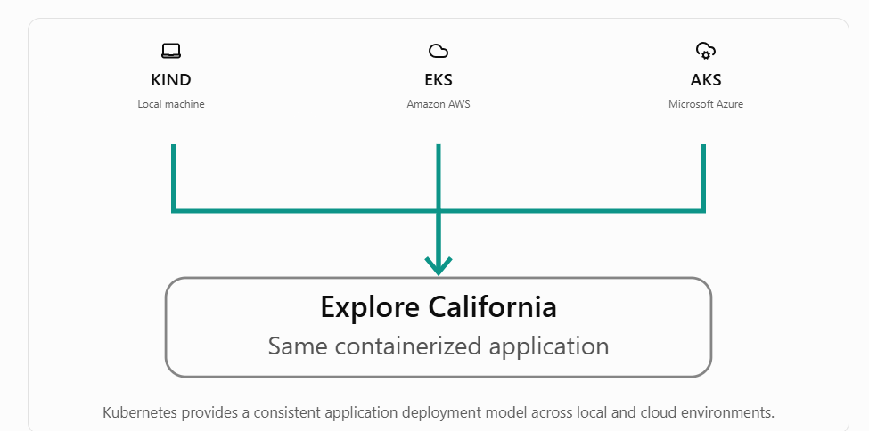

# 7.1 From kind to AKS Whats changing

**From KIND to AKS — What's Changing?**

**1. Overview**

This lesson introduces deploying the **Explore California application into Microsoft Azure Kubernetes Service (AKS)**.

Previously, the application was deployed using:

- **KIND** — Local Kubernetes development environment.

- **Amazon EKS** — AWS-managed Kubernetes service.

- **Amazon ECR** — AWS container image registry.

Now, the same application will be deployed into Microsoft Azure using:

- **Azure Kubernetes Service (AKS)** — Managed Kubernetes cluster.

- **Azure Container Registry (ACR)** — Container image storage.

- **Helm** — Kubernetes application deployment and management.

The main goal is to demonstrate that Kubernetes applications can be deployed across different cloud providers using similar commands and deployment configurations.

**2. Architecture: KIND vs. EKS vs. AKS**



**3. What changes when moving to AKS?**

| **Component**          | **Amazon AWS**    | **Microsoft Azure**             |
|------------------------|-------------------|---------------------------------|
| Kubernetes service     | Amazon EKS        | Azure AKS                       |
| Container registry     | Amazon ECR        | Azure ACR                       |
| Command-line interface | AWS CLI / eksctl  | Azure CLI (az)                  |
| Cloud identity         | AWS IAM           | Microsoft Entra ID / Azure RBAC |
| Container images       | Stored in ECR     | Stored in ACR                   |
| Application deployment | Helm              | Helm                            |
| Kubernetes management  | kubectl           | kubectl                         |
| Load balancing         | AWS Load Balancer | Azure Load Balancer             |

**Important:** The Kubernetes commands remain largely the same. The main differences involve cloud infrastructure, authentication, and container registries.

**4. AKS deployment workflow**

1.  **Create an Azure AKS cluster**

Provision a managed Kubernetes cluster using Microsoft Azure.

2.  **Create an Azure Container Registry**

Set up ACR to store the Explore California container image.

3.  **Push the container image into ACR**

Authenticate, tag, and upload the existing Docker or Podman image.

4.  **Deploy Explore California using Helm**

Update the Helm configuration to reference the ACR image and install the application.

5.  **Verify the deployment**

Confirm that the application Pods are running and the website is accessible.

**5. Example Azure commands**

These commands illustrate the upcoming workflow. They are not executed in this introductory lesson.

**Login to Azure**

```bash

az login

```

**Create an Azure resource group**

```bash

az group create \
  --name explorecalifornia-rg \
  --location eastus

```

**Create an AKS cluster**

```bash

az aks create \
  --resource-group explorecalifornia-rg \
  --name explorecalifornia-aks \
  --node-count 2 \
  --generate-ssh-keys

```

**Connect kubectl to AKS**

```bash

az aks get-credentials \
  --resource-group explorecalifornia-rg \
  --name explorecalifornia-aks

```

Verify:

```bash

kubectl get nodes

```

**Create an Azure Container Registry**

```bash

az acr create \
  --resource-group explorecalifornia-rg \
  --name explorecaliforniaacr123 \
  --sku Basic

```

The registry name must be globally unique.

**Deploy using Helm**

After pushing the image into ACR and configuring AKS image-pull access:

```bash

helm upgrade --install aks ./chart \
  --set image.name=explorecaliforniaacr123.azurecr.io/explorecalifornia \
  --set image.tag=1.0.0

```

This example assumes the Helm chart supports the image.name and image.tag values.

**6. Key takeaway**

**Moving from KIND or EKS to AKS does not require rebuilding the entire Kubernetes application.**

The container image, Kubernetes manifests, and Helm chart can generally be reused.

The main changes are:

- Kubernetes infrastructure moves to Azure AKS.

- Container images are stored in Azure ACR instead of Amazon ECR.

- Azure CLI replaces AWS-specific management commands.

- Helm and kubectl continue to manage application deployments.

**Next lesson:** Creating and configuring the Azure environment for deploying Explore California into AKS.

# [README](./../../../README.md)
