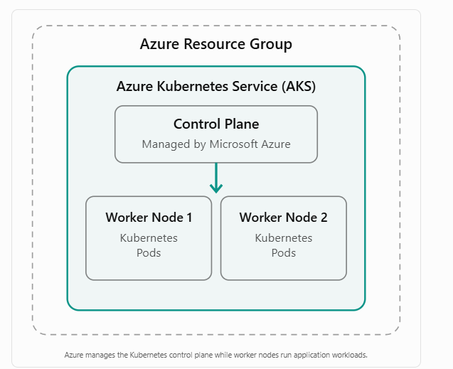
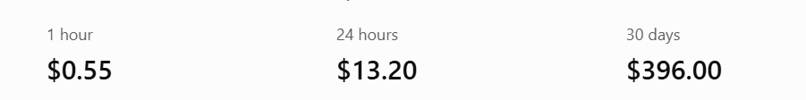

# 7.2 Deploying your AKS cluster with the Azure CLI

**Deploying an Azure AKS Cluster Using Azure CLI**

**1. Overview**

This lesson demonstrates how to create an **Azure Kubernetes Service (AKS) cluster** using the Azure Command-Line Interface (Azure CLI).

The goal is to prepare a Kubernetes environment in Microsoft Azure for deploying the Explore California application.

The process involves three main steps:

1.  Understand Azure AKS costs.

2.  Create an Azure Resource Group.

3.  Deploy an AKS Kubernetes cluster.

**2. Azure AKS architecture**



**3. Understanding AKS costs**

The instructor warns that running an AKS cluster can generate charges even when no applications are actively being used.

| **Resource**                    | **Estimated hourly cost in lesson** |
|---------------------------------|-------------------------------------|
| AKS control plane               | \$0.10                              |
| Worker nodes (combined example) | \$0.45                              |
| Total                           | \$0.55/hour                         |

Estimated cost based on the lesson's assumptions



These are illustrative course estimates, not current Azure price quotes. Actual costs depend on the AKS pricing tier, VM sizes, node count, region, storage, networking, and other services. Some AKS configurations have no control-plane management fee.

**Recommendation:** Delete practice clusters when they are no longer needed to avoid unnecessary charges.

**4. Step-by-step AKS deployment**

**Step 1: Create an Azure Resource Group**

Azure Resource Groups organize related cloud resources.

In this project, the resource group will contain the AKS cluster and, later, the Azure Container Registry (ACR).

```bash

az group create \
  --name example \
  --location westus

```

**Explanation:**

| **Parameter**     | **Purpose**                        |
|-------------------|------------------------------------|
| az group create   | Creates a new Azure Resource Group |
| --name example    | Specifies the resource group name  |
| --location westus | Selects the Azure region           |

The command returns a JSON response containing information about the new resource group.

**Step 2: Create the AKS cluster**

```bash

az aks create \
  --name explore-california-cluster \
  --resource-group example \
  --generate-ssh-keys

```

**Explanation:**

| **Parameter**       | **Purpose**                         |
|---------------------|-------------------------------------|
| az aks create       | Creates an Azure Kubernetes cluster |
| --name              | Specifies the cluster name          |
| --resource-group    | Identifies the Azure Resource Group |
| --generate-ssh-keys | Generates SSH keys if necessary     |

The SSH keys support SSH access to Linux nodes; they are not what joins worker nodes to the control plane.

Azure provisions the managed Kubernetes control plane and worker nodes according to the selected configuration and defaults.

**Step 3: Wait for deployment**

According to the lesson, cluster creation typically takes approximately **8–10 minutes**.

The actual deployment time can vary depending on Azure region, cluster configuration, and resource availability.

Once provisioning finishes, Azure CLI returns information about the created cluster.

**5. Verify the AKS cluster**

After creation, you can verify that the cluster exists:

```bash

az aks list \
  --resource-group example \
  --output table

```

To connect kubectl to the cluster:

```bash

az aks get-credentials \
  --resource-group example \
  --name explore-california-cluster

```

Then verify the Kubernetes worker nodes:

```bash

kubectl get nodes

```

Expected example:

NAME STATUS ROLES

aks-nodepool1-xxxxxxxx-vmss000000 Ready \<none\>

aks-nodepool1-xxxxxxxx-vmss000001 Ready \<none\>

A Ready status indicates that Kubernetes considers the node available to run workloads.

These verification commands are useful follow-up steps; the transcript itself ends after initiating cluster creation.

**6. Important Azure CLI commands**

| **Command**            | **Purpose**                               |
|------------------------|-------------------------------------------|
| az login               | Authenticate with Azure                   |
| az group create        | Create a resource group                   |
| az group list          | List resource groups                      |
| az aks create          | Create an AKS cluster                     |
| az aks list            | List AKS clusters                         |
| az aks get-credentials | Configure kubectl access                  |
| kubectl get nodes      | Verify Kubernetes nodes                   |
| az aks delete          | Delete an AKS cluster                     |
| az group delete        | Delete a resource group and its resources |

**7. AKS vs. EKS**

| **Feature** | **Amazon EKS** | **Azure AKS** |
|----|----|----|
| Cloud provider | AWS | Microsoft Azure |
| Kubernetes management | Managed | Managed |
| Cluster creation tool | eksctl | az aks |
| Resource organization | AWS resource tags / CloudFormation stacks | Azure Resource Groups |
| Container registry | Amazon ECR | Azure ACR |
| Application deployment | Helm | Helm |
| Kubernetes commands | kubectl | kubectl |

The primary difference is how each cloud provider provisions and manages the Kubernetes infrastructure. Once the cluster is available, the same standard Kubernetes tools can be used.

**8. Key takeaway**

The lesson introduces two essential Azure commands:

```bash
# Create a resource group
az group create \
  --name example \
  --location westus

# Create an AKS cluster
az aks create \
  --name explore-california-cluster \
  --resource-group example \
  --generate-ssh-keys

```

These commands establish the Azure infrastructure needed to run Explore California.

**Next lesson:** Connect to the new AKS cluster and prepare the Azure environment for deploying the application.

# [README](./../../../README.md)
