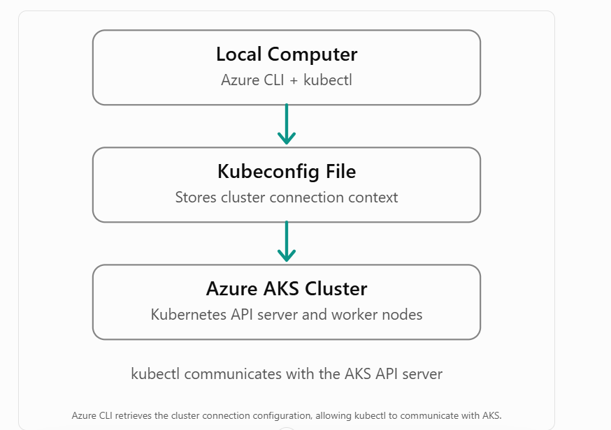
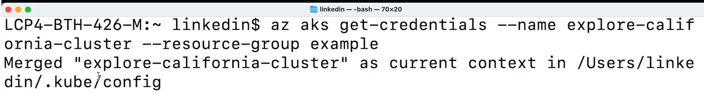

# 7.3 Logging into your AKS cluster

**Logging into Your Azure AKS Cluster**

**1. Overview**

This lesson demonstrates how to **connect to an existing Azure Kubernetes Service (AKS) cluster** using Azure CLI and verify the connection using kubectl.

After creating the Explore California AKS cluster, the next step is to configure your local computer to communicate with it.

The process involves two main steps:

1.  Retrieve the AKS cluster credentials using Azure CLI.

2.  Verify the Kubernetes connection using kubectl.

**2. How AKS authentication works**



**3. Step-by-step: Connect to AKS**

**Step 1: Retrieve AKS credentials**

Run the following command:

```bash

az aks get-credentials \
  --name explore-california-cluster \
  --resource-group example

```



**Command explanation:**

| **Parameter**          | **Purpose**                                 |
|------------------------|---------------------------------------------|
| az aks get-credentials | Retrieves Kubernetes connection credentials |
| --name                 | Specifies the AKS cluster name              |
| --resource-group       | Specifies the Azure Resource Group          |

The command merges the AKS cluster configuration into your local kubeconfig file.

On Linux and macOS, the default location is:

~/.kube/config

On Windows:

%USERPROFILE%\\kube\config

**Step 2: Confirm the kubeconfig update**

Expected message:

Merged "explore-california-cluster" as current context in ~/.kube/config

This means the cluster configuration was added successfully.

**Important:** A successful merge does not by itself guarantee that you have permission to access Kubernetes resources.

**Step 3: Verify the connection**

```bash

kubectl get nodes

```

Expected example:

NAME STATUS ROLES AGE

aks-nodepool1-12345678-vmss000000 Ready \<none\> 10m

aks-nodepool1-12345678-vmss000001 Ready \<none\> 10m

If the nodes appear with a Ready status, your connection is working and the nodes are available to run workloads.

**4. Additional useful commands**

| **Command** | **Purpose** |
|----|----|
| az login | Sign in to Microsoft Azure |
| az aks list --output table | List AKS clusters |
| az aks get-credentials | Configure access to AKS |
| kubectl config get-contexts | Display configured Kubernetes contexts |
| kubectl config current-context | Show the currently selected cluster |
| kubectl get nodes | Verify cluster connectivity |
| kubectl get pods -A | List Pods across all namespaces |
| kubectl cluster-info | Display Kubernetes control-plane information |

**5. Troubleshooting connection problems**

If kubectl get nodes fails, check the following:

**Problem: Azure authentication expired**

```bash

az login

```

Sign in again and retry.

**Problem: Wrong Kubernetes context**

```bash

kubectl config get-contexts

```

Switch to the correct context:

```bash

kubectl config use-context explore-california-cluster

```

**Problem: Missing cluster credentials**

Run the credentials command again:

```bash

az aks get-credentials \
  --name explore-california-cluster \
  --resource-group example

```

For Microsoft Entra-integrated clusters, additional authentication configuration or permissions may be required.

**6. Key takeaway**

The two most important commands from this lesson are:

```bash
# Connect to the AKS cluster
az aks get-credentials \
  --name explore-california-cluster \
  --resource-group example

# Verify the connection
kubectl get nodes

```

**Remember:**

- az aks get-credentials configures your local Kubernetes connection.

- kubectl get nodes verifies that you can communicate with the AKS cluster.

- A Ready node status indicates that Kubernetes considers the node healthy enough to accept workloads.

**Next step:** Prepare the AKS environment for deploying the Explore California application, including its container registry and Kubernetes resources.

# [README](./../../../README.md)
