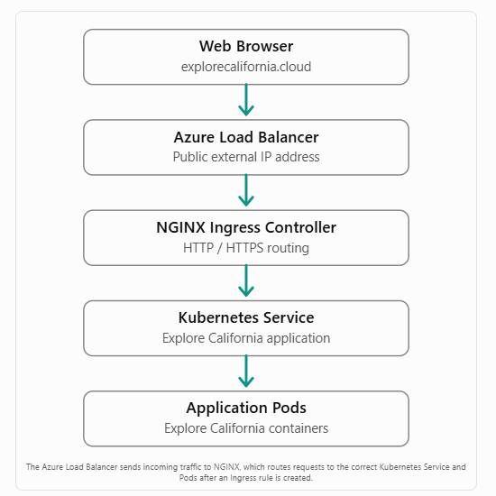
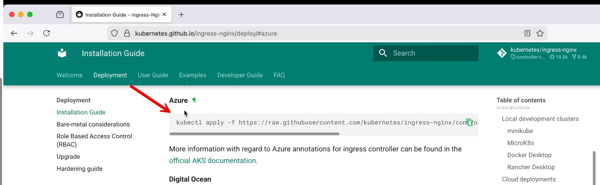
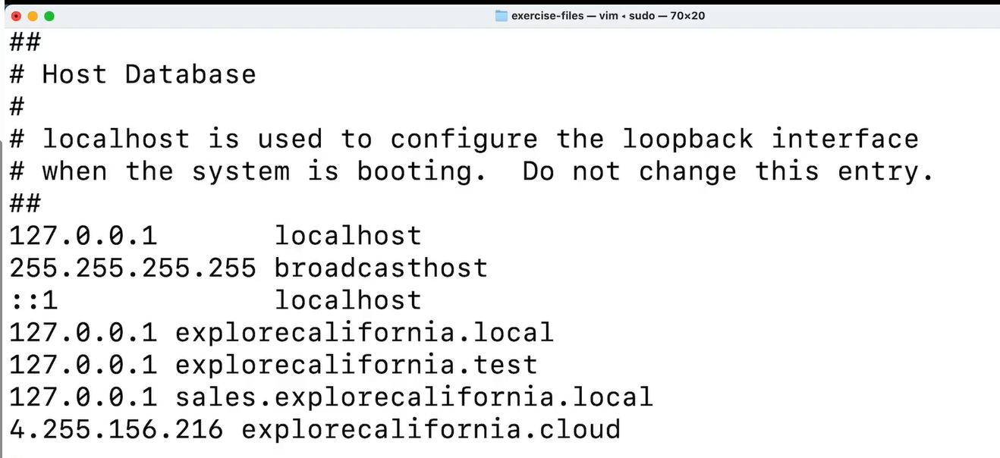

# 7.4 Installing NGINX ingress controller into AKS

**Installing NGINX Ingress Controller into Azure AKS**

**1. Overview**

This lesson demonstrates how to install the **NGINX Ingress Controller** into an Azure Kubernetes Service (AKS) cluster.

The NGINX Ingress Controller manages incoming HTTP and HTTPS traffic and routes requests to Kubernetes applications.

The installation process is similar to KIND and Amazon EKS, but Azure AKS automatically provisions an **Azure Load Balancer** for a Kubernetes Service configured with type: LoadBalancer.

The lesson covers four main steps:

1.  Install the NGINX Ingress Controller.

2.  Verify the Azure Load Balancer's external IP address.

3.  Configure the local hosts file.

4.  Test access to the Ingress Controller.

**2. How NGINX Ingress works in AKS**



**3. Step-by-step installation**

**Step 1: Install NGINX Ingress Controller**

Open the official documentation:

[NGINX Ingress Controller — Azure Deployment](https://kubernetes.github.io/ingress-nginx/deploy/?utm_source=chatgpt.com#azure)

The instructor navigates to the Azure installation section and copies the installation command.

Example command structure:

```bash

kubectl apply -f <azure-ingress-nginx-manifest-url>

```



Use the exact installation manifest recommended for your controller version.

This creates the NGINX controller's Kubernetes resources, including its Deployment and LoadBalancer Service.

**Step 2: Verify the controller Service**

Run:

```bash

kubectl get svc -n ingress-nginx

```

Example output:

NAME TYPE EXTERNAL-IP

ingress-nginx-controller LoadBalancer 20.100.50.25

The external IP address is assigned through the Azure Load Balancer.

You can also verify the controller Pods:

```bash

kubectl get pods -n ingress-nginx

```

The Pods should show a Running status.

**Step 3: Configure the hosts file**

Because the lesson does not create a public DNS record, the instructor manually maps the Azure Load Balancer's external IP address to the application hostname.

On Linux or macOS:

```bash

sudo vim /etc/hosts

```

Add:

20.100.50.25 explorecalifornia.cloud



The IP address above is an example. Use the actual external IP assigned to your Azure Load Balancer.

On Windows, open Notepad as administrator and edit:

C:\Windows\System32\drivers\etc\hosts

Add the same IP-to-hostname mapping.

**Purpose:** The hosts file allows your computer to resolve explorecalifornia.cloud to the Azure Load Balancer without creating a public DNS record.

**Step 4: Test the NGINX Ingress Controller**

Open a browser and navigate to:

http://explorecalifornia.cloud

Expected response:

404 Not Found

nginx

**Why is a 404 response expected?**

At this point, the NGINX Ingress Controller is installed, but no Ingress rule has been created for explorecalifornia.cloud.

A response from the NGINX default backend indicates that the request is reaching the controller.

The 404 will be resolved later when the Explore California Helm chart creates the application's Ingress resource.

**4. Important Kubernetes commands**

| **Command** | **Purpose** |
|----|----|
| kubectl get nodes | Verify AKS cluster nodes |
| kubectl get pods -n ingress-nginx | Check NGINX controller Pods |
| kubectl get svc -n ingress-nginx | Retrieve Azure Load Balancer IP |
| kubectl get ingress -A | List Ingress resources |
| kubectl describe svc ingress-nginx-controller -n ingress-nginx | Inspect the LoadBalancer Service |
| kubectl logs -n ingress-nginx deployment/ingress-nginx-controller | Troubleshoot controller logs |

**5. KIND vs. EKS vs. AKS**

| **Feature** | **KIND** | **Amazon EKS** | **Azure AKS** |
|----|----|----|----|
| Environment | Local computer | AWS | Azure |
| Load balancer | Local configuration | AWS Network Load Balancer | Azure Load Balancer |
| External address | Often localhost | AWS DNS hostname | Azure public IP |
| Ingress controller | NGINX | NGINX | NGINX |
| Kubernetes commands | kubectl | kubectl | kubectl |
| Hosts file | Local IP mapping | NLB IP mapping for testing | Azure Load Balancer IP mapping |

The important difference is that cloud Kubernetes environments can automatically create cloud load balancers for Kubernetes Services.

**6. Important production considerations**

The course demonstrates the community NGINX Ingress Controller. However, the community ingress-nginx project reached its announced retirement in March 2026. For new production deployments, choose a maintained and supported controller or Gateway API implementation.

Additional considerations:

- **Public IP addresses:** Consider reserving a static Azure public IP for production applications.

- **DNS:** Use a proper DNS record instead of modifying individual hosts files.

- **HTTPS:** Configure TLS certificates before exposing sensitive application traffic.

- **Costs:** Azure Load Balancers and public IP addresses may generate charges.

- **Cleanup:** Remove the LoadBalancer Service before deleting the AKS cluster to reduce the risk of orphaned Azure resources.

**7. Key takeaway**

The NGINX Ingress Controller is installed into Azure AKS and exposed through an Azure Load Balancer.

The workflow is:

Install NGINX → Verify LoadBalancer IP → Update Hosts File → Test Browser Access

A **404 Not Found** response is expected at this stage because the application Ingress routing rule has not yet been created.

**Next lesson:** Prepare Azure Container Registry (ACR) to store the Explore California container image before deploying the application into AKS.

# [README](./../../../README.md)
