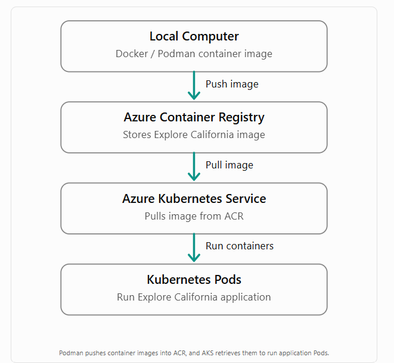
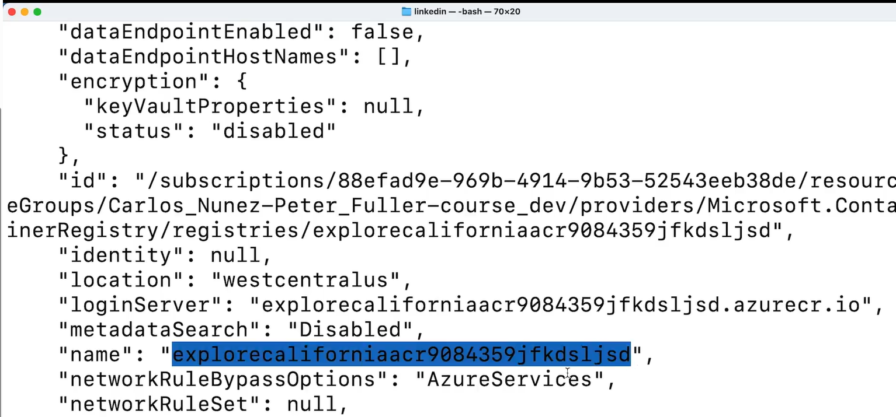
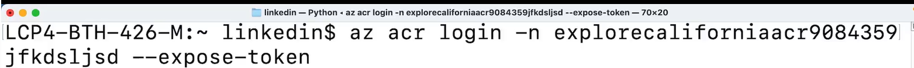

# 7.5 Creating an ACR repository

**Creating an Azure Container Registry (ACR)**

**1. Overview**

This lesson demonstrates how to create an **Azure Container Registry (ACR)** and authenticate using Podman.

ACR is Microsoft's managed container registry service for storing Docker and OCI container images.

The goal is to prepare a registry for the **Explore California** container image so it can later be deployed into Azure Kubernetes Service (AKS).

The process involves three main steps:

1.  Create an Azure Container Registry.

2.  Retrieve the registry login server and access token.

3.  Authenticate Podman with ACR.

**Important correction:** The transcript occasionally mentions EKS and ECR, but this lesson uses **Azure AKS and ACR**.

**2. How ACR works with AKS**



**3. Step-by-step: Create an Azure Container Registry**

**Step 1: Create the registry**

The instructor uses Azure CLI to create an ACR instance.

```bash

az acr create \
  --resource-group example \
  --name explorecalifornia12345 \
  --sku Basic

```

| **Parameter**                 | **Purpose**                         |
|-------------------------------|-------------------------------------|
| az acr create                 | Creates an Azure Container Registry |
| --resource-group example      | Specifies the Azure resource group  |
| --name explorecalifornia12345 | Specifies the registry name         |
| --sku Basic                   | Selects the Basic pricing tier      |

ACR registry names must be globally unique and contain only alphanumeric characters, with a length of 5–50 characters.

The instructor recommends adding a timestamp to reduce naming conflicts.

Example for bash:

```bash

az acr create \
  --resource-group example \
  --name "explorecalifornia\$(date +%s)" \
  --sku Basic

```

Save the generated registry name because you will need it for subsequent commands. Running the timestamp-based command repeatedly can create additional registries and charges.

**Step 2: List existing registries**

```bash

az acr list \
  --resource-group example \
  --output table

```

This displays the registries in the resource group.

Example:

NAME LOCATION SKU

explorecalifornia12345 westus Basic

**Step 3: Retrieve the registry access token**

```bash

az acr login \
  --name explorecalifornia12345 \
  --expose-token

```



This returns information including:

- loginServer — Registry endpoint.

- accessToken — Temporary authentication token.

Example login server:

explorecalifornia12345.azurecr.io

The access token is sensitive and should not be stored in source code or shared.

**Step 4: Authenticate Podman with ACR**

The instructor uses the access token to authenticate Podman.

A more secure approach avoids placing the token directly into the command history.

```bash

az acr login \
  --name explorecalifornia12345 \
  --expose-token \
  --query accessToken \
  --output tsv \
  | podman login \
  explorecalifornia12345.azurecr.io \
  --username 00000000-0000-0000-0000-000000000000 \
  --password-stdin

```



The username consists of the special all-zero GUID used for ACR token authentication.

Expected output:

Login Succeeded!

This confirms that Podman has successfully authenticated with Azure Container Registry.

**4. Important Azure CLI commands**

| **Command**                 | **Purpose**                              |
|-----------------------------|------------------------------------------|
| az login                    | Authenticate with Azure                  |
| az acr create               | Create an Azure Container Registry       |
| az acr list                 | List existing registries                 |
| az acr show                 | Retrieve registry information            |
| az acr login --expose-token | Retrieve a registry authentication token |
| podman login                | Authenticate the container engine        |
| podman images               | List local container images              |
| podman push                 | Upload a container image                 |

**5. Azure ACR vs. Amazon ECR**

| **Feature** | **Azure ACR** | **Amazon ECR** |
|----|----|----|
| Cloud provider | Microsoft Azure | Amazon AWS |
| Registry creation | az acr create | aws ecr create-repository |
| Authentication | Microsoft Entra / Azure token | AWS IAM / ECR token |
| Container engine | Docker / Podman | Docker / Podman |
| Kubernetes integration | Azure AKS | Amazon EKS |
| Image storage | OCI/Docker images | OCI/Docker images |

An important difference is that az acr create creates a **registry**, not an individual image repository. An image repository is established when an image is pushed under a repository name.

**6. Key takeaway**

**Azure Container Registry stores the Explore California container image, while Azure Kubernetes Service runs the application.**

The workflow is:

Create ACR → Retrieve Access Token → Login with Podman → Tag Image → Push Image → Deploy to AKS

At the end of this lesson, the registry has been created and Podman is authenticated.

The Explore California image has not yet been uploaded.

**Next lesson:** Tag and push the Explore California container image into Azure Container Registry.

# [README](./../../../README.md)
