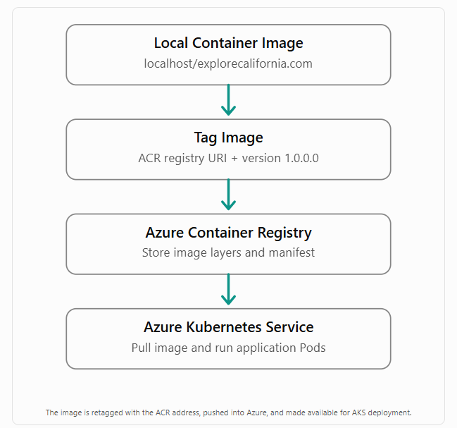
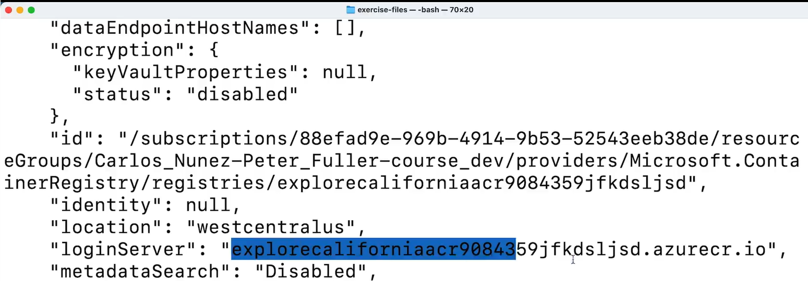

# 7.6 Deploying the Explore California image into ACR

**Deploying the Explore California Image into Azure Container Registry (ACR)**

**1. Overview**

This lesson demonstrates how to **upload the Explore California container image into Azure Container Registry (ACR)** using Docker or Podman.

The image will later be deployed into Azure Kubernetes Service (AKS) using Helm.

The process consists of three steps:

1.  **Login** — Authenticate with Azure Container Registry.

2.  **Tag** — Assign the ACR registry address and image version.

3.  **Push** — Upload the container image to ACR.

The instructor already completed authentication in the previous lesson.

**2. How the image deployment works**



**3. Step-by-step deployment**

**Step 1: Authenticate with Azure Container Registry**

Authentication was completed in the previous lesson.

Example using Podman:

```bash

az acr login \
  --name explorecalifornia12345 \
  --expose-token \
  --query accessToken \
  --output tsv \
  | podman login \
  explorecalifornia12345.azurecr.io \
  --username 00000000-0000-0000-0000-000000000000 \
  --password-stdin

```  

Expected result:

Login Succeeded!

Replace explorecalifornia12345 with your actual registry name.

**Step 2: Retrieve the ACR registry address**

```bash

az acr list --output table

```



Example registry login server:

explorecalifornia12345.azurecr.io

You can retrieve the login server directly:

```bash

az acr show \
  --name explorecalifornia12345 \
  --query loginServer \
  --output tsv
```

**Step 3: Tag the Explore California image**

```bash

podman tag \
  localhost/explorecalifornia.com:latest \
  explorecalifornia12345.azurecr.io/explorecalifornia.com:1.0.0.0

```

**Command explanation:**

| **Component** | **Purpose** |
|----|----|
| podman tag | Assign a new name and version to an existing image |
| localhost/explorecalifornia.com:latest | Original local container image |
| explorecalifornia12345.azurecr.io | Azure Container Registry login server |
| explorecalifornia.com | Image repository name |
| 1.0.0.0 | Application image version used in the transcript |

The tag must match the version you intend to deploy. The instructor states 1.0.0.0 in this transcript; verify the actual appVersion in your Chart.yaml because earlier lessons used 1.0.0.

Verify the new tag:

```bash

podman images

```

**Step 4: Push the image to ACR**

```bash

podman push \
  explorecalifornia12345.azurecr.io/explorecalifornia.com:1.0.0.0

```

Podman uploads the container image layers and manifest to Azure Container Registry.

Example output:

Copying blob...

Copying config...

Writing manifest to image destination

These messages indicate that the image is being uploaded.

**Step 5: Verify the image in ACR**

List the image repositories:

```bash

az acr repository list \
  --name explorecalifornia12345 \
  --output table

```

List the tags for Explore California:

```bash

az acr repository show-tags \
  --name explorecalifornia12345 \
  --repository explorecalifornia.com \
  --output table

```

Expected version:

1.0.0.0

**4. Why use version tags instead of latest?**

The instructor recommends explicit version numbers because they make application deployments easier to identify and manage.

| **Image tag** | **Meaning** |
|----|----|
| latest | Conventional default tag; does not guarantee the newest version |
| 1.0.0 | Example initial release |
| 1.0.0.0 | Version used in this lesson |
| 1.0.1 | Example patch release |
| 2.0.0 | Example major release |

Using explicit versions helps with troubleshooting, tracking changes, and rolling back deployments.

For production environments, immutable image tags or image digests provide stronger version control.

**5. Important commands**

| **Command**                 | **Purpose**                           |
|-----------------------------|---------------------------------------|
| az acr list                 | List Azure Container Registries       |
| az acr show                 | Retrieve registry information         |
| podman images               | Display local images                  |
| podman tag                  | Assign the ACR image name and version |
| podman push                 | Upload the image to ACR               |
| az acr repository list      | List image repositories               |
| az acr repository show-tags | Verify uploaded image versions        |

Docker users can replace podman with docker in the equivalent commands.

**6. Key takeaway**

The Explore California image is now stored in Azure Container Registry and is ready to be deployed into Azure Kubernetes Service.

The overall workflow is:

**Local Image → Login to ACR → Tag Image → Push to ACR → Deploy to AKS**

At the end of this lesson:

- The ACR registry is available.

- Podman has authenticated successfully.

- The Explore California image has been tagged with its registry address and version.

- The image has been uploaded to ACR.

**Next lesson:** Deploy Explore California into AKS using Helm and configure Kubernetes to pull the image from Azure Container Registry.

# [README](./../../../README.md)
