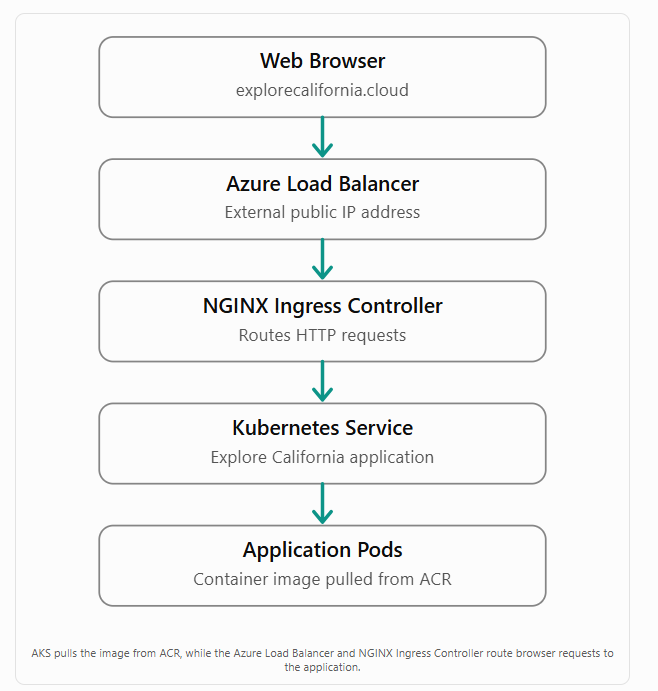
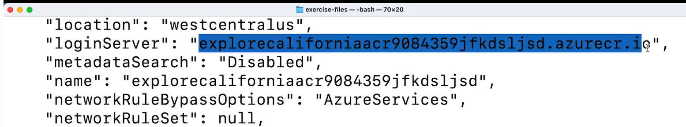
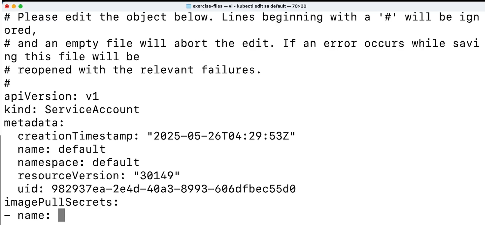
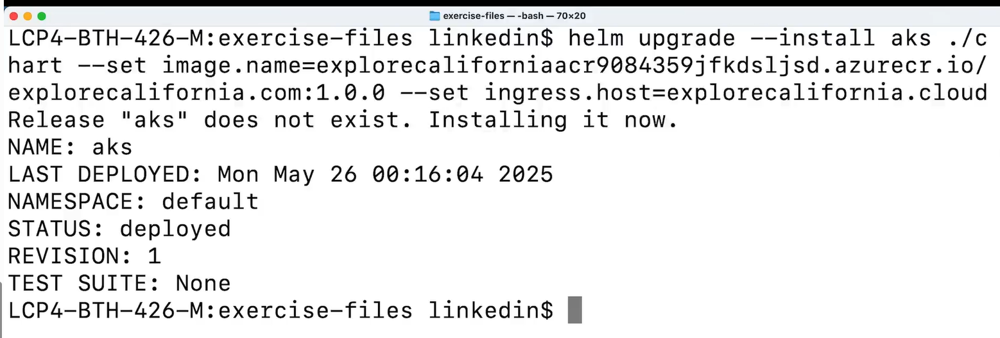
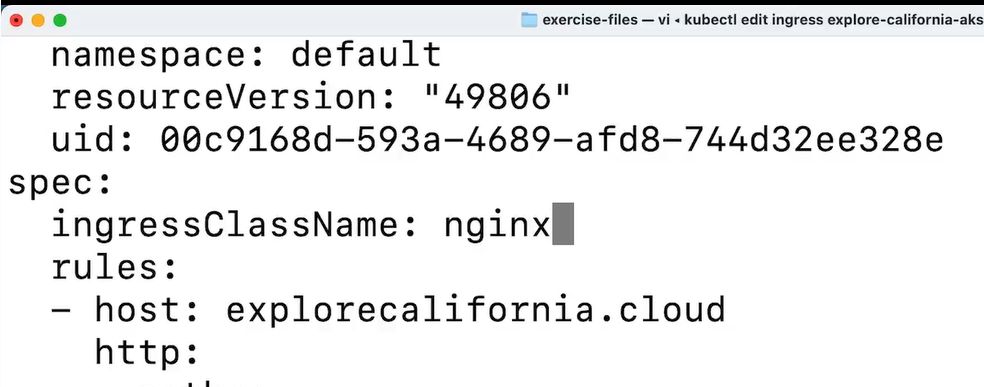
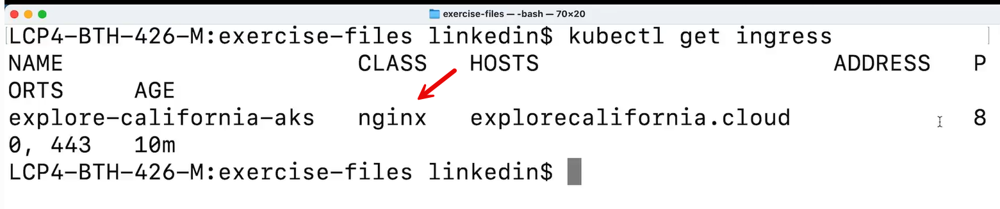
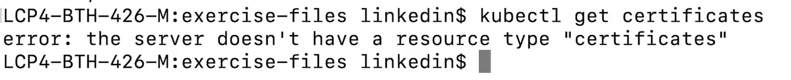

# 7.7 Deploying Explore California into AKS

**Deploying Explore California into Azure AKS Using Helm**

**1. Overview**

This lesson demonstrates how to deploy the **Explore California application into Azure Kubernetes Service (AKS)** using Helm, Azure Container Registry (ACR), Kubernetes Secrets, and the NGINX Ingress Controller.

The Explore California container image has already been uploaded to ACR. The next step is to configure AKS to pull that image and make the application accessible through a web browser.

The deployment consists of three main steps:

1.  **Create an image pull secret** to authenticate AKS with Azure Container Registry.

2.  **Deploy the application using Helm**, specifying the ACR image and application hostname.

3.  **Configure the NGINX Ingress Controller** to route external traffic to Explore California.

**2. How the AKS deployment works**



**3. Step-by-step deployment**

**Step 1: Retrieve the Azure Container Registry information**

List your registries:

```bash

az acr list --output table

```



Example registry:

explorecalifornia12345.azurecr.io

Retrieve an ACR authentication token:

```bash

az acr login \
  --name explorecalifornia12345 \
  --expose-token

```

The command returns an access token that can be used for registry authentication.

**Step 2: Create a Kubernetes image pull secret**

The instructor creates a Kubernetes Secret named explorecalifornia-acr.

Example:

```bash

kubectl create secret docker-registry explorecalifornia-acr \
  --docker-server=explorecalifornia12345.azurecr.io \
  --docker-username=00000000-0000-0000-0000-000000000000 \
  --docker-password="\$(az acr login \
  --name explorecalifornia12345 \
  --expose-token \
  --query accessToken \
  --output tsv)"

```

Replace the registry name with your actual ACR name.

Verify the Secret:

```bash

kubectl get secrets

```

**Important:** The ACR access token is temporary. For production AKS deployments, use AKS-to-ACR identity-based authentication instead of manually managing temporary pull secrets.

**Step 3: Associate the Secret with the default ServiceAccount**

The instructor edits the default Kubernetes ServiceAccount:

```bash

kubectl edit sa default

```

Add the following configuration:

```yaml

imagePullSecrets:
  - name: explorecalifornia-acr

```



This allows Pods using the default ServiceAccount to access the image pull credentials.

The Secret and ServiceAccount must be in the same Kubernetes namespace as the application Pods.

An alternative is to configure imagePullSecrets directly in the application's Deployment or Helm chart.

**Step 4: Verify the project branch**

Before deploying, the instructor switches to the course branch:

```bash

git checkout 07_07b

```

This ensures that the correct Helm chart and application configuration are available.

**Step 5: Deploy Explore California using Helm**

The instructor installs the application using helm upgrade --install.

Example:

```bash

helm upgrade --install aks ./chart \
  --set image.name=explorecalifornia12345.azurecr.io/explorecalifornia.com \
  --set image.tag=1.0.0 \
  --set ingress.host=explorecalifornia.cloud

```



| **Parameter**          | **Purpose**                        |
|------------------------|------------------------------------|
| helm upgrade --install | Installs or updates a Helm release |
| aks                    | Helm release name                  |
| ./chart                | Helm chart directory               |
| image.name             | ACR container image repository     |
| image.tag              | Container image version            |
| ingress.host           | Website hostname                   |

The exact values must match the Helm chart's templates. If the chart expects a single image reference rather than separate name and tag values, configure it accordingly.

Also verify the image tag in ACR. Earlier course transcripts mentioned both 1.0.0 and 1.0.0.0.

**Step 6: Verify the application Pods and Services**

Check the Pods:

```bash

kubectl get pods

```

Expected example:

NAME READY STATUS

explore-california-xxxxx 1/1 Running

Check the Services:

```bash

kubectl get svc

```

These commands help confirm that the application has been deployed and its Kubernetes Service exists.

**Step 7: Configure the NGINX Ingress Controller**

The instructor checks the Ingress:

```bash

kubectl get ingress

```

Then edits the application's Ingress:

```bash

kubectl edit ingress explore-california-aks

```

Add the following under spec:

yaml

spec:

ingressClassName: nginx



The ingressClassName field tells Kubernetes to use the NGINX Ingress Controller.

For a permanent solution, update the Helm chart to include the Ingress class rather than manually editing the resource after deployment.

**Step 8: Verify the Ingress external IP**

```bash

kubectl get ingress

```



Check the NGINX controller's LoadBalancer Service:

```bash

kubectl get svc -n ingress-nginx

```

The Ingress should eventually report the external IP address associated with the Azure Load Balancer.

This can take a few minutes.

**Step 9: Test the Explore California website**

Open the following URL in your browser:

http://explorecalifornia.cloud

The hostname must resolve to the Azure Load Balancer's IP address, which was configured in the hosts file in an earlier lesson.

If the Pods, Service, and Ingress are configured correctly, the Explore California website should load.

**4. Important Kubernetes and Azure commands**

| **Command** | **Purpose** |
|----|----|
| az acr list | List Azure Container Registries |
| az acr login --expose-token | Retrieve an ACR authentication token |
| kubectl create secret docker-registry | Create image pull credentials |
| kubectl edit sa default | Configure the default ServiceAccount |
| helm upgrade --install | Deploy or update the application |
| kubectl get pods | Verify application Pods |
| kubectl get svc | Verify Kubernetes Services |
| kubectl get ingress | Check Ingress configuration |
| kubectl edit ingress | Configure the Ingress class |
| kubectl get certificates | Check certificate resources |

**5. Recommended AKS-to-ACR authentication**

Although the instructor demonstrates an image pull secret, Azure supports identity-based integration between AKS and ACR.

For a compatible registry configuration, an administrator can attach ACR to AKS:

```bash

az aks update \
  --resource-group example \
  --name explore-california-cluster \
  --attach-acr explorecalifornia12345

```

This configures the AKS image-pulling identity with appropriate registry access for supported ACR authorization modes, reducing the need to maintain Docker registry secrets.

**6. Remaining issue: cert-manager**

After successfully deploying the application, the instructor checks for certificates:

```bash

kubectl get certificates

```



Kubernetes returns an error because the cert-manager CustomResourceDefinitions have not been installed.

Cert-manager is required for the certificate resources used by the course's Helm chart.

The next lesson will install cert-manager and redeploy Explore California so its TLS certificate can be created.

**7. Key takeaway**

- **ACR image available**

  - Explore California container image uploaded

- **Image pull credentials configured**

  - Kubernetes can authenticate with ACR

- **Application deployed using Helm**

  - Helm release named aks

- **NGINX Ingress configured**

  - Ingress class set to nginx

- **Website accessible**

  - Explore California running in Azure AKS

- **TLS certificate setup**

  - Pending cert-manager installation

**Final result:** Explore California is successfully deployed into Azure Kubernetes Service using Helm, ACR, and NGINX Ingress.

**Next lesson:** Install cert-manager into AKS and configure TLS certificates for HTTPS access.

# [README](./../../../README.md)
