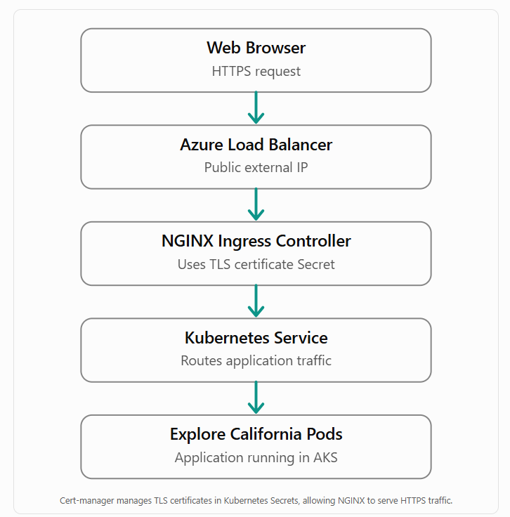
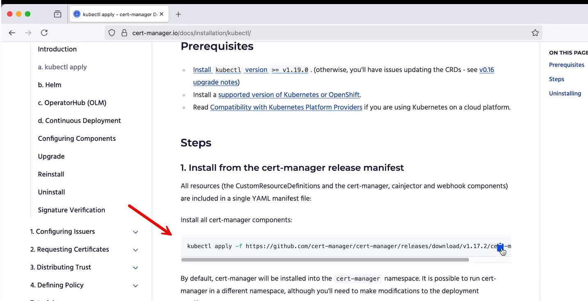
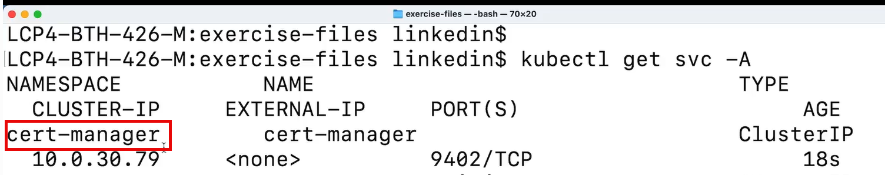
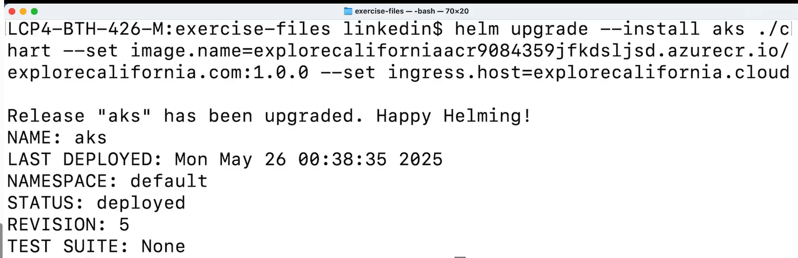
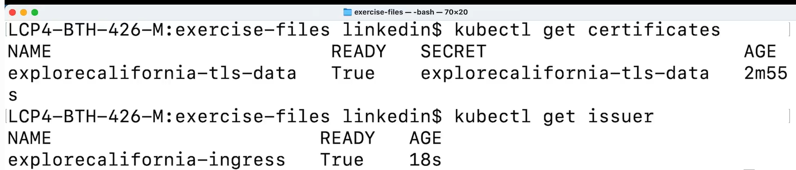

# 7.8 Installing cert-manager into AKS

**Installing cert-manager into Azure AKS**

**1. Overview**

This lesson demonstrates how to install **cert-manager into Azure Kubernetes Service (AKS)** and configure TLS certificates for the Explore California application.

In the previous lesson, Explore California was successfully deployed into AKS using Helm, Azure Container Registry (ACR), and the NGINX Ingress Controller.

However, Kubernetes could not recognize Certificate resources because cert-manager had not been installed.

**Goal:** Install cert-manager, redeploy the Explore California Helm chart, and verify that a TLS certificate is created and associated with the application's Ingress.

**2. How cert-manager works in AKS**



Cert-manager introduces several Kubernetes resources:

| **Resource**  | **Purpose**                                              |
|---------------|----------------------------------------------------------|
| cert-manager  | Automates certificate issuance and renewal               |
| Issuer        | Defines how certificates are issued within a namespace   |
| ClusterIssuer | Defines a certificate issuer available across namespaces |
| Certificate   | Requests and manages a TLS certificate                   |
| Secret        | Stores the certificate and private key                   |
| Ingress       | References the TLS Secret for HTTPS                      |

**3. Step-by-step installation**

**Step 1: Install cert-manager**

Open the official documentation:

[cert-manager — Installing with kubectl](https://cert-manager.io/docs/installation/kubectl/?utm_source=chatgpt.com)

The instructor installs cert-manager using the official Kubernetes manifest.

Example command structure:

```bash

kubectl apply -f \
  https://github.com/cert-manager/cert-manager/releases/download/%3cVERSION%3e/cert-manager.yaml

```



Replace \<VERSION\> with a supported release version from the documentation.

This installs cert-manager components, including its CustomResourceDefinitions (CRDs), controller, webhook, and CA injector.

**Step 2: Verify cert-manager Pods**

```bash

kubectl get pods -n cert-manager

```

Expected example:

NAME READY STATUS

cert-manager-xxxxx 1/1 Running

cert-manager-cainjector-xxxxx 1/1 Running

cert-manager-webhook-xxxxx 1/1 Running

All three components should be healthy.

**Step 3: Verify cert-manager Services**

```bash

kubectl get services -A

```



This displays Services across all namespaces.

Look for cert-manager Services in the cert-manager namespace.

A Service having a ClusterIP indicates that Kubernetes assigned it an internal address, but does not by itself prove cert-manager is fully operational.

**Step 4: Redeploy Explore California using Helm**

After installing cert-manager, redeploy the existing Helm chart:

```bash

helm upgrade --install aks ./chart \
  --set image.name=explorecalifornia12345.azurecr.io/explorecalifornia.com \
  --set image.tag=1.0.0 \
  --set ingress.host=explorecalifornia.cloud

```



Replace the example registry name with your own ACR registry.

This example assumes the Helm chart supports these configuration values.

The instructor uses Ctrl + R to retrieve the previous Helm command from terminal history.

**Why redeploy?** The Helm chart contains certificate-related configuration that can now be processed by Kubernetes because cert-manager has installed the necessary CRDs.

**4. Verify the certificate and Issuer**

**Check the Certificate**

```bash

kubectl get certificates

```



Expected example:

NAME READY SECRET

explore-california True explore-california-tls

READY=True indicates that cert-manager considers the certificate ready.

**Check the Issuer**

```bash

kubectl get issuers

```

Expected example:

NAME READY

explore-california True

The Issuer defines how the certificate is obtained.

**Inspect the Ingress**

kubectl describe ingress explore-california-aks

Look for the TLS Secret associated with the application hostname.

Example configuration:

```yaml

spec:
  ingressClassName: nginx
  tls:
    - hosts:
        - explorecalifornia.cloud
      secretName: explore-california-tls
	  
```

This configuration tells NGINX which Secret contains the TLS certificate for the hostname.

**5. Important Kubernetes commands**

| **Command** | **Purpose** |
|----|----|
| kubectl get pods -n cert-manager | Verify cert-manager Pods |
| kubectl get services -A | List Services across namespaces |
| helm upgrade --install aks ./chart | Redeploy Explore California |
| kubectl get certificates | Check certificate readiness |
| kubectl get issuers | Check Issuer readiness |
| kubectl describe certificate \<name\> | Troubleshoot certificate issuance |
| kubectl describe ingress explore-california-aks | Verify Ingress TLS configuration |

**6. Understanding HTTPS certificates**

There are two common certificate approaches:

| **Certificate type** | **Description** | **Browser trust** |
|----|----|----|
| Self-signed | Certificate signed by its own private key | Usually generates a warning |
| Public CA-issued | Certificate issued by a trusted certificate authority | Trusted when valid and correctly configured |

For a production website, use a publicly trusted certificate and configure automatic renewal.

Installing cert-manager alone does not guarantee that the website has a trusted certificate. The Issuer, Certificate, Secret, and Ingress must all be configured correctly.

**7. Key takeaway**

**1. Install cert-manager**

Add Certificate and Issuer resources to AKS

**2. Verify cert-manager components**

Confirm controller, webhook, and cainjector are running

**3. Redeploy the Helm chart**

Apply the certificate-related Kubernetes resources

**4. Verify Certificate and Issuer**

Check that the resources exist and become ready

**5. Inspect the Ingress**

Confirm its TLS configuration references the certificate Secret

**Final result:** Cert-manager is installed into Azure AKS, and the Explore California application can now use Kubernetes-managed TLS certificates.

The complete deployment workflow is:

ACR → AKS → Helm → NGINX Ingress → cert-manager → HTTPS

**Next step:** Verify HTTPS access and clean up the Azure resources when the practice deployment is no longer needed.

# [README](./../../../README.md)
