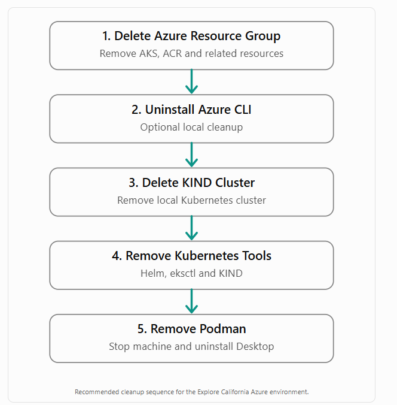

# 7.9 Cleaning up AKS

**Cleaning Up Azure AKS Resources**

**1. Overview**

This lesson explains how to **delete Azure Kubernetes Service (AKS) resources and uninstall the development tools** used throughout the Explore California Kubernetes course.

After successfully deploying Explore California into AKS, the instructor demonstrates how to remove cloud resources and local development tools.

The primary goals are to:

- Delete the Azure AKS cluster and Azure Container Registry (ACR).

- Prevent unnecessary Azure charges.

- Remove the local KIND Kubernetes cluster.

- Optionally uninstall Azure CLI, Helm, eksctl, KIND, and Podman Desktop.

**Important:** Deleting an Azure Resource Group permanently deletes the resources it contains. Verify that the group does not contain anything you need before proceeding.

**2. AKS cleanup workflow**



**3. Step-by-step cleanup**

**Step 1: Delete the Azure Resource Group**

The instructor created a resource group named example to contain the Explore California Azure resources.

Delete it using:

```bash

az group delete --name example

```

Azure CLI asks for confirmation before deleting the group.

The deletion removes resources contained in that group, potentially including:

- Azure Kubernetes Service cluster

- AKS worker nodes and associated resources

- Azure Container Registry

- Azure Load Balancer and public IP addresses

- Other resources within the group

The operation may take several minutes.

**Caution:** Some AKS-managed resources can reside in separate managed resource groups. Azure normally coordinates their cleanup when the AKS cluster is deleted, but you should verify that no orphaned billable resources remain.

**Step 2: Verify Azure resource deletion**

Check whether the resource group still exists:

```bash

az group exists --name example

```

Expected output after successful deletion:

false

You can also list remaining resource groups:

```bash

az group list --output table

```

Verify the deletion before assuming that Azure billing has stopped.

**Step 3: Uninstall Azure CLI**

If you no longer plan to use Microsoft Azure, you can uninstall Azure CLI.

On macOS:

```bash

brew uninstall azure-cli

```

On Windows:

```bash

winget uninstall Microsoft.AzureCLI

```

**Recommendation:** Keep Azure CLI installed if you plan to continue working with AKS, Azure Container Registry, or other Azure services.

**Step 4: Delete the local KIND cluster**

List existing KIND clusters:

```bash

kind get clusters

```

Delete the Explore California cluster:

```bash

kind delete cluster --name explorecalifornia.com

```

Verify:

```bash

kind get clusters

```

The deleted cluster should no longer appear.

The instructor emphasizes checking the deletion output to confirm that the intended cluster was actually removed.

**Step 5: Remove Helm, eksctl, and KIND**

These tools were installed earlier in the Kubernetes course.

On macOS, if they were manually installed in /usr/local/bin:

```bash

sudo rm /usr/local/bin/{helm,eksctl,kind}

```

This removes those specific binaries.

On Windows PowerShell, the instructor removes the course's application directory:

Remove-Item -Recurse "\$env:USERPROFILE\Apps"

**Warning:** The Windows command removes the entire Apps directory, potentially including unrelated applications. Inspect its contents first and remove only the tools you no longer need.

**Step 6: Stop and remove the Podman machine**

Before uninstalling Podman, check for running containers:

```bash

podman ps

```

List Podman machines:

```bash

podman machine list

```

Stop the Podman machine:

```bash

podman machine stop

```

Remove the machine:

```bash

podman machine rm

```

Confirm the deletion when prompted.

Removing the machine can permanently delete containers, images, and volumes stored within it.

**Step 7: Uninstall Podman Desktop**

On macOS, use the application's supported uninstall procedure or remove the installed application bundle after quitting it.

On Windows:

1.  Press Windows + R.

2.  Enter appwiz.cpl.

3.  Locate **Podman Desktop**.

4.  Select **Uninstall**.

5.  Repeat for **Podman**, if installed separately.

This completes the optional local development environment cleanup.

**4. Important cleanup commands**

| **Command** | **Purpose** |
|----|----|
| az group delete --name example | Delete the Azure Resource Group |
| az group exists --name example | Verify resource group deletion |
| az group list --output table | List remaining resource groups |
| brew uninstall azure-cli | Uninstall Azure CLI on macOS |
| winget uninstall Microsoft.AzureCLI | Uninstall Azure CLI on Windows |
| kind get clusters | List local KIND clusters |
| kind delete cluster --name explorecalifornia.com | Delete the local Kubernetes cluster |
| podman ps | Check running containers |
| podman machine stop | Stop the Podman virtual machine |
| podman machine rm | Delete the Podman virtual machine |

**5. Azure cleanup vs. AWS cleanup**

| **Task** | **Amazon EKS** | **Azure AKS** |
|----|----|----|
| Delete application | helm uninstall eks | Can delete with Helm before removing the group |
| Delete Kubernetes cluster | eksctl delete cluster | az group delete can remove the AKS cluster |
| Delete container registry | Separate ECR deletion | ACR removed with its resource group |
| Delete load balancer | Remove Kubernetes LoadBalancer Service first | Usually removed with the Azure resource group |
| Delete local cluster | kind delete cluster | kind delete cluster |
| Remove development tools | Optional | Optional |

Azure Resource Groups simplify cleanup because related resources can be deleted together.

However, deleting a resource group is safe only when all its resources are intended for removal.

**6. Cleanup checklist**

**Cleanup progress**

- Verify the Azure resource group contains only disposable resources

- Delete the Azure resource group

- Confirm the resource group has been deleted

- Check for remaining Azure resources and charges

- Delete the local KIND cluster

- Optionally uninstall Azure CLI

- Optionally uninstall Helm, eksctl, and KIND

- Stop and remove the Podman machine

- Optionally uninstall Podman Desktop

**7. Key takeaway**

The most important command from this lesson is:

```bash

az group delete --name example

```

This deletes the Azure Resource Group and the resources it contains, including the Explore California AKS cluster and ACR registry if they are located in that group.

The complete cleanup workflow is:

**Delete Azure Resource Group → Verify Deletion → Delete KIND Cluster → Optionally Remove Development Tools**

The lesson concludes the Explore California deployment project across local Kubernetes, Amazon EKS, and Microsoft Azure AKS.

# [README](./../../../README.md)
