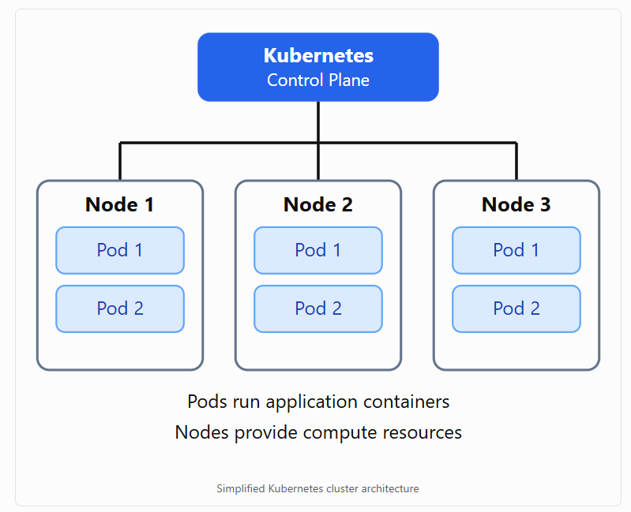

# 2.1 What is Kubernetes

**Summary: What Is Kubernetes (K8s)?**

Kubernetes (K8s) is an open-source container orchestration platform that automates the deployment, management, scaling, and recovery of containerized applications.

Kubernetes helps organizations run applications reliably across multiple servers, whether in cloud environments, on-premises data centers, or hybrid infrastructures.

**1. History of Kubernetes**

| **Topic**               | **Description**                                   |
|-------------------------|---------------------------------------------------|
| Created by              | Google                                            |
| Announced               | 2014                                              |
| Open-source development | Began in 2014; version 1.0 released in 2015       |
| Inspired by             | Google's internal cluster management system, Borg |
| Programming language    | Go (Golang)                                       |
| Managed by              | Cloud Native Computing Foundation (CNCF)          |
| Abbreviation            | K8s                                               |
| Name meaning            | Greek for pilot or helmsman                       |

According to the 2021 CNCF survey cited in the lesson, 96% of organizations were using or evaluating Kubernetes. This is a historical statistic, not a current adoption figure.

**2. What Does Kubernetes Do?**

Kubernetes acts like a captain managing a fleet of ships. It coordinates containers and decides where and how applications should run.

Its primary responsibilities include:

1.  Container orchestration: Coordinates containerized applications across multiple servers.

2.  Automated deployment: Deploys applications without manually configuring every server.

3.  Auto-scaling: Increases or decreases application replicas based on demand.

4.  Self-healing: Restarts or replaces failed containers and reschedules workloads when nodes fail.

5.  Load balancing: Distributes network traffic across application instances.

6.  Resource optimization: Helps efficiently utilize CPU, memory, and infrastructure resources.

**3. How Kubernetes Works**

Simplified Kubernetes cluster architecture

Important components:

- Cluster: A collection of machines managed by Kubernetes.

- Control Plane: Manages the cluster and schedules workloads.

- Node: A physical or virtual machine that runs applications.

- Pod: The smallest deployable unit in Kubernetes, containing one or more containers.

- Container: A packaged application with its dependencies.

**4. Real-World Example: Spotify**

The lesson describes how Spotify migrated from its internal orchestration platform, Helios, to Kubernetes in 2018.

| **Before Kubernetes** | **After Kubernetes** |
|----|----|
| Used internally developed Helios | Adopted Kubernetes |
| Required significant maintenance | Reduced custom orchestration maintenance |
| New services could take approximately an hour to provision | New services could be deployed in seconds or minutes |
| Scaling required more operational effort | Benefited from automatic scaling |

The lesson reports that one Spotify service handled approximately 10 million requests per second, demonstrating the scalability of its Kubernetes-based infrastructure.

**5. Kubernetes Deployment Environments**

Kubernetes can run in several environments.

| **Environment** | **Description** |
|----|----|
| On-premises | Kubernetes installed on company-owned servers |
| Public cloud | Kubernetes deployed on cloud infrastructure |
| Hybrid cloud | Combines on-premises and cloud resources |
| Managed Kubernetes | Cloud provider manages significant portions of the Kubernetes infrastructure |

Examples of managed Kubernetes services include:

- Amazon Elastic Kubernetes Service (EKS)

- Azure Kubernetes Service (AKS)

- Google Kubernetes Engine (GKE)

**6. Benefits of Kubernetes**

| **Benefit** | **Explanation** |
|----|----|
| Scalability | Automatically adjusts application replicas based on configured scaling rules |
| High availability | Helps maintain application availability when containers or servers fail |
| Portability | Runs across different cloud and on-premises environments |
| Automation | Reduces manual deployment and operational tasks |
| Cost optimization | Can reduce unused compute resources through scaling and efficient scheduling |
| Open source | Supported by a large community and the CNCF |

**7. Key Takeaways**

1.  Kubernetes is an open-source container orchestration platform.

2.  Google originally developed Kubernetes, inspired by Borg.

3.  Kubernetes is written primarily in Go and maintained under the CNCF.

4.  Kubernetes manages application deployment, scaling, networking, and recovery.

5.  Applications run inside containers organized into Pods.

6.  Kubernetes supports on-premises, public cloud, and hybrid deployments.

7.  Companies such as Spotify use Kubernetes to operate large-scale applications.

Main takeaway: Kubernetes automates the management of containerized applications, helping organizations deploy software faster, scale applications as demand changes, recover from failures, and manage computing resources efficiently.

# [README](./../../../README.md)
