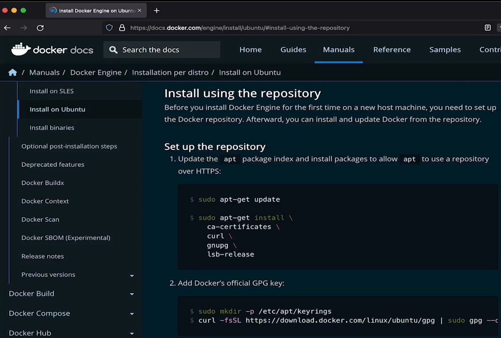

# 3.2 Install Docker on Linux

**Summary: Install Docker on Linux**

This lesson explains how to install **Docker Engine on Linux (Ubuntu 22.04)** so you can run containers and prepare your computer for a local Kubernetes cluster.

**Installation Steps**

1.  **Check your Linux version** using:

> bash
>
> lsb_release -a

2.  **Update package lists** to ensure your system has the latest package information:

> bash
>
> sudo apt-get update

3.  **Install prerequisites** and configure the system to trust Docker's official repository.

4.  **Add Docker's official GPG key** to verify the authenticity of Docker packages.

5.  **Set up Docker's APT repository** so Ubuntu can download Docker packages from the official source.

6.  **Update package lists again** after adding the repository:

> bash
>
> sudo apt-get update

7.  **Install Docker Engine** using the installation command provided in Docker's official documentation.

8.  **Verify the installation** by running:

> bash
>
> docker
>
> If Docker displays its help information and commonly used commands, the installation was successful.

**Key Concepts**

- **Docker Engine:** The core software responsible for running containers.

- **APT repository:** A source from which Ubuntu downloads and installs software packages.

- **GPG key:** Helps verify that downloaded packages come from a trusted source.

- **Terminal:** The command-line interface used to execute installation commands on Linux.

**Why Is Docker Needed?**

Docker provides the container runtime needed to run containerized applications. In this course, it helps prepare your environment for **Minikube**, which lets you run a Kubernetes cluster on your own computer.

**Key takeaway:** Identify your Linux distribution, configure Docker's official repository, install Docker Engine, and verify the installation before setting up Minikube.

For current installation commands, refer to the official [<u>Docker Engine installation guide for Ubuntu </u>](https://docs.docker.com/engine/install/ubuntu/).

# [README](./../../../README.md)
