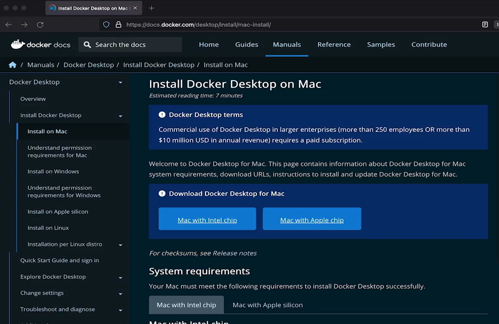

# 3.3 Install Docker on macOS

**Summary: Install Docker on macOS**

This lesson explains how to install **Docker Desktop on macOS** so you can run containers and prepare your computer for a local Kubernetes cluster.

**Installation Steps**

1.  **Visit Docker Docs:** Open the official Docker Desktop installation page for Mac.

> 

2.  **Download Docker Desktop:** Choose the correct version for your Mac's processor:

    - **Intel chip**

    - **Apple silicon** (such as M1, M2, M3, or newer)

3.  **Open the downloaded file:** Launch the Docker Desktop installer.

4.  **Install Docker:** Drag the Docker application into the **Applications** folder.

5.  **Launch Docker Desktop:** Open Docker from Applications and approve any security prompts.

6.  **Wait for Docker to start:** Initial startup may take some time.

7.  **Verify the installation:** Open Terminal and run:

bash

docker

If Docker displays its help information and commonly used commands, the installation is successful.

**Why Is Docker Needed?**

- **Docker Desktop** provides the tools needed to run containers on macOS.

- **Docker** acts as the container engine for running containerized applications.

- **Minikube** will use the local environment to run a Kubernetes cluster on your computer.

**Key Takeaway**

Docker installation differs slightly across Windows, Linux, and macOS, but the goal is the same: prepare your computer to run containers.

**Next step:** Install Minikube, which allows you to practice deploying and managing applications with Kubernetes locally.

Official guide: [Install Docker Desktop on Mac ](https://docs.docker.com/desktop/setup/install/mac-install/)

# [README](./../../../README.md)
