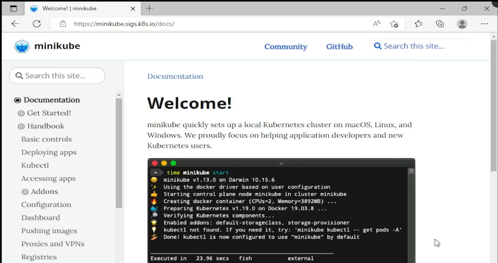

# 3.4 Install minikube on Windows

**Summary: Install Minikube on Windows**

**Minikube** is a tool that lets you run a Kubernetes cluster locally on your computer. It is useful for learning Kubernetes without paying for cloud computing resources.

**Installation Steps**

1.  **Install Docker Desktop:** Minikube needs a container runtime, such as Docker or Podman.

> 

2.  **Visit the official Minikube website:** Go to the [<u>Minikube website </u>](https://minikube.sigs.k8s.io/docs/start/).

3.  **Select your configuration:**

    - Operating system: Windows

    - Architecture: x86-64

    - Release: Stable

    - Download type: Installer executable

4.  **Download the installer:** Click the download link for the Windows installer.

5.  **Run the installer:** If Windows displays a security warning, verify that you downloaded the installer from the official Minikube website before proceeding.

6.  **Complete the setup wizard:** Accept the license agreement, click Install, and finish the installation.

7.  **Verify the installation:** Open Command Prompt and run:

> bash
>
> minikube
>
> If Minikube displays its available commands, the installation was successful.

**Important Concepts**

- **Minikube:** Runs a local Kubernetes cluster for learning and development.

- **Docker:** Provides the container runtime that Minikube can use to run containers.

- **Kubernetes cluster:** A group of components that manage and run containerized applications.

- **Command Prompt:** The Windows terminal used to execute Minikube commands.

**Limitations of Minikube**

- It runs locally and uses your computer's resources.

- It is ideal for learning, testing, and development.

- It is not intended to replace a properly configured production Kubernetes cluster.

**Key Takeaway**

**Docker runs containers, and Minikube runs a local Kubernetes cluster.** Together, they provide an environment for practicing Kubernetes without needing a cloud provider.

**Next step:** Start your Minikube cluster using:

bash

minikube start

This command initializes your local Kubernetes cluster.

# [README](./../../../README.md)
