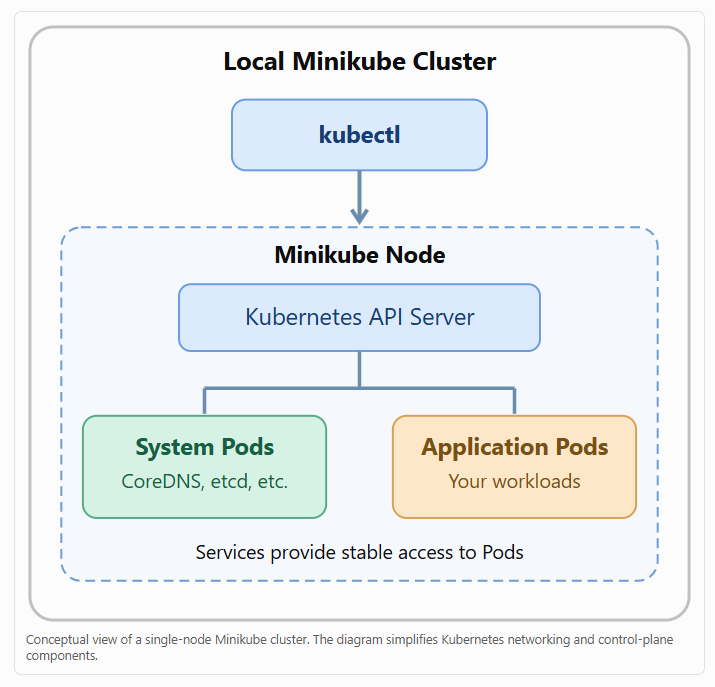

# 3.7 Spin up and explore a minikube cluster

**Summary: Spin Up and Explore a Minikube Cluster**

**1. Overview**

This lesson demonstrates how to create a local Kubernetes cluster using Minikube and explore its components using kubectl (Kubernetes command-line tool).

You will learn how to:

- Verify that Docker or Podman is running.

- Create a Kubernetes cluster using Minikube.

- Understand the difference between Minikube and kubectl.

- Inspect cluster information and nodes.

- Explore Kubernetes namespaces, pods, and services.

**2. Prerequisites**

Before starting, ensure the following tools are installed:

| **Tool**         | **Purpose**                                     |
|------------------|-------------------------------------------------|
| Minikube         | Creates and manages a local Kubernetes cluster  |
| kubectl          | Interacts with and manages Kubernetes resources |
| Docker or Podman | Provides the container runtime or driver        |
| Terminal         | Executes Kubernetes commands                    |

Step 1: Verify Docker is running

```bash
docker info
```

This checks whether the Docker daemon is available.

If Docker is not running, start Docker Desktop or the Docker service.

**3. Create a Kubernetes Cluster**

Step 2: Start Minikube

```bash
minikube start
```

This command creates and starts a local Kubernetes cluster.

The process typically takes a few minutes.

Once the cluster is ready, Minikube displays a success message.

**4. Minikube vs. kubectl**

Although both tools are used with Kubernetes, they have different responsibilities.

| **Feature** | **Minikube** | **kubectl** |
|----|----|----|
| Primary purpose | Create and manage local clusters | Interact with Kubernetes clusters |
| Create a local cluster | Yes | No |
| List Kubernetes nodes | Not its primary function | Yes |
| Manage pods | Limited helper functionality | Yes |
| Manage deployments | Not its primary function | Yes |
| Typical command | minikube start | kubectl get pods |

Important concept:

- Minikube creates and manages the local Kubernetes environment.

- kubectl communicates with the Kubernetes API server to manage resources.

In cloud environments such as AWS, Azure, and Google Cloud, provider-specific tools can create Kubernetes clusters, while kubectl is used to interact with them.

**5. Explore Cluster Information**

Step 3: Display cluster information

```bash
kubectl cluster-info
```

This command displays information about the Kubernetes control plane and services such as CoreDNS.

Example output:

Kubernetes control plane is running at https://127.0.0.1:54321

CoreDNS is running at https://127.0.0.1:54321/api/v1/namespaces/kube-system/services/kube-dns:dns/proxy

The IP address 127.0.0.1 represents localhost. The actual address and port depend on your Minikube driver and configuration.

Troubleshooting: If you receive a connection-refused error, check whether Minikube has finished starting and whether kubectl is using the correct cluster context.

```bash
minikube status

kubectl config current-context
```

**6. Explore Kubernetes Nodes**

Step 4: List cluster nodes

```bash
kubectl get nodes
```

Example output:

```
NAME STATUS ROLES AGE VERSION

minikube Ready control-plane 5m v1.33.0
```

| **Column** | **Description**                     |
|------------|-------------------------------------|
| NAME       | Kubernetes node name                |
| STATUS     | Indicates whether the node is ready |
| ROLES      | Node responsibilities               |
| AGE        | How long the node has existed       |
| VERSION    | Kubernetes version                  |

A default Minikube cluster typically has one node that runs both control-plane and workload components.

**7. Explore Kubernetes Namespaces**

Step 5: List namespaces

```bash
kubectl get namespaces
```

Kubernetes creates several namespaces by default.

| **Namespace** | **Purpose** |
|----|----|
| default | Default namespace for user workloads |
| kube-system | Contains Kubernetes system components |
| kube-public | Contains resources intended to be publicly readable within the cluster |
| kube-node-lease | Stores node lease objects used for heartbeat tracking |

Important concept: Namespaces provide logical separation of Kubernetes resources within a cluster. They help organize applications, teams, and environments, although they do not automatically provide complete security isolation.

**8. Explore Kubernetes Pods**

Step 6: List pods in all namespaces

```bash
kubectl get pods -A
```

The -A flag means all namespaces.

Example output:

```
NAMESPACE NAME READY STATUS

kube-system coredns-xxxxxxxx 1/1 Running

kube-system etcd-minikube 1/1 Running

kube-system kube-apiserver-minikube 1/1 Running
```

A Pod is the smallest deployable unit in Kubernetes. It contains one or more containers that share networking and storage resources.

System pods may include components such as CoreDNS, the API server, and etcd, depending on the cluster configuration.

**9. Explore Kubernetes Services**

Step 7: List services in all namespaces

```bash
kubectl get services -A
```

Example output:

```
NAMESPACE NAME TYPE CLUSTER-IP

default kubernetes ClusterIP 10.96.0.1

kube-system kube-dns ClusterIP 10.96.0.10
```

A Service provides a stable network endpoint for accessing a set of pods.

Services can direct and load-balance traffic to matching pods, even when individual pod IP addresses change.

**10. Kubernetes Cluster Architecture**

Conceptual view of a single-node Minikube cluster. The diagram simplifies Kubernetes networking and control-plane components.



**11. Important Kubernetes Commands**

| **Command**             | **Purpose**                         |
|-------------------------|-------------------------------------|
| docker info             | Verify Docker daemon availability   |
| minikube start          | Create and start a cluster          |
| minikube status         | Check Minikube status               |
| kubectl cluster-info    | Display control-plane information   |
| kubectl get nodes       | List cluster nodes                  |
| kubectl get namespaces  | List namespaces                     |
| kubectl get pods -A     | List pods across all namespaces     |
| kubectl get services -A | List services across all namespaces |
| minikube stop           | Stop the cluster                    |
| minikube delete         | Delete the cluster                  |

**12. Key Takeaways and Exam Tips**

1.  Minikube creates and manages a local Kubernetes cluster.

2.  kubectl communicates with the Kubernetes API server.

3.  Nodes are machines or virtual environments that run Kubernetes workloads.

4.  Namespaces logically organize Kubernetes resources.

5.  Pods are the smallest deployable units in Kubernetes.

6.  Services provide stable networking access to pods.

7.  The -A flag displays resources across all namespaces.

8.  The control plane manages the Kubernetes cluster.

Main concept: Minikube provides the local Kubernetes cluster, while kubectl allows administrators and developers to explore and manage its nodes, namespaces, pods, services, and other resources.

Official documentation: [<u>Minikube Getting Started</u>](https://minikube.sigs.k8s.io/docs/start/?utm_source=chatgpt.com) \| [<u>Kubernetes kubectl Reference</u>](https://kubernetes.io/docs/reference/kubectl/?utm_source=chatgpt.com)

# [README](./../../../README.md)
