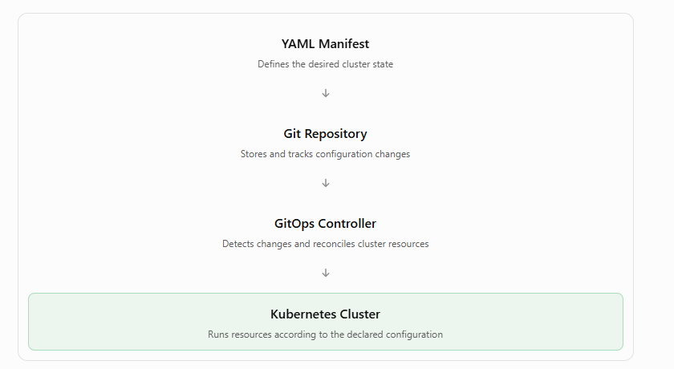

# 4.1 Reading and writing YAML

Learning Kubernetes – Reading and Writing YAML

Topic: YAML Configuration Files and Kubernetes Manifests

**1. Overview**

YAML is a human-readable data serialization language commonly used to define and configure Kubernetes resources.

In Kubernetes, YAML files are called manifests. They describe the desired state of Kubernetes objects, such as Pods, Deployments, Services, and Namespaces.

YAML is important for two approaches:

- Infrastructure as Code (IaC): Managing infrastructure through configuration files instead of manual setup.

- GitOps: Using Git as a source of truth for infrastructure and application configurations, with automated reconciliation of changes.

**2. What Is YAML?**

YAML stands for YAML Ain't Markup Language.

It is a data serialization language that allows applications, operating systems, and programming languages to exchange structured information.

Other data serialization formats include JSON and XML.

| **Feature**      | **Description**                                          |
|------------------|----------------------------------------------------------|
| Purpose          | Store structured configuration data.                     |
| Readability      | Designed to be easy for humans to read.                  |
| File extensions  | .yaml or .yml                                            |
| Data structure   | Uses keys, values, lists, and nested mappings.           |
| Kubernetes usage | Defines Kubernetes resources and desired configurations. |
| Portability      | Configuration files can be shared across environments.   |

**3. Understanding YAML Syntax**

YAML uses a few basic formatting rules.

| **Syntax**  | **Meaning**                     | **Example**                |
|-------------|---------------------------------|----------------------------|
| ---         | Starts a YAML document.         | ---                        |
| \#          | Adds a comment.                 | \# Instructor record       |
| :           | Separates a key from its value. | name: Kim Schlesinger      |
| \-          | Identifies an item in a list.   | \- Kubernetes              |
| Indentation | Defines nested relationships.   | Spaces before nested keys. |

**Example YAML File**

```yml
---
# Instructor record

name: Kim Schlesinger

courses:
  - Learning Kubernetes
  - GitOps Foundations

jobs:
  - company: Example Company
    years: 3
    titles:
      - Software Engineer
      - Instructor

  - company: Another Company
    years: 2
    titles:
      - Developer
```
	  
This illustrative example demonstrates key-value pairs, sequences, nested mappings, and comments.

**4. YAML Data Structures**

**A. Key-Value Pairs**

A key and value are separated by a colon.

```yml
name: Kim Schlesinger
course: Learning Kubernetes
duration: 120
```

**B. Lists (Sequences)**

Lists contain multiple items, each beginning with a dash.

```yml
courses:
  - Learning Kubernetes
  - GitOps Foundations
  - Docker Fundamentals
```

**C. Nested Maps**

Maps organize related key-value pairs using indentation.

```yml
employee:
  name: Kim Schlesinger
  department: Engineering
  location:
    city: Denver
    state: Colorado
```

**D. Multiple YAML Documents**

A single file can contain multiple YAML documents separated by ---.

```yml
---
name: Application1
environment: development

---
name: Application2
environment: production
```

**5. YAML Indentation Rules**

Indentation is extremely important in YAML because it defines relationships between data elements.

Correct YAML:

```yml
employee:
  name: John
  department: IT
  skills:
    - Python
    - Kubernetes
```

Incorrect YAML:

```yml
employee:
name: John
  department: IT
```

The incorrect example has inconsistent indentation.

Best practices:

- Use spaces instead of tabs.

- Use two spaces per indentation level for consistency.

- Keep related elements aligned.

- Validate YAML files before using them.

**6. Validating YAML Files**

YAML errors often occur because of incorrect indentation or formatting.

The instructor recommends using a YAML validator.

Online validator: [YAML Checker](https://yamlchecker.com?utm_source=chatgpt.com)

A validator can help identify syntax errors and their locations.

Note that valid YAML syntax does not necessarily mean the configuration is valid for Kubernetes.

**7. Kubernetes YAML Manifest Example**

Kubernetes uses YAML manifests to define resources.

The following example creates a Kubernetes Namespace.

```yml
---
apiVersion: v1
kind: Namespace
metadata:
  name: development
```

**Explanation**

| **Field**  | **Description**                          |
|------------|------------------------------------------|
| apiVersion | Specifies the Kubernetes API version.    |
| kind       | Defines the resource type.               |
| metadata   | Contains information about the resource. |
| name       | Specifies the resource name.             |

Save the file as **namespace.yaml**.

Create the Namespace:

```bash
kubectl apply -f namespace.yaml
```

Verify it:

```bash
kubectl get namespaces
```

**8. How YAML Supports Infrastructure as Code and GitOps**

**YAML Manifest**




This illustrates a typical GitOps workflow. Kubernetes YAML files describe the desired state, Git tracks changes, and a GitOps controller can apply and reconcile those changes automatically.

**9. Key Takeaways**

1.  YAML is a human-readable configuration language.

2.  Kubernetes uses YAML manifests to define resources.

3.  YAML files can use .yaml or .yml extensions.

4.  Key-value pairs use colons (:).

5.  Lists use dashes (-).

6.  Nested structures use indentation.

7.  Comments begin with \#.

8.  Three dashes (---) separate YAML documents.

9.  YAML validators help detect formatting errors.

10. YAML supports Infrastructure as Code and GitOps workflows.

**10. What's Next in the Course?**

The instructor explains that the next lesson will demonstrate how to:

- Create a Kubernetes Namespace.

- Deploy an application into a Kubernetes cluster.

- Use YAML manifests to configure Kubernetes resources.

Overall summary: YAML is a foundational skill for Kubernetes administrators and developers. It allows you to define the desired state of a Kubernetes cluster in readable configuration files, manage those files through Git, and automate infrastructure deployment using Infrastructure as Code and GitOps practices.


# [README](./../../../README.md)
