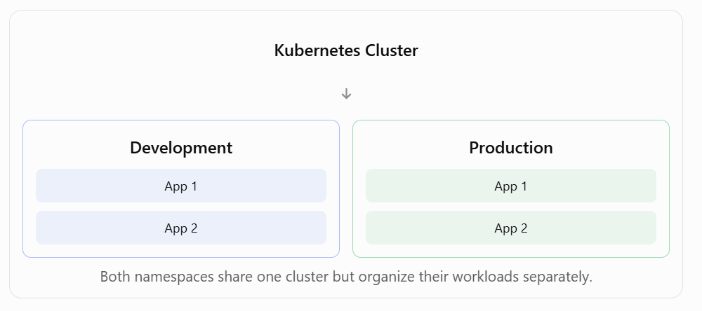

# 4.2 Create a namespace

**Learning Kubernetes – Creating and Managing Namespaces**  
Topic: Kubernetes Namespaces and YAML Manifests

**1. Overview**

Kubernetes Namespaces allow you to organize, separate, and manage applications and workloads within the same Kubernetes cluster.

Namespaces are useful when multiple teams, applications, or environments share a Kubernetes cluster.

For example, you can create separate namespaces for:

- Development: Applications being developed and tested.

- Testing: Applications undergoing testing.

- Production: Applications running in a live environment.

Namespaces provide logical separation, but they do not automatically enforce network or security isolation.

**2. What Is a Kubernetes Namespace?**

A Namespace is a logical grouping of Kubernetes resources within a cluster.



**3. Default Kubernetes Namespaces**

Kubernetes commonly creates four namespaces automatically.

| **Namespace** | **Purpose** |
|----|----|
| default | Used for resources without an explicitly specified namespace. |
| kube-system | Contains Kubernetes system components. |
| kube-public | Contains resources intended to be publicly readable within the cluster. |
| kube-node-lease | Stores node heartbeat information. |

View available namespaces:

```bash
kubectl get namespaces
```

**4. Create a Namespace Using YAML**

Create a file called namespace.yaml.

```yaml
apiVersion: v1
kind: Namespace
metadata:
	name: development
```

**Explanation**

| **YAML Field**    | **Description**                         |
|-------------------|-----------------------------------------|
| apiVersion: v1    | Specifies the Kubernetes API version.   |
| kind: Namespace   | Identifies the resource as a Namespace. |
| metadata:         | Contains resource information.          |
| name: development | Defines the Namespace name.             |

Create the namespace:

```bash
kubectl apply -f namespace.yaml
```

Verify that it exists:

```bash
kubectl get namespaces
```

Expected output includes:

```
NAME STATUS

default Active
development Active
kube-node-lease Active
kube-public Active
kube-system Active
```

**5. Create Multiple Namespaces in One YAML File**

YAML supports multiple documents in a single file.

Use three dashes (---) to separate the documents.

Example namespace.yaml:

```yml
apiVersion: v1
kind: Namespace
metadata:
	name: development
```

---

```yml
apiVersion: v1
kind: Namespace
metadata:
	name: production
```

Apply both namespaces:

```bash
kubectl apply -f namespace.yaml
```

Verify:

```bash
kubectl get namespaces
```

Both development and production should now appear.

**6. Delete Namespaces**

Delete namespaces defined in the YAML file:

```bash
kubectl delete -f namespace.yaml
```

Alternatively, delete a specific namespace:

```bash
kubectl delete namespace development
```

Important: Deleting a namespace also deletes the namespaced resources it contains, including Deployments, Pods, and Services. Be careful when deleting production namespaces.

**7. Important Kubernetes Namespace Commands**

| **Command** | **Description** |
|----|----|
| kubectl get namespaces | List namespaces. |
| kubectl create namespace development | Create a namespace directly. |
| kubectl apply -f namespace.yaml | Create or update resources using YAML. |
| kubectl get pods -n development | List Pods in development. |
| kubectl get all -n production | List common workload resources in production. |
| kubectl describe namespace development | Show namespace details. |
| kubectl delete namespace development | Delete the development namespace. |
| kubectl delete -f namespace.yaml | Delete resources defined in the file. |

**8. Key Takeaways**

1.  Kubernetes Namespaces organize workloads within a cluster.

2.  Development and production applications can use separate namespaces.

3.  Kubernetes commonly provides four default namespaces.

4.  Namespaces can be created using YAML manifests.

5.  The metadata.name field specifies the namespace name.

6.  Three dashes (---) separate multiple YAML documents.

7.  kubectl apply -f creates or updates resources from a manifest.

8.  kubectl get namespaces displays existing namespaces.

9.  kubectl delete -f deletes the resources defined in a YAML file.

10. Deleting a namespace also deletes its namespaced resources.

**9. What's Next in the Course?**

The next lesson demonstrates how to deploy an application into the development namespace using Kubernetes manifests.

Overall summary: Kubernetes Namespaces provide a way to logically organize applications and microservices inside a single cluster. By using YAML manifests and kubectl commands, administrators can create, view, manage, and delete namespaces while keeping development and production workloads organized separately.

# [README](./../../../README.md)
